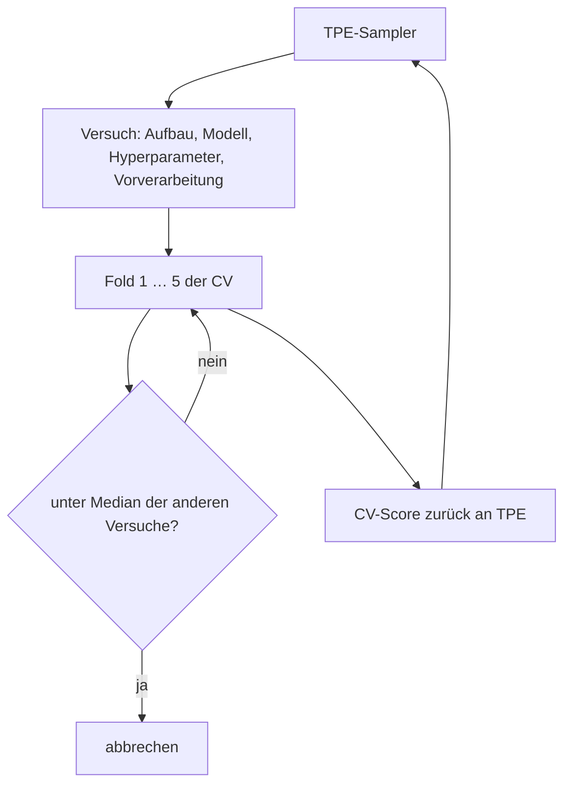
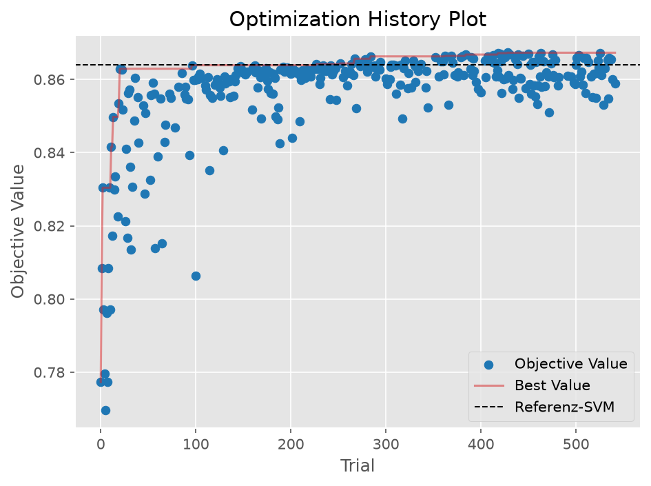
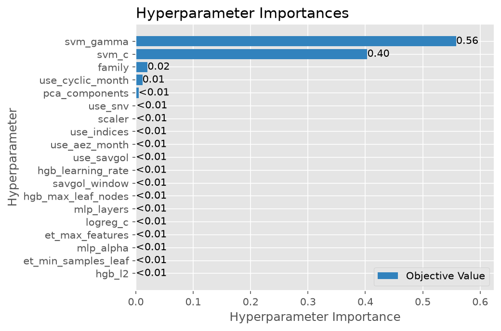
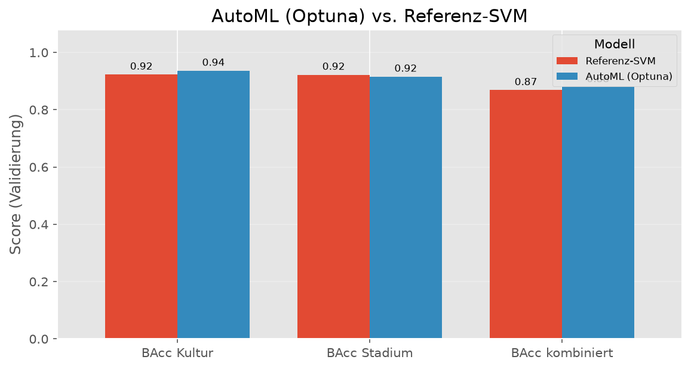
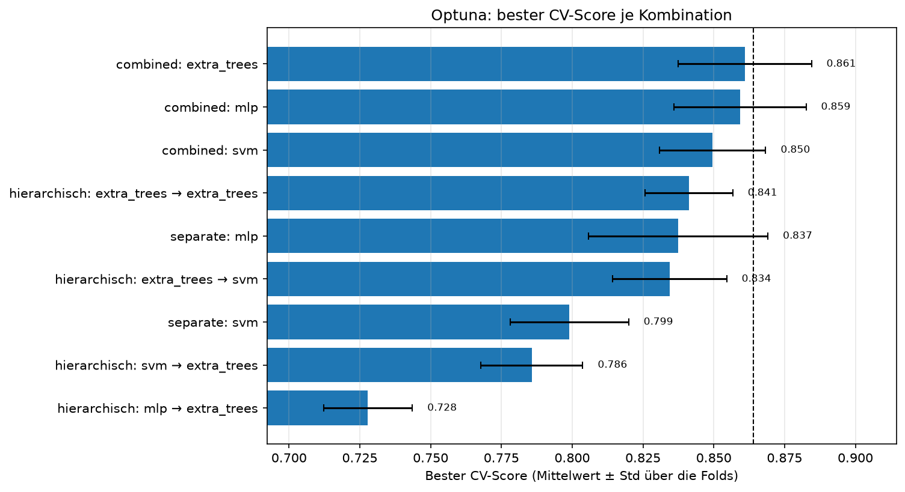

# AutoML

## Idee

Statt jede Kombination aus Modell, Hyperparametern und Vorverarbeitung als eigenes Experiment
anzulegen, durchsucht **eine** Optuna-Suche alles zugleich (`awp2.automl.automl`). Die Frage:
Gibt es eine Konfiguration, die wir mit den Einzel-Experimenten übersehen haben?

- **TPE** (Tree-structured Parzen Estimator) schlägt den nächsten Versuch aus den Scores der
  bisherigen vor – vielversprechende Bereiche werden dichter abgesucht als bei einem Raster.
- **Median-Pruning**: Nach jedem Fold wird der laufende Mittelwert mit den anderen Versuchen
  verglichen; schwache Versuche enden nach ein bis zwei Folds. Das spart etwa 30 % der Fits.
- Gleiche Regeln wie `tune()`: gemeinsame CV-Folds, Vorverarbeitung nur über
  `PreprocessingConfig`, `SEED`, danach **einmal** `run()` auf der Validierung.

**Suchraum**

| Dimension | Werte |
| --- | --- |
| Aufbau | kombiniert (`CombinedLabelClassifier`), hierarchisch (`HierarchicalClassifier`, jede Stufe mit eigener Familie), getrennt (`MultiOutputClassifier`) |
| Modellfamilie | RBF-SVM, Extra Trees, HistGradientBoosting, logistische Regression, MLP |
| Hyperparameter | je Familie 1–3, log-skaliert um die Optima der Rastersuchen (`AUTOML_*` in `awp2.config`) |
| Vorverarbeitung | Standard- oder Min-Max-Skalierung, SNV, Savitzky-Golay (5/7), PCA (–/20/40/80), Vegetationsindizes, AEZ × Monat, zyklischer Monat |

Klassen-Ungleichgewicht: `class_weight="balanced"`; HistGradientBoosting und MLP bekommen
ausgeglichene Sample-Gewichte (in einer Hierarchie mit MLP dann beide Stufen, ohne doppelte
Gewichtung).

## Vor- und Nachteile

| Vorteil | Nachteil |
| --- | --- |
| Viele Kombinationen in einer Stunde (540 Versuche), auch solche, die niemand von Hand testet | Der beste CV-Score ist optimistisch: Unter Hunderten Versuchen gewinnt auch der, der mit den Folds Glück hatte |
| Wichtigkeit der Suchparameter zeigt, welche Entscheidungen überhaupt zählen | TPE konzentriert sich früh auf den besten Bereich – andere Familien und Aufbauten werden kaum geprüft |
| Unterbrochene Suchen lassen sich fortsetzen (`models/automl.db`) | Ergebnis hängt von Budget und Größe des Suchraums ab |

## Klassifikatoren

### Suche 1: kombinierte Klasse, fünf Modellfamilien

- Suche `automl_optuna` (MLflow `c631ea28`): 1 h, 542 Versuche (317 abgeschlossen, 225 abgebrochen).
- Bester Versuch: RBF-SVM, `C=138`, `gamma=0.0021`, standardisiert, PCA 80, AEZ × Monat,
  zyklischer Monat; CV **0.867** (Referenz `combined_svm_aez_month` 0.864).
- Validierung `automl_optuna_best` (`aa2d5f42`): BAcc Kultur 0.936, Stadium 0.916,
  kombiniert **0.879**, Macro-F1 kombiniert 0.853, Samples-F1 0.917; keine ungültigen Paare.
- Notebook: `notebooks/04_kombiniert/12_jd_automl-optuna.ipynb`

- Ab etwa Versuch 280 kommt nichts mehr hinzu; die zehn besten Versuche liegen alle bei 0.867
  – ein **Plateau**, kein übersehenes Optimum.
- `gamma` und `C` der SVM erklären fast alle Unterschiede (Wichtigkeit 0.56 und 0.40); jede
  Vorverarbeitungsoption liegt unter 0.01. Die Vorverarbeitung ist ausgereizt.

- Beste Familien: SVM 0.867, MLP 0.856, Extra Trees 0.847, HistGradientBoosting 0.808,
  logistische Regression 0.797 – TPE hat 294 von 317 Versuchen auf die SVM verwendet.
- Der CV-Gewinn (+0.003) liegt unter `MIN_CV_GAIN` (0.005). Gepaart auf denselben
  Trainingszeilen (out-of-fold) liegt die **Referenz** vorn: 116 Zeilen nur sie richtig, 77 nur
  AutoML (p = 0.006). Die +0.010 auf der Validierung zählen deshalb nicht als neuer Bestwert.

### Suche 2: Aufbau × Modellfamilie

- Suche `automl_structures` (MLflow `30c75139`): 300 Versuche (189 abgeschlossen), SVM, Extra
  Trees und MLP, alle drei Aufbauten.
- Bester Versuch: kombiniert, Extra Trees (`max_features=0.56`, `min_samples_leaf=2`),
  standardisiert, PCA 20, Vegetationsindizes; CV **0.861**.
- Validierung `automl_structures_best` (`97b53814`): BAcc Kultur 0.928, Stadium 0.928,
  kombiniert **0.870**, Macro-F1 kombiniert 0.861, Samples-F1 0.925; keine ungültigen Paare.
  Gepaart out-of-fold gegen die Referenz: kein Unterschied (170 : 156, p = 0.47).
- Notebook: `notebooks/04_kombiniert/14_jd_automl-aufbau.ipynb`

- Bester je Aufbau: kombiniert 0.861, hierarchisch 0.841 (Extra Trees → Extra Trees),
  getrennt 0.837 (MLP) – dieselbe Reihenfolge wie in den Einzel-Experimenten.
- **Einschränkung:** TPE hat nur 6 hierarchische und 5 getrennte Versuche abgeschlossen (178
  kombinierte). Für einen fairen Vergleich der Aufbauten bräuchte jeder ein eigenes Budget.
- Im größeren Suchraum erreicht die SVM nur 0.850 statt 0.867 in Suche 1 – bei gleichem Budget
  geht die Suche weniger in die Tiefe.

### Suche 3: zusätzlich neue Merkmale und Mais/Soja-Spezialist

- Suche `automl_extended` (MLflow `164a79a7`): 300 Versuche (155 abgeschlossen), kombinierte
  Klasse, SVM/Extra Trees/MLP; zusätzlich Schalter für Trockenmasse-Indizes, Boden-Indizes,
  Ableitungsspektren und einen Mais/Soja-Spezialisten (`extra_features=True`, `specialist=True`).
- Bester Versuch: RBF-SVM, AEZ × Monat, Boden-Indizes; CV **0.866** (+0.002 gegenüber der
  Referenz, unter `MIN_CV_GAIN`), out-of-fold gleichauf (32 : 24, p = 0.35) – keine Validierung.
- Notebook: `notebooks/04_kombiniert/20_jd_automl-erweitert.ipynb`

| Schalter | bester CV an | bester CV aus | unter den 20 besten |
| --- | --- | --- | --- |
| Trockenmasse-Indizes | 0.863 | 0.866 | 0 % |
| Boden-Indizes | 0.866 | 0.866 | 65 % |
| Ableitungsspektren | 0.856 | 0.866 | 0 % |
| Mais/Soja-Spezialist | 0.858 | 0.866 | 0 % |

- Auch in Kombination trägt keine der Ideen aus der
  [Fehleranalyse](../fehleranalyse.md#gezielte-gegenmassnahmen); alle 20 besten Versuche sind SVMs.

### AutoGluon (abgebrochen)

Geplant war AutoGluon (`best_quality`, Stacking vieler Modelltypen) als Obergrenze. Es lief auf
macOS nicht verlässlich und wurde verworfen:

- PyTorch, LightGBM/XGBoost und scikit-learn bringen je eine eigene OpenMP-Laufzeit mit; zwei
  davon in einem Prozess stürzen ab (Segfault). Abhilfe war ein eigener Prozess ohne PyTorch.
- Ohne `ray` trainiert AutoGluon die Bagging-Folds nacheinander; unter Last schaffte es im
  Zeitbudget nur LightGBM oder gar kein Modell, ein Fold brach ab.
- Zudem verlangt AutoGluon pandas < 2.4 und numpy < 2.3 – ein Downgrade der ganzen Umgebung.

## Fazit

**Status: verglichen – kein neuer Bestwert.** Drei Suchen mit zusammen über 1.100 Versuchen
finden keine Konfiguration, die die Referenz-SVM (`combined_svm_aez_month`) über das Rauschen
hinaus schlägt. Die Suche bestätigt die bisherigen Entscheidungen: kombinierte Klasse,
RBF-SVM, die Vorverarbeitung ist ausgereizt. Weitere Gewinne sind eher von neuen Informationen
(Merkmale, Daten) als von weiterem Tuning zu erwarten.
