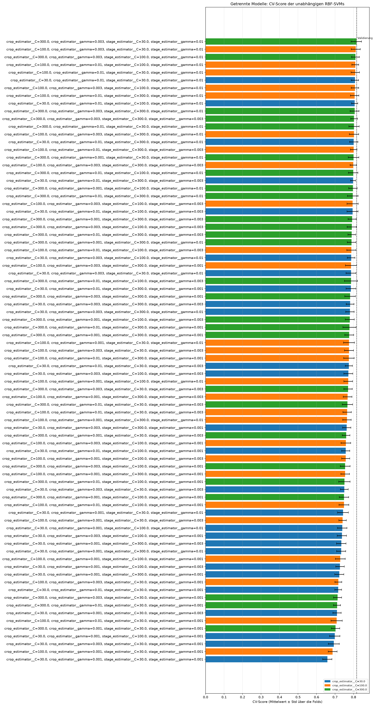
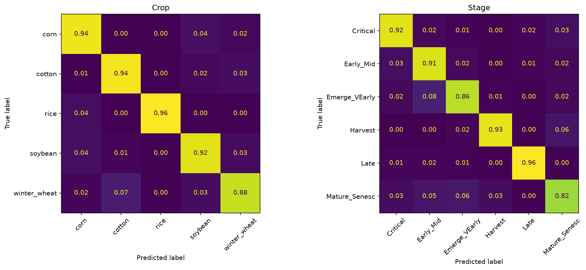
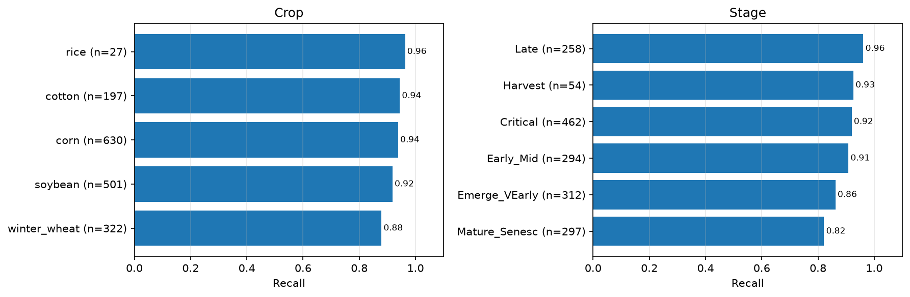
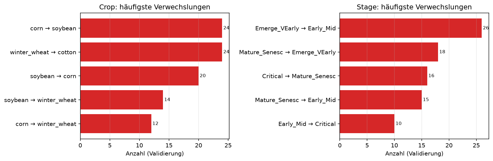

# Getrennte Modelle

## Idee

Je ein Modell für Crop und für Stage wird auf allen Trainingszeilen unabhängig trainiert. Die
beiden Vorhersagen werden anschließend zu einem Crop/Stage-Paar zusammengefügt. Damit modelliert
der Ansatz die gemeinsame Verteilung als $P(\text{Crop}) \cdot P(\text{Stage})$ und nutzt weder
die Crop-Information für die Stadiumsvorhersage noch gemeinsame Modellparameter.

Dies ist weder der [kombinierte Ansatz](kombiniert.md), der ein gemeinsames Label lernt, noch der
[hierarchische Ansatz](hierarchisch.md), dessen Stadium-Modelle nur auf Zeilen einer Kultur
trainieren. Er dient als Kontrolle dafür, ob die explizite Kopplung von Crop und Stage den
zusätzlichen Modellaufwand rechtfertigt.

## Vor- und Nachteile

| Vorteil | Nachteil |
| --- | --- |
| Zwei klar getrennte, einfache Aufgaben; Crop und Stage können je eigene Hyperparameter erhalten. | Das Stage-Modell ignoriert, dass nicht jede Kultur jedes Stadium hat. |
| Keine Fehlerfortpflanzung durch eine vorgeschaltete Crop-Entscheidung. | Es können Crop/Stage-Paare vorhergesagt werden, die im Training nicht vorkommen. |
| Direkter Vergleich dazu, ob die Abhängigkeit der Targets überhaupt hilft. | Das globale Stage-Modell muss Stadien über Kulturen hinweg trennen und kann dadurch schwerer lernen. |

Die erste Variante korrigiert ungültige Paare bewusst nicht nachträglich. Ihr Anteil ist eine
eigene Metrik von `evaluate()` und macht den Nachteil des Ansatzes sichtbar. Eine spätere
Paarbeschränkung über Modellwahrscheinlichkeiten wäre eine getrennte Hypothese, weil sie die
Unabhängigkeit der beiden Vorhersagen nachträglich aufhebt.

## Klassifikatoren

### RBF-SVM -> RBF-SVM

**Hypothese:** Zwei global trainierte, ausgeglichene RBF-SVMs erreichen ohne bedingtes Routing
eine mindestens so hohe kombinierte BAcc wie die hierarchische RBF-SVM. Falls nicht, zeigt der
Abstand den Nutzen, die Stage-Vorhersage von der Kultur abhängig zu machen.

Notebook: `notebooks/18_duac1011_independent-svm.ipynb`. Beide SVMs erhalten skalierte
Spektren, AEZ und einen zyklisch kodierten Month. Die 81 CV-Kandidaten wählen unabhängig `C`
und `gamma` für Crop und Stage.

- Tuning `independent_svm_search` (MLflow `9d9be212`): Crop `C=300, gamma=0.003`, Stage
    `C=30, gamma=0.01`; CV-BAcc kombiniert **0.815** (Std 0.028).
- Validierung `independent_svm` (MLflow `330ac1b4`): BAcc Crop 0.929, Stage 0.900,
    **kombiniert 0.818**, Macro-F1 kombiniert 0.733 und Samples-F1 0.909.
- Nur 0,3 % der Vorhersagen sind ungültige Crop/Stage-Paare. Diese sind nicht die wesentliche
    Ursache für den Abstand von 0.026 zur hierarchischen SVM (0.844).
- Die Crop-SVM erreicht fast die kombinierte Referenz (0.931), das globale Stage-Modell bleibt
    aber hinter der bedingten Stage-SVM zurück. Besonders schwach sind Emerge_VEarly (Recall 0.86)
    und Mature_Senesc (0.82); die häufigsten Stadiumsverwechslungen sind Emerge_VEarly → Early_Mid
    (26) sowie Mature_Senesc → Emerge_VEarly (18).
- Die CV- und Validierungs-BAcc liegen eng zusammen (0.815 / 0.818). Der Befund ist daher keine
    Auffälligkeit des gemeinsamen Holdouts, sondern spricht gegen die Unabhängigkeitsannahme.
- Der direkte Vergleich zur hierarchischen SVM ist nicht vollständig vorverarbeitungsidentisch:
    dieser Lauf verwendet `scale=True`, die hierarchische Referenz die spektrale
    Standardskalierung. Der Abstand zur kombinierten Referenz beträgt jedoch bereits 0.048; die
    Verwerfung als finale Referenz bleibt davon unberührt.

#### Preprocessing-Screen

`notebooks/19_duac1011_independent-svm-preprocessing.ipynb` vergleicht fünf Varianten bei den
festen CV-Gewinnern des ersten Laufs, ausschließlich auf den Trainingsfolds:

| Variante | CV-BAcc kombiniert | Differenz zur Referenz |
| --- | --- | --- |
| Skalierte Spektren, zyklischer Month | **0.815** | 0.000 |
| Spektrale Standardskalierung, zyklischer Month | 0.800 | −0.015 |
| Spektrale Standardskalierung + Savitzky-Golay | 0.795 | −0.021 |
| Skalierte Spektren, numerischer Month | 0.794 | −0.021 |
| SNV + Mean Albedo | 0.769 | −0.046 |

Keine Variante übertrifft die Referenz um die vorab festgelegte Schwelle von 0.005; eine weitere
`C`-/`gamma`-Suche oder Validierung ist daher nicht begründet. Als einzige noch unterscheidbare
Hypothese bleibt eine Paarbeschränkung: Kalibrierte Wahrscheinlichkeiten beider globaler SVMs
zu $P(\text{Crop}) \cdot P(\text{Stage})$ für die im Training erlaubten Paare kombinieren. Das
wäre ein eigener **CV-only** Versuch und keine Optimierung des unabhängigen Kontrollansatzes.

## Fazit

**Verworfen.** Der Kontrollversuch zeigt, dass die Crop-Stage-Abhängigkeit für die kombinierte
BAcc wertvoll ist. Die kombinierte SVM bleibt mit 0.866 die Referenz; die hierarchische SVM
bleibt mit 0.844 die bessere explizite Zerlegung.
