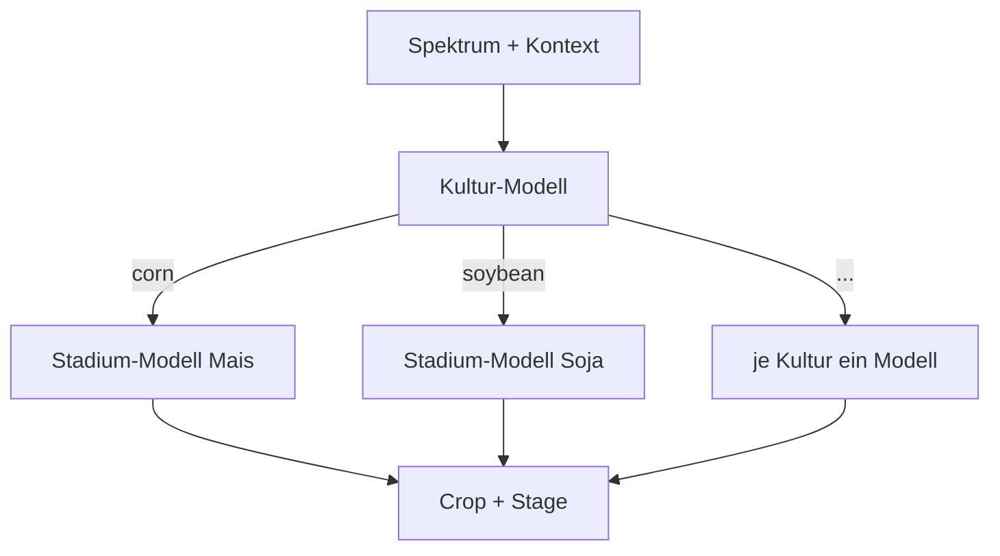
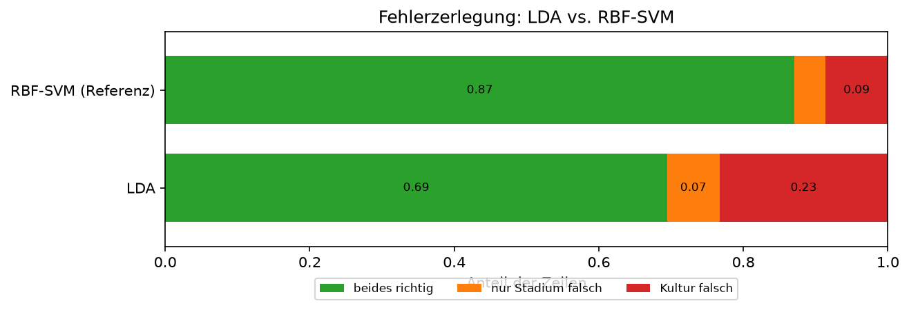
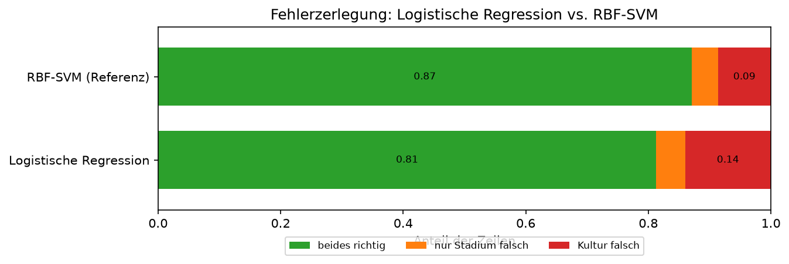
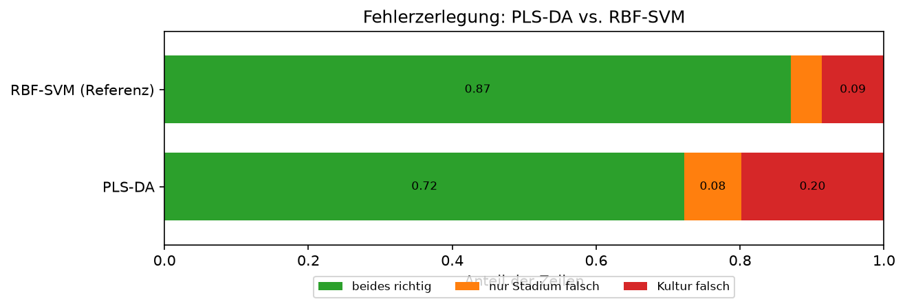
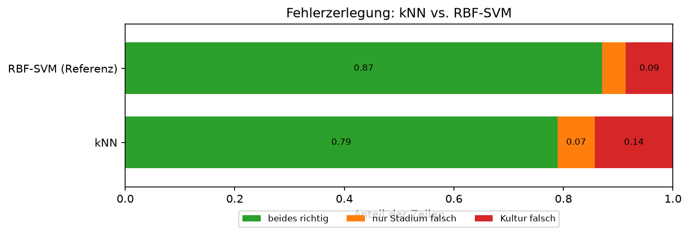
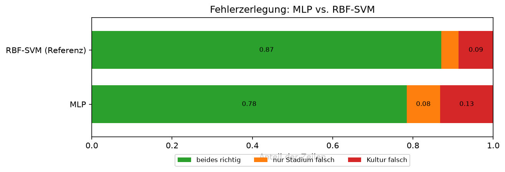
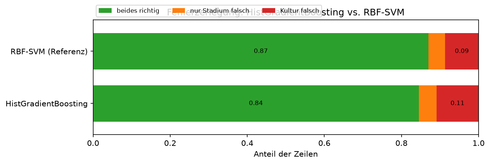
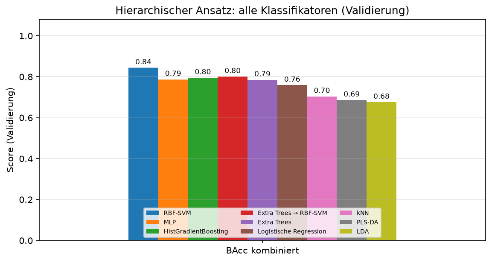
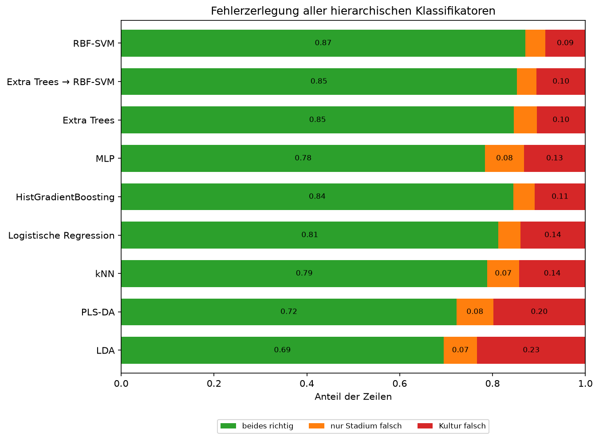
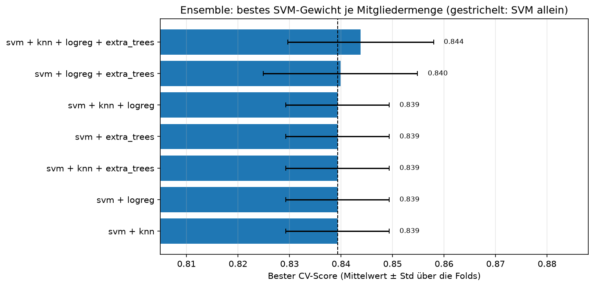

# Hierarchisch

## Idee

Erst die Kultur vorhersagen, dann das Stadium mit einem eigenen Modell **je Kultur**. Das
bildet die Zerlegung P(Crop, Stage) = P(Crop) · P(Stage | Crop) direkt ab: Das
Stadium-Modell für Mais muss nur Mais-Stadien unterscheiden und sieht keine Soja-Spektren.
Baustein: `HierarchicalClassifier` in `src/awp2/models/hierarchical.py` (#85).

- Die Stadium-Modelle lernen auf der **wahren** Kultur. Bei der Vorhersage entscheidet die
  vorhergesagte Kultur, welches Stadium-Modell antwortet (hartes Routing).
- Jedes Stadium-Modell kennt nur die Stadien seiner Kultur, daher entstehen nur Paare, die im
  Training vorkommen.
- Beide Stufen sind für `tune()` als `crop_estimator__…` und `stage_estimator__…` erreichbar;
  alle Stadium-Modelle teilen dieselben Hyperparameter.
- `predict_stage(X, crop)` sagt das Stadium für eine vorgegebene Kultur vorher. Mit der wahren
  Kultur ergibt das die **Oracle-Kultur**-Analyse: Wie gut wäre das Stadium ohne Kulturfehler?
  Grundlage der Fehleranalyse in #32. `X` muss dafür vorverarbeitet sein:
  `result.pipeline[-1].predict_stage(result.pipeline[:-1].transform(X_val), y_val["Crop"])`.
- Mit `balance_samples=True` werden die Gewichte je Stufe umskaliert: Das Kultur-Modell sieht
  jede Kultur mit gleichem Gesamtgewicht, jedes Stadium-Modell Gewichte mit Mittelwert 1. Die
  Fabriken nutzen bereits `class_weight="balanced"` und brauchen das nicht.

Stadien je Kultur im Trainingsteil:

| Kultur | Stadien | Zeilen | Seltenstes Stadium |
| --- | --- | --- | --- |
| corn | 6 | 1467 | Harvest (71) |
| soybean | 6 | 1168 | Harvest (47) |
| winter_wheat | 4 | 750 | Late (21) |
| cotton | 5 | 461 | Harvest (8) |
| rice | 2 | 66 | Late (29) |

## Vor- und Nachteile

| Vorteil | Nachteil |
| --- | --- |
| Nutzt die Abhängigkeit des Stadiums von der Kultur: Jedes Stadium-Modell löst eine kleinere, homogenere Aufgabe | Jeder Kulturfehler wird zum Stadiumfehler (Fehlerfortpflanzung beim harten Routing) |
| Sagt nur Paare vorher, die es gibt | Stadium-Modelle für seltene Kulturen haben wenig Daten (Reis: 66 Zeilen, Baumwolle/Harvest: 8) |
| Kultur- und Stadium-Stufe lassen sich getrennt analysieren und mit unterschiedlichen Klassifikatoren besetzen | Mehr Modelle; dieselben Hyperparameter für alle Stadium-Modelle sind ein Kompromiss |
| Die Oracle-Kultur trennt Kultur- und Stadiumfehler sauber | Kein Wissensaustausch zwischen gleichen Stadien verschiedener Kulturen (z. B. Mais/Late und Soja/Late) |

Gegenmaßnahmen: weiches Routing über Wahrscheinlichkeiten gegen die Fehlerfortpflanzung (#88,
ohne messbaren Effekt) sowie Vorverarbeitung und gezieltes Tuning schwacher Kulturen (#89).

## Klassifikatoren

Alle getunten Varianten liegen als Fabriken in `awp2.models.tuned` (z. B. `tuned_hierarchical_svm()`,
Übersicht in `TUNED_HIERARCHIES`) – mit Vorverarbeitung, Gewichtung, Herkunfts-Lauf und CV-Score.
`refit_untracked()` baut sie ohne MLflow nach und reproduziert die protokollierten
Validierungswerte exakt; so laufen die Notebooks auch ohne den lokalen MLflow-Speicher.

Notebook: `notebooks/05_hierarchisch/01_jd_erste-klassifikatoren.ipynb` (#87). Alle Varianten mit derselben
Vorverarbeitung: standardisierte Spektren, AEZ one-hot, Monat zyklisch
(`PreprocessingConfig(use_spectral_standard_scale=True)`). Die Referenz `combined_svm_expanded`
(0.866) lief noch mit numerischem Monat; als fairer Vergleich wurde die kombinierte SVM mit
derselben Vorverarbeitung und demselben Raster **nur per CV** neu getunt
(`combined_svm_cv_reference`, CV 0.845).

| Klassifikator | CV kombiniert | BAcc Crop | BAcc Stage | BAcc kombiniert | Oracle-Kultur kombiniert | MLflow-Run |
| --- | --- | --- | --- | --- | --- | --- |
| [RBF-SVM → RBF-SVM](#rbf-svm-rbf-svm) | 0.839 | 0.920 | 0.902 | **0.844** | 0.939 | `aa082323` |
| [Extra Trees → RBF-SVM](#extra-trees-rbf-svm) | 0.811 | 0.874 | 0.890 | 0.801 | 0.939 | `8449d63e` |
| [Extra Trees → Extra Trees](#extra-trees-extra-trees) | 0.797 | 0.874 | 0.879 | 0.785 | 0.922 | `55dd4258` |
| Kombiniert: RBF-SVM (nur CV) | 0.845 | – | – | – | – | `014c54f2` |

### RBF-SVM → RBF-SVM

- Gemeinsame Suche über beide Stufen (`hierarchical_svm_search`, 144 Kandidaten, MLflow
  `2b851b88`): Kultur `C=30, gamma=0.01`, Stadium `C=100, gamma=0.003` – CV 0.839 ± 0.010.
- Validierung `hierarchical_svm` (MLflow `aa082323`): BAcc Crop 0.920, Stage 0.902,
  **kombiniert 0.844**, Macro-F1 kombiniert 0.820, Samples-F1 0.906; keine ungültigen Paare.
- **Knapp hinter kombiniert:** Die kombinierte SVM mit gleicher Vorverarbeitung
  (`combined_svm_cv_reference`) liegt in der CV 0.006 höher (0.845) und gewinnt 4 von 5 Folds;
  der Unterschied liegt im Rauschen (Std der Fold-Differenzen ≈ 0.011). Die hierarchische
  Suche hatte 144 statt 12 Kandidaten – ihr CV-Score ist eher leicht zu optimistisch.
- **Engpass Kultur:** Mit der wahren Kultur (`oracle_crop_metrics`) erreichen die Stadium-SVMs
  BAcc Stage 0.947 und kombiniert 0.939; Kulturfehler kosten also rund 0.095 BAcc kombiniert.
  Eine eigene Kultur-SVM (0.920) ist nicht besser als die Kultur aus der kombinierten SVM
  (`combined_svm_expanded`: 0.931, allerdings mit numerischem Monat – kein exakter Vergleich).
- Häufigste Kulturverwechslung Winterweizen → Baumwolle (26), vermutlich in frühen Stadien mit
  viel offenem Boden; dazu Mais ↔ Soja (je 22). Beim Stadium vor allem benachbarte Stadien
  (Emerge_VEarly → Early_Mid, 20) und Stadien mit wenig grüner Vegetation
  (Emerge_VEarly ↔ Mature_Senesc, 17 + 13; Critical → Mature_Senesc, 18).
- Das Stadium-Optimum liegt am Rasterrand (`C=100`, `gamma=0.003`). Bei der kombinierten SVM
  half eine Erweiterung (`combined_svm_wide_cv_search`, andere Vorverarbeitung); in #89 per CV
  mit der aktuellen Vorverarbeitung wiederholen.

### RBF-SVM → RBF-SVM, weiches Routing

Notebook: `notebooks/05_hierarchisch/02_jd_weiches-routing.ipynb` (#88). Statt der harten Kulturentscheidung
gewinnt das gültige Paar mit dem höchsten P(Kultur) · P(Stadium | Kultur)
(`HierarchicalClassifier(routing="soft")`); die SVMs bekommen Wahrscheinlichkeiten über
`CalibratedClassifierCV` (Sigmoid, `ensemble=False`).

- Suche `hierarchical_soft_search` (18 Kandidaten, MLflow `9e7edd15`): Kultur-`C`/`gamma` ×
  Stadium-`C` um das Optimum aus #87. Bestes weiches Routing CV 0.840 gegenüber 0.839 für hart
  (`hierarchical_svm_search`, gleiche Folds) – bei **identischen Hyperparametern**, drei von
  fünf Folds gleich, Unterschied im Rauschen (Std 0.010).
- Validierung `hierarchical_soft` (MLflow `4868f97d`): BAcc Crop 0.921, Stage 0.903,
  **kombiniert 0.844** (hart: 0.844), Macro-F1 kombiniert 0.821, Samples-F1 0.907; keine
  ungültigen Paare – ebenfalls ein Unentschieden.
- **Kaum Änderungen** (out-of-fold auf dem Trainingsteil): Die Kalibrierung allein ändert keine
  Kulturentscheidung und 5 Stadien; das weiche Routing danach 2 von 3 912 Kulturentscheidungen.
  Der Recall je Kultur ist in allen Varianten gleich.
- **Warum:** Auch bei *falschen* Kulturentscheidungen ist die Top-Kultur im Median 3,3-mal so
  wahrscheinlich wie die zweite (90 % > 2-mal), kaum weniger als bei richtigen (3,4; 95 %). Die
  kalibrierten Wahrscheinlichkeiten erben die Stimmenstruktur der OvO-SVM; ein Stadium-Modell
  kann eine Kultur damit fast nie überstimmen. Weiches Routing hilft also **mit diesen
  Wahrscheinlichkeiten** nicht – ob andere (z. B. Temperature Scaling oder eine multinomiale
  logistische Regression auf den SVM-Scores) mehr Unsicherheit zeigen, wäre eine eigene
  Hypothese.
- **Die Wahrscheinlichkeitsquelle zählt:** Ein erster Lauf mit `SVC(probability=True)`
  (libsvm-Platt, in scikit-learn 1.9 veraltet; MLflow `f0b6fbb8`, Notebook-Stand `7a515b2`)
  änderte 2,3 % der Kulturentscheidungen, verschob sie zur häufigsten Kultur Mais (Recall Mais
  0.916 → 0.935, Baumwolle 0.918 → 0.887) und verlor in der CV (0.828). Reis wurde in keinem
  Lauf bevorzugt – die Vermutung „wenige Stadien ⇒ hohe P(Stadium | Kultur)“ trifft nicht zu.
- Ein Smoke-Test hatte die libsvm-Variante vorab einmal auf der Validierung gesehen (0.823); er
  ging nicht in die Entscheidung ein.
- Hartes Routing bleibt Referenz: gleiche Güte, ein Fit statt sechs je SVM (die Kalibrierung
  trainiert intern fünf weitere).

### RBF-SVM → RBF-SVM: Tuning und Vorverarbeitung

Notebook: `notebooks/05_hierarchisch/03_jd_tuning.ipynb` (#89). Jede Entscheidung per CV; ein
Gewinn unter 0.005 gilt als Rauschen (Std der Referenz über die Folds 0.010).

| Schritt | Ergebnis (CV kombiniert) | MLflow |
| --- | --- | --- |
| Erweitertes Raster (Stadium `C` bis 1000, `gamma` bis 0.0003) | 0.840 ± 0.020 mit Stadium `C=1000` (Referenz 0.839 ± 0.010) | `ed78855f` |
| *Ablationen unten: je eine Änderung auf Stadium `C=1000` (Basis 0.840), `gamma` bisher/`scale`* | | |
| Savitzky-Golay (Fenster 5, Grad 2) | 0.842 | `5a21e11a` |
| PCA 60 / 30 / 15 | 0.840 / 0.839 / 0.831 | `58b2f7e9` / `4c8cdc20` / `715d5390` |
| Monat numerisch statt zyklisch | 0.839 | `a3d29cf0` |
| Vegetationsindizes | 0.839 | `7e153174` |
| SNV | 0.822 | `c81bd2e6` |

- **Kein Hebel:** Weder das größere Raster noch eine Vorverarbeitungs-Variante gewinnt mehr als
  das Rauschen; daher keine Kombination. Die Pipeline-Optionen aus #83 bringen für diese SVM
  nichts – die standardisierten Rohspektren reichen. Die Varianten hatten je 4, die Basis 36
  Kandidaten; der Vergleich begünstigt eher die Basis, das Ergebnis ist also konservativ.
- **Plateau statt Optimum:** Stadium `C=1000` liegt wieder am Rasterrand, die Scores sind aber
  flach (`C=300`: 0.839, `C=1000`: 0.840) – größere Werte versprechen keinen Gewinn.
- **SNV schadet deutlich** (−0.018, in 4 von 5 Folds schlechter), vermutlich weil die absolute
  Helligkeit Information über Kultur und Stadium trägt (z. B. Biomasse), die SNV entfernt –
  nicht eigens getestet. PCA mit 15 Komponenten verliert ebenfalls (−0.009).
- **Zyklischer vs. numerischer Monat ist egal** (0.839 vs. 0.840); die Variante nutzt das
  veraltete `scale=True` und ändert damit Kodierung und Skalierung des Monats. Der Unterschied
  zwischen `combined_svm_expanded` und den hierarchischen Läufen liegt nicht an der
  Monatskodierung.
- Das erweiterte Raster wählte Stadium `C=1000`: +0.001 liegt unter der Schwelle von 0.005, und
  die Fold-Differenzen zur Referenz wechseln das Vorzeichen (−0.025, −0.004, +0.007, +0.011,
  +0.016). Weil die Schwelle in diesem Schritt fehlte, wurde es dennoch einmal bewertet:
  `hierarchical_svm_tuned` (MLflow `f2d755a7`) erreicht Crop 0.920, Stage 0.898, **kombiniert
  0.839**. `hierarchical_svm` bleibt Referenz – begründet durch die CV, nicht durch die
  Validierung.

**Schwache Kultur: Baumwolle.** Stadium-BAcc je Kultur auf den Zeilen mit richtig erkannter
Kultur (out-of-fold, Trainingsteil, `out_of_fold_predictions`, Referenzmodell
`hierarchical_svm`):

| Kultur | Stadium-BAcc | Zeilen | schwächste Stadien (Recall, Zeilen) |
| --- | --- | --- | --- |
| corn | 0.964 | 1344 | Mature_Senesc 0.91 (233) |
| cotton | **0.837** | 423 | Mature_Senesc 0.75 (36), Emerge_VEarly 0.82 (113), Critical 0.84 (98) |
| rice | 1.000 | 65 | – |
| soybean | 0.932 | 1069 | Mature_Senesc 0.85 (95), Emerge_VEarly 0.90 (52) |
| winter_wheat | 0.981 | 692 | – |

Baumwolle/Harvest (7 Zeilen, Recall 0.86) ist zu selten für eine belastbare Aussage.

Die Stadium-Modelle von Baumwolle und Soja sind die Schwachstelle nach der Kulturstufe; Reis ist
trotz nur 66 Zeilen perfekt. Eigene Hyperparameter je Kultur unterstützt
`HierarchicalClassifier` noch nicht – ein möglicher nächster Schritt, Ursachen in #32.

### Extra Trees → RBF-SVM

- Suche `hierarchical_et_svm_search` (24 Kandidaten, MLflow `c3f13a6e`): Kultur
  `max_features=0.3`, Stadium `C=100, gamma=0.003` – CV 0.811.
- Validierung `hierarchical_et_svm` (MLflow `8449d63e`): Crop 0.874, Stage 0.890,
  **kombiniert 0.801**.
- Die Hypothese „Bäume für die Kultur“ trägt nicht: Die Kultur fällt gegenüber der SVM um 0.046
  ab. Die Stadium-SVMs haben dieselben Hyperparameter wie oben und lernen auf der wahren Kultur,
  sind also identisch (Oracle 0.939 per Konstruktion) – der ganze Verlust kommt aus der
  Kulturstufe.

### Extra Trees → Extra Trees

- Suche `hierarchical_et_search` (8 Kandidaten, MLflow `95c88504`): `max_features=0.3` auf
  beiden Stufen, Stadium `min_samples_leaf=3` – CV 0.797.
- Validierung `hierarchical_et` (MLflow `55dd4258`): Crop 0.874 (dasselbe Kultur-Modell wie
  bei Extra Trees → RBF-SVM), Stage 0.879, **kombiniert 0.785** – unter `combined_extra_trees`
  (0.804).
- Auch für Bäume bringt die Zerlegung keinen Gewinn; die Stadium-Bäume sind mit Oracle-Kultur
  (0.922) schwächer als die Stadium-SVMs (0.939).

### LDA → LDA

Notebook: `notebooks/05_hierarchisch/04_jd_lda.ipynb` (#98). Lineare Diskriminanzanalyse mit
Shrinkage – ein Klassiker für stark korrelierte Spektralbänder. Plain LDA nimmt die
Klassenhäufigkeiten als Priors und bevorzugt so häufige Klassen; `BalancedLinearDiscriminantAnalysis`
setzt gleiche Priors (wie `class_weight="balanced"`).

- Suche `hierarchical_lda_search` (16 Kandidaten): Kultur Shrinkage `auto`, Stadium 0.01
  (Rasterrand) – **CV 0.657** (SVM 0.839).
- Validierung `hierarchical_lda` (MLflow `2b5eb7dc`): Crop 0.822, Stage 0.768, **kombiniert
  0.676**; keine ungültigen Paare. McNemar gegen die SVM: 340 zu 45 Zeilen (p < 10⁻⁵⁰).
- **Engpass Kultur:** 23 % der Zeilen haben die falsche Kultur (SVM 9 %). Mit wahrer Kultur
  erreicht LDA 0.901 (SVM 0.939) – eine lineare Grenze trennt die Stadien innerhalb einer Kultur
  recht gut, die Kulturen untereinander nicht. Die Nichtlinearität der RBF-SVM zählt vor allem
  auf der Kulturstufe.

### Logistische Regression → logistische Regression

Notebook: `notebooks/05_hierarchisch/05_jd_logreg.ipynb` (#99). Multinomiale logistische Regression
mit `class_weight="balanced"` – die einfachste lineare Referenz mit Klassengewichten.

- Suche `hierarchical_logreg_search` (16 Kandidaten): Kultur `C=10`, Stadium `C=100`
  (Rasterrand, also schwache Regularisierung) – **CV 0.747** (SVM 0.839, LDA 0.657).
- Validierung `hierarchical_logreg` (MLflow `78fbacd9`): Crop 0.887, Stage 0.831, **kombiniert
  0.759**; keine ungültigen Paare. McNemar gegen die SVM: 164 zu 67 Zeilen (p ≈ 10⁻¹⁰).
- Besser als LDA, aber derselbe Befund: 14 % falsche Kultur (SVM 9 %), mit wahrer Kultur 0.920.
  Lineare Modelle verlieren vor allem auf der Kulturstufe.

### PLS-DA → PLS-DA

Notebook: `notebooks/05_hierarchisch/06_jd_plsda.ipynb` (#100). `PLSDAClassifier` verdichtet die
Bänder per PLS überwacht auf wenige Komponenten und klassifiziert sie mit einer LDA mit gleichen
Priors – ein Standard der Spektroskopie.

- Suche `hierarchical_plsda_search` (25 Kandidaten): Kultur 120 Komponenten (Rasterrand, fast
  alle Merkmale), Stadium 20 – **CV 0.678** (LDA 0.657, SVM 0.839).
- Validierung `hierarchical_plsda` (MLflow `b21da81c`): Crop 0.846, Stage 0.778, **kombiniert
  0.686**; keine ungültigen Paare. McNemar gegen die SVM: 303 zu 55 Zeilen.
- Ein erster Lauf (`b3627b9c`) begrenzte die Komponentenzahl nicht auf die Zeilenzahl; beim
  Reis-Stadium-Modell (~50 Zeilen je Fold) scheiterten so alle Kandidaten mit 80 oder 120
  Stadium-Komponenten. Nach der Korrektur sind alle 25 gültig – mit demselben Ergebnis.
- Die überwachte Verdichtung hilft kaum: Die Kulturstufe will fast alle Komponenten und landet
  damit nahe an LDA auf allen Bändern. 20 % falsche Kultur, mit wahrer Kultur 0.898.

### kNN → kNN

Notebook: `notebooks/05_hierarchisch/07_jd_knn.ipynb` (#101). k-Nearest Neighbors klassifiziert über
die ähnlichsten Trainingsspektren; der Kosinus-Abstand misst den Winkel zwischen Spektren
(verwandt mit dem Spectral Angle Mapper). Klassengewichte gibt es nicht, `weights="distance"`
mildert das nur.

- Suche `hierarchical_knn_search` (64 Kandidaten): beide Stufen **1 Nachbar, Kosinus** –
  **CV 0.742** (SVM 0.839). Kosinus schlägt euklidisch durchgehend: Die Form des Spektrums zählt
  mehr als der absolute Abstand.
- Validierung `hierarchical_knn` (MLflow `4be28bd7`): Crop 0.860, Stage 0.828, **kombiniert
  0.704**; keine ungültigen Paare. McNemar gegen die SVM: 200 zu 63 Zeilen.
- Der Abfall von der CV (0.742) zur Validierung (0.704) ist der größte der Serie – 1-NN hat eine
  hohe Varianz. Anders als bei den linearen Modellen ist auch das Stadium schwach: mit wahrer
  Kultur nur 0.839.

### MLP → MLP

Notebook: `notebooks/05_hierarchisch/08_jd_mlp.ipynb` (#102). Kleines neuronales Netz
(`MLPClassifier`) je Stufe mit frühem Stoppen und ausgeglichenen Gewichten
(`balance_samples=True`, je Stufe umskaliert).

- Suche `hierarchical_mlp_search` (16 Kandidaten, je zwei Werte pro Parameter – jede Wahl liegt
  am Rasterrand): beide Stufen zwei Schichten (256, 128), Kultur `alpha=0.01`, Stadium
  `alpha=0.1` – **CV 0.789** (SVM 0.839).
- Validierung `hierarchical_mlp` (MLflow `5aa76d10`): Crop 0.893, Stage 0.838, **kombiniert
  0.787**; keine ungültigen Paare. McNemar gegen die SVM: 175 zu 30 Zeilen.
- Nach CV auf Platz 4 der Serie (hinter SVM, Extra Trees → SVM und Extra Trees). Anders als die
  linearen Modelle verliert das MLP auch beim Stadium: 8 % nur Stadium falsch (SVM 4 %), mit wahrer Kultur 0.892 – die Stadium-Netze haben
  je Kultur nur 66 bis 1 467 Zeilen.

### HistGradientBoosting → HistGradientBoosting

Notebook: `notebooks/05_hierarchisch/09_jd_hgb.ipynb` (#103). Gradient Boosting je Stufe mit
ausgeglichenen Gewichten (`balance_samples=True`). Ein Fit dauert rund 30 s, daher nur eine
kleine Suche über die Lernrate je Stufe.

- Suche `hierarchical_hgb_search` (4 Kandidaten): beide Stufen Lernrate 0.05 (Rasterrand) –
  **CV 0.783** (SVM 0.839).
- Validierung `hierarchical_hgb` (MLflow `6cc2984f`): Crop 0.901, Stage 0.871, **kombiniert
  0.795**; keine ungültigen Paare. McNemar gegen die SVM: 105 zu 62 Zeilen (p ≈ 0.001).
- In der CV gleichauf mit HistGradientBoosting im kombinierten Ansatz (0.783 vs. 0.781,
  `combined_hist_gradient_boosting_search`) – die Zerlegung hilft dem Boosting nicht messbar; der
  Vorsprung auf der Validierung (0.795 vs. 0.777) ist eine einzelne Zahl. Abstand zur SVM vor
  allem bei der Kultur (11 % vs. 9 % falsch); mit wahrer Kultur 0.898.

### Vergleich aller Klassifikatoren

Notebook: `notebooks/05_hierarchisch/10_jd_vergleich.ipynb` (#104). Alle Bewertungsläufe aus MLflow
geladen, nichts neu trainiert.

| Klassifikator | CV | Validierung | Kultur falsch | nur Stadium falsch | Oracle-Kultur |
| --- | --- | --- | --- | --- | --- |
| [RBF-SVM → RBF-SVM](#rbf-svm-rbf-svm) | **0.839** | **0.844** | **8,6 %** | **4,3 %** | 0.939 |
| [Extra Trees → RBF-SVM](#extra-trees-rbf-svm) | 0.811 | 0.801 | 10,5 % | 4,3 % | 0.939 |
| [Extra Trees](#extra-trees-extra-trees) | 0.797 | 0.785 | 10,5 % | 4,9 % | 0.922 |
| [MLP](#mlp-mlp) | 0.789 | 0.787 | 13,2 % | 8,4 % | 0.892 |
| [HistGradientBoosting](#histgradientboosting-histgradientboosting) | 0.783 | 0.795 | 10,9 % | 4,6 % | 0.898 |
| [Logistische Regression](#logistische-regression-logistische-regression) | 0.747 | 0.759 | 14,0 % | 4,7 % | 0.920 |
| [kNN](#knn-knn) | 0.742 | 0.704 | 14,3 % | 6,9 % | 0.839 |
| [PLS-DA](#pls-da-pls-da) | 0.678 | 0.686 | 19,9 % | 7,9 % | 0.898 |
| [LDA](#lda-lda) | 0.657 | 0.676 | 23,3 % | 7,2 % | 0.901 |

- **Die RBF-SVM gewinnt auf beiden Stufen:** wenigste Kulturfehler und (gleichauf mit
  Extra Trees → RBF-SVM, das dieselbe Stadium-SVM nutzt) wenigste reine Stadiumfehler.
- **Mischung der Stufen hilft nicht:** In der CV-Suche `hierarchical_mixed_search` (MLflow
  `050b8253`, 12 Kombinationen; frühere identische Läufe `947439b4`, `033e9f5f`) gewinnt
  SVM → SVM (0.839); jede andere Kultur- oder Stadiumstufe ist schlechter (beste Mischung
  SVM → logistische Regression 0.827). Kein neuer Lauf.
- **Lineare Modelle verlieren auf der Kulturstufe** (14–23 % falsche Kultur), sind beim Stadium
  innerhalb einer Kultur aber brauchbar (Oracle-Kultur 0.90–0.92). **MLP und kNN** verlieren auch
  beim Stadium.
- **Die Modelle ergänzen sich** – auf dem Trainingsteil (out-of-fold) wie auf der Validierung:

  | | Training (out-of-fold) | Validierung |
  | --- | --- | --- |
  | RBF-SVM richtig | 87,7 % | 87,1 % |
  | mindestens ein Klassifikator richtig | 96,2 % | 95,9 % |
  | Kulturfehler der SVM, die ein anderes Modell trifft | 228 von 319 | 104 von 145 |

  Das ist eine Obergrenze, keine erreichbare Zahl (Extra Trees → RBF-SVM teilt zudem die
  Stadium-SVM mit der Referenz). Welche Modelle die SVM-Kulturfehler auf dem Trainingsteil am
  häufigsten treffen: kNN (121), logistische Regression (104), Extra Trees (97),
  HistGradientBoosting (91), MLP (70). Ausgerechnet das schwache kNN ergänzt die SVM am meisten;
  wie viele richtige SVM-Zeilen ein Modell dabei verdirbt, zeigt diese Zählung nicht.

### Ensemble: gewichtete Abstimmung

Notebook: `notebooks/05_hierarchisch/11_jd_ensemble.ipynb` (#113). `CropStageVotingClassifier` lässt
jedes Mitglied ein vollständiges Crop/Stage-Paar vorhersagen; das Paar mit den meisten Stimmen
gewinnt, bei Gleichstand das Paar des frühesten Mitglieds (der SVM). Mitglieder: RBF-SVM plus jede
Teilmenge der auf dem Trainingsteil komplementärsten Modelle (kNN, logistische Regression, Extra
Trees), Gewicht der SVM 1, 1.5 oder 2. Weil Gleichstände an die SVM gehen, entscheiden Gewicht 1
und 1.5 gleich, und mit nur einem weiteren Mitglied ist das Ensemble die SVM – die 21 Kandidaten
sind etwa 5 verschiedene Entscheidungsregeln.

- Suche `hierarchical_ensemble_search` (MLflow `9259062a`): bestes Ensemble alle vier Modelle mit
  gleichem Gewicht – **CV 0.844** (SVM 0.839, Std des Ensembles 0.014). Der Gewinn von 0.0045 liegt
  unter `MIN_CV_GAIN` (0.005), daher **keine Validierung**; die SVM bleibt Referenz.
- Auf dem Trainingsteil (out-of-fold) ändert das Ensemble kaum etwas: Kultur falsch 8,15 % (SVM)
  vs. 8,13 % (Ensemble); der kleine Gewinn kommt vom Stadium (nur Stadium falsch 4,17 % → 3,91 %).
  McNemar 43 zu 54 Zeilen (p = 0.31).
- **Warum hilft es nicht, obwohl sich die Modelle ergänzen?** Mindestens eines der vier trifft
  94,9 % der Trainingszeilen (SVM 87,7 %). Von den 482 Zeilen, in denen die SVM falsch liegt, hat
  in 282 mindestens ein anderes Mitglied recht – in 150 davon aber nur genau eines, das in der
  Abstimmung unterliegt. Das Ensemble rettet nur 54 dieser Zeilen.
- **Fehlerhafter erster Lauf:** Eine erste Version entschied Gleichstände nach dem Alphabet der
  Klassennamen statt zugunsten der SVM und erreichte so scheinbar CV 0.848 und Validierung 0.849
  (`d4e93003`, ungültig, in MLflow markiert). Die Validierung wurde dabei einmal gesehen, ging aber
  nicht in die Entscheidung ein. Varianten der Gleichstandsregel sind dadurch vorbelastet und
  dürfen auf diesem Split nicht erneut validiert werden.

### LSTM → LSTM mit hartem Routing

Die LSTM-Variante behält die bestehende harte Hierarchie bei: Ein LSTM sagt zuerst die Kultur
voraus, danach sagt ein separater LSTM je vorhergesagter Kultur das Stadium voraus. Beide
Stufen verarbeiten die Spektralfolge ohne Metadaten je Wellenlängenschritt und verbinden den
Kontext erst mit dem letzten LSTM-Zustand.

- **Hypothese:** Die geordnete Spektralrepräsentation hilft besonders innerhalb der kleineren
  kulturbedingten Stadiumsaufgaben, ohne die Garantien für gültige Paare zu verlieren.
- **Kontrollen:** Die identische LSTM-Hyperparametersuche vergleicht kein Kontextsignal,
  bestehendes AEZ-/Monat-Encoding und lernbare AEZ-/Monatsembeddings. Weiches Routing und
  Kalibrierung sind nicht Teil dieser Studie.
- Die CV-BAcc kombiniert steigt von 0,175 ohne Kontext auf 0,497 mit Standardkontext und
  **0,546** mit Embeddings. Auf dem Holdout erreichen die Varianten 0,139, 0,486 und
  **0,568** BAcc kombiniert.
- Der beste Embedding-Lauf nutzt 32 Einheiten für die Kulturstufe und 64 für die Stadiumsstufe.
  Gegenüber dem Standardkontext steigt vor allem die Stage-BAcc von 0,657 auf 0,778; die
  Crop-BAcc bleibt mit 0,812 praktisch gleich.
- Alle Varianten erzeugen nur gültige Paare. Der Embedding-LSTM bleibt jedoch 0,276 BAcc
  kombiniert hinter der hierarchischen SVM-Referenz (0,844); die geordnete Repräsentation löst
  die Fehlerfortpflanzung der Kulturstufe nicht.
- Notebook: `notebooks/07_sequenz/04_jd_hierarchisch-lstm-ohne-kontext.ipynb`,
  `notebooks/07_sequenz/05_jd_hierarchisch-lstm-standardkontext.ipynb` und
  `notebooks/07_sequenz/06_jd_hierarchisch-lstm-embeddings.ipynb`. MLflow konnte die Läufe wegen eines
  nicht beschreibbaren Pfads `/C:` nicht erfassen; die vollständigen Ausgaben stehen in den
  Notebook-Outputs.

## Datenreduktion

Mit 10 simulierten Sentinel-2-Bändern statt 131 Hyperion-Bändern bleibt die Qualität praktisch
gleich. Ergebnisse, Grenzen und Empfehlung: [Datenreduktion](../datenreduktion.md).
PCA hält die Qualität ab 15 Komponenten, spart aber keine Messungen und kaum Zeit
(#213, [Lohnt sich PCA?](../datenreduktion.md#lohnt-sich-pca)).

## Fazit

**Stand nach #87–#89 und #98–#104:** Hierarchisch mit RBF-SVM auf beiden Stufen
(`hierarchical_svm`, CV 0.839, Validierung 0.844) ist der beste hierarchische Klassifikator.
Gegen die kombinierte SVM mit gleicher Vorverarbeitung liegt er in der CV knapp dahinter
(0.845); bei den Treffern unterscheiden sich beide nicht signifikant (McNemar p = 0.25).

- **Engpass Kulturstufe:** Mit der wahren Kultur wären es 0.939; Kulturfehler pflanzen sich
  hart ins Stadium fort. Weiches Routing (#88) hilft mit den kalibrierten
  SVM-Wahrscheinlichkeiten nicht.
- **Kein anderer Klassifikator und keine Mischung schlägt die SVM** – weder lineare Modelle (LDA,
  logistische Regression, PLS-DA), noch kNN, MLP oder Boosting (#98–#104). Tuning und
  Vorverarbeitung (#89) bringen keinen Gewinn über das Rauschen; SNV schadet.
- **Fehlerquellen** ([Fehleranalyse](../fehleranalyse.md), #32): Kulturfehler an den
  Saisonrändern (Mai/Juni, Oktober) und in AEZ 9; vermutlich werden sich die Spektren dort
  ähnlicher. Nach der Kultur sind die Stadium-Modelle von Baumwolle (0.84) und Soja (0.93) die
  Schwachstelle.
- **Ensemble (#113) bringt keinen Gewinn:** Die Modelle ergänzen sich zwar (auf dem Trainingsteil
  trifft mindestens einer 96,2 % der Zeilen, die SVM 87,7 %), eine Abstimmung löst das aber nicht
  ein (CV 0.844 vs. 0.839, unter der Schwelle) – wo die SVM irrt, hat meist nur ein einzelnes
  anderes Modell recht und unterliegt. Nächster Hebel sind Merkmale für die
  Kulturfehler an den Saisonrändern (#114).
- **LSTM-Kontextvergleich:** Embeddings verbessern den harten LSTM gegenüber dem
  Standardkontext (0,568 statt 0,486 BAcc kombiniert), bleiben aber weit unter der
  SVM-Referenz (0,844). Die Architektur wird nicht weiter skaliert.
