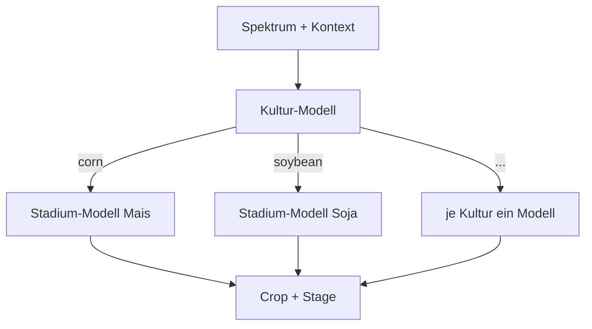
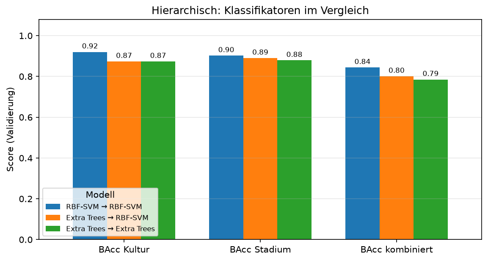
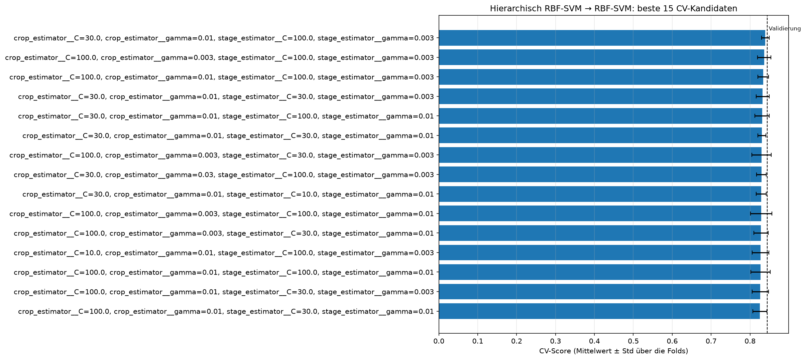
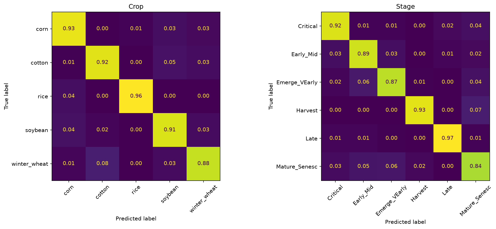
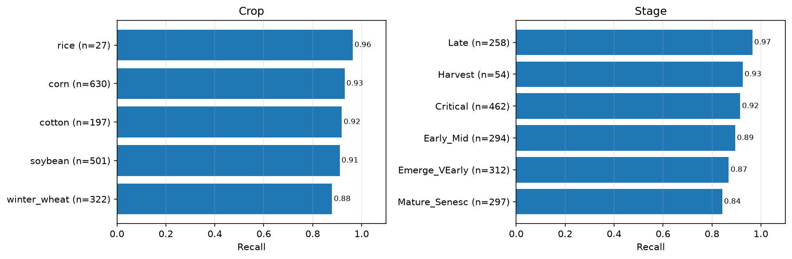
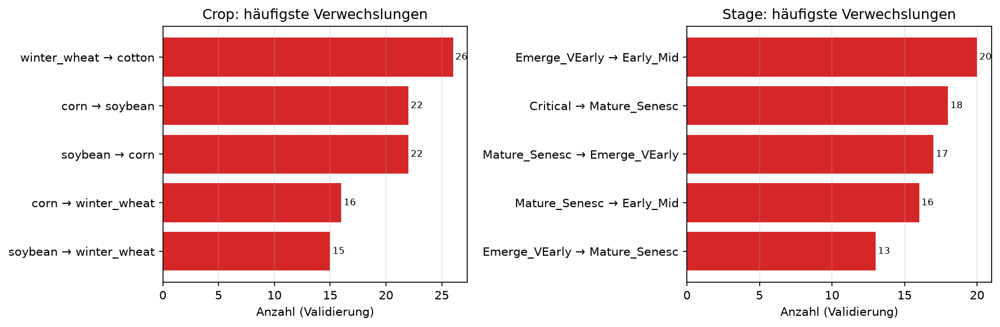
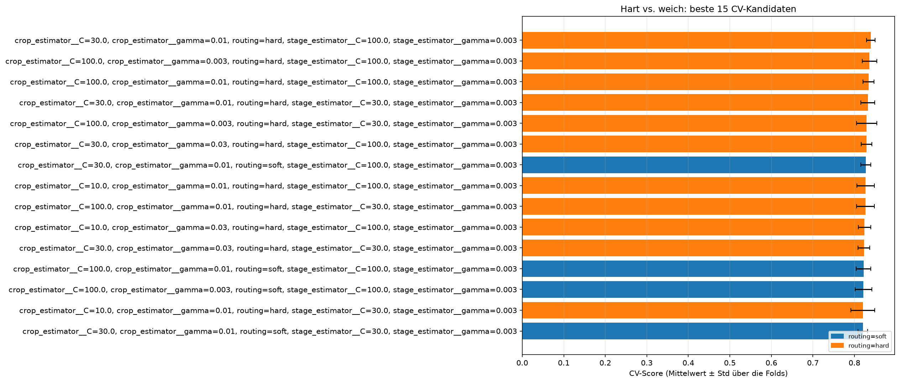
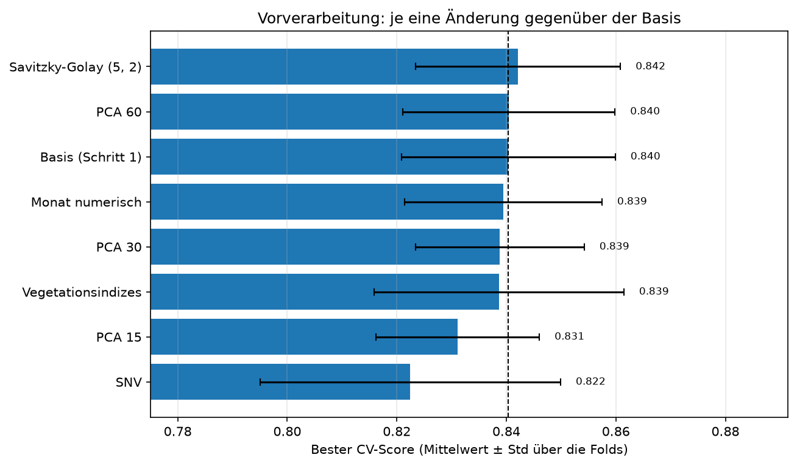
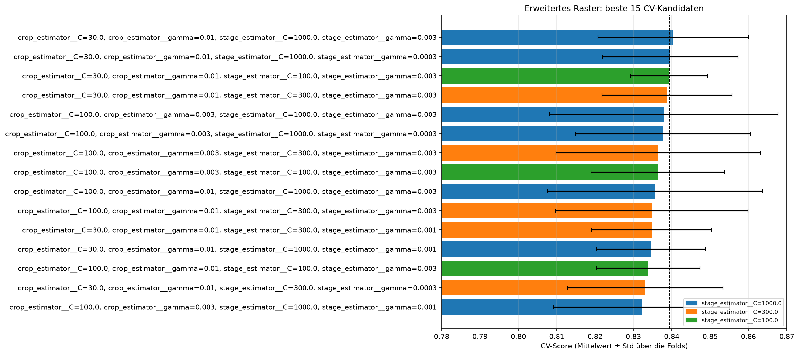

# Hierarchisch

## Idee

Erst die Kultur vorhersagen, dann das Stadium mit einem eigenen Modell **je Kultur**. Das
bildet die Zerlegung P(Crop, Stage) = P(Crop) · P(Stage | Crop) direkt ab: Das
Stadium-Modell für Mais muss nur Mais-Stadien unterscheiden und sieht keine Soja-Spektren.
Baustein: `HierarchicalClassifier` in `src/awp2/models/hierarchical.py` (#85).

- Die Stadium-Modelle lernen auf der **wahren** Kultur. Bei der Vorhersage entscheidet die
  vorhergesagte Kultur, welches Stadium-Modell antwortet (hartes Routing).
- Jedes Stadium-Modell kennt nur die Stadien seiner Kultur, daher entstehen nur Paare, die im
  Training vorkommen.
- Beide Stufen sind für `tune()` als `crop_estimator__…` und `stage_estimator__…` erreichbar;
  alle Stadium-Modelle teilen dieselben Hyperparameter.
- `predict_stage(X, crop)` sagt das Stadium für eine vorgegebene Kultur vorher. Mit der wahren
  Kultur ergibt das die **Oracle-Kultur**-Analyse: Wie gut wäre das Stadium ohne Kulturfehler?
  Grundlage der Fehleranalyse in #32. `X` muss dafür vorverarbeitet sein:
  `result.pipeline[-1].predict_stage(result.pipeline[:-1].transform(X_val), y_val["Crop"])`.
- Mit `balance_samples=True` werden die Gewichte je Stufe umskaliert: Das Kultur-Modell sieht
  jede Kultur mit gleichem Gesamtgewicht, jedes Stadium-Modell Gewichte mit Mittelwert 1. Die
  Fabriken nutzen bereits `class_weight="balanced"` und brauchen das nicht.

Stadien je Kultur im Trainingsteil:

| Kultur | Stadien | Zeilen | Seltenstes Stadium |
| --- | --- | --- | --- |
| corn | 6 | 1467 | Harvest (71) |
| soybean | 6 | 1168 | Harvest (47) |
| winter_wheat | 4 | 750 | Late (21) |
| cotton | 5 | 461 | Harvest (8) |
| rice | 2 | 66 | Late (29) |

## Vor- und Nachteile

| Vorteil | Nachteil |
| --- | --- |
| Nutzt die Abhängigkeit des Stadiums von der Kultur: Jedes Stadium-Modell löst eine kleinere, homogenere Aufgabe | Jeder Kulturfehler wird zum Stadiumfehler (Fehlerfortpflanzung beim harten Routing) |
| Sagt nur Paare vorher, die es gibt | Stadium-Modelle für seltene Kulturen haben wenig Daten (Reis: 66 Zeilen, Baumwolle/Harvest: 8) |
| Kultur- und Stadium-Stufe lassen sich getrennt analysieren und mit unterschiedlichen Klassifikatoren besetzen | Mehr Modelle; dieselben Hyperparameter für alle Stadium-Modelle sind ein Kompromiss |
| Die Oracle-Kultur trennt Kultur- und Stadiumfehler sauber | Kein Wissensaustausch zwischen gleichen Stadien verschiedener Kulturen (z. B. Mais/Late und Soja/Late) |

Gegenmaßnahmen: weiches Routing über Wahrscheinlichkeiten gegen die Fehlerfortpflanzung (#88,
ohne messbaren Effekt) sowie Vorverarbeitung und gezieltes Tuning schwacher Kulturen (#89).

## Klassifikatoren

Notebook: `notebooks/07_jd_hierarchical.ipynb` (#87). Alle Varianten mit derselben
Vorverarbeitung: standardisierte Spektren, AEZ one-hot, Monat zyklisch
(`PreprocessingConfig(use_spectral_standard_scale=True)`). Die Referenz `combined_svm_expanded`
(0.866) lief noch mit numerischem Monat; als fairer Vergleich wurde die kombinierte SVM mit
derselben Vorverarbeitung und demselben Raster **nur per CV** neu getunt
(`combined_svm_cv_reference`, CV 0.845).

| Klassifikator | CV kombiniert | BAcc Crop | BAcc Stage | BAcc kombiniert | Oracle-Kultur kombiniert | MLflow-Run |
| --- | --- | --- | --- | --- | --- | --- |
| [RBF-SVM → RBF-SVM](#rbf-svm-rbf-svm) | 0.839 | 0.920 | 0.902 | **0.844** | 0.939 | `aa082323` |
| [Extra Trees → RBF-SVM](#extra-trees-rbf-svm) | 0.811 | 0.874 | 0.890 | 0.801 | 0.939 | `8449d63e` |
| [Extra Trees → Extra Trees](#extra-trees-extra-trees) | 0.797 | 0.874 | 0.879 | 0.785 | 0.922 | `55dd4258` |
| Kombiniert: RBF-SVM (nur CV) | 0.845 | – | – | – | – | `014c54f2` |

### RBF-SVM → RBF-SVM

- Gemeinsame Suche über beide Stufen (`hierarchical_svm_search`, 144 Kandidaten, MLflow
  `2b851b88`): Kultur `C=30, gamma=0.01`, Stadium `C=100, gamma=0.003` – CV 0.839 ± 0.010.
- Validierung `hierarchical_svm` (MLflow `aa082323`): BAcc Crop 0.920, Stage 0.902,
  **kombiniert 0.844**, Macro-F1 kombiniert 0.820, Samples-F1 0.906; keine ungültigen Paare.
- **Knapp hinter kombiniert:** Die kombinierte SVM mit gleicher Vorverarbeitung
  (`combined_svm_cv_reference`) liegt in der CV 0.006 höher (0.845) und gewinnt 4 von 5 Folds;
  der Unterschied liegt im Rauschen (Std der Fold-Differenzen ≈ 0.011). Die hierarchische
  Suche hatte 144 statt 12 Kandidaten – ihr CV-Score ist eher leicht zu optimistisch.
- **Engpass Kultur:** Mit der wahren Kultur (`oracle_crop_metrics`) erreichen die Stadium-SVMs
  BAcc Stage 0.947 und kombiniert 0.939; Kulturfehler kosten also rund 0.095 BAcc kombiniert.
  Eine eigene Kultur-SVM (0.920) ist nicht besser als die Kultur aus der kombinierten SVM
  (`combined_svm_expanded`: 0.931, allerdings mit numerischem Monat – kein exakter Vergleich).
- Häufigste Kulturverwechslung Winterweizen → Baumwolle (26), vermutlich in frühen Stadien mit
  viel offenem Boden; dazu Mais ↔ Soja (je 22). Beim Stadium vor allem benachbarte Stadien
  (Emerge_VEarly → Early_Mid, 20) und Stadien mit wenig grüner Vegetation
  (Emerge_VEarly ↔ Mature_Senesc, 17 + 13; Critical → Mature_Senesc, 18).
- Das Stadium-Optimum liegt am Rasterrand (`C=100`, `gamma=0.003`). Bei der kombinierten SVM
  half eine Erweiterung (`combined_svm_wide_cv_search`, andere Vorverarbeitung); in #89 per CV
  mit der aktuellen Vorverarbeitung wiederholen.

### RBF-SVM → RBF-SVM, weiches Routing

Notebook: `notebooks/08_jd_hierarchical_soft.ipynb` (#88). Statt der harten Kulturentscheidung
gewinnt das gültige Paar mit dem höchsten P(Kultur) · P(Stadium | Kultur)
(`HierarchicalClassifier(routing="soft")`); die SVMs bekommen Wahrscheinlichkeiten über
`CalibratedClassifierCV` (Sigmoid, `ensemble=False`).

- Suche `hierarchical_soft_search` (18 Kandidaten, MLflow `9e7edd15`): Kultur-`C`/`gamma` ×
  Stadium-`C` um das Optimum aus #87. Bestes weiches Routing CV 0.840 gegenüber 0.839 für hart
  (`hierarchical_svm_search`, gleiche Folds) – bei **identischen Hyperparametern**, drei von
  fünf Folds gleich, Unterschied im Rauschen (Std 0.010).
- Validierung `hierarchical_soft` (MLflow `4868f97d`): BAcc Crop 0.921, Stage 0.903,
  **kombiniert 0.844** (hart: 0.844), Macro-F1 kombiniert 0.821, Samples-F1 0.907; keine
  ungültigen Paare – ebenfalls ein Unentschieden.
- **Kaum Änderungen** (out-of-fold auf dem Trainingsteil): Die Kalibrierung allein ändert keine
  Kulturentscheidung und 5 Stadien; das weiche Routing danach 2 von 3 912 Kulturentscheidungen.
  Der Recall je Kultur ist in allen Varianten gleich.
- **Warum:** Auch bei *falschen* Kulturentscheidungen ist die Top-Kultur im Median 3,3-mal so
  wahrscheinlich wie die zweite (90 % > 2-mal), kaum weniger als bei richtigen (3,4; 95 %). Die
  kalibrierten Wahrscheinlichkeiten erben die Stimmenstruktur der OvO-SVM; ein Stadium-Modell
  kann eine Kultur damit fast nie überstimmen. Weiches Routing hilft also **mit diesen
  Wahrscheinlichkeiten** nicht – ob andere (z. B. Temperature Scaling oder eine multinomiale
  logistische Regression auf den SVM-Scores) mehr Unsicherheit zeigen, wäre eine eigene
  Hypothese.
- **Die Wahrscheinlichkeitsquelle zählt:** Ein erster Lauf mit `SVC(probability=True)`
  (libsvm-Platt, in scikit-learn 1.9 veraltet; MLflow `f0b6fbb8`, Notebook-Stand `7a515b2`)
  änderte 2,3 % der Kulturentscheidungen, verschob sie zur häufigsten Kultur Mais (Recall Mais
  0.916 → 0.935, Baumwolle 0.918 → 0.887) und verlor in der CV (0.828). Reis wurde in keinem
  Lauf bevorzugt – die Vermutung „wenige Stadien ⇒ hohe P(Stadium | Kultur)“ trifft nicht zu.
- Ein Smoke-Test hatte die libsvm-Variante vorab einmal auf der Validierung gesehen (0.823); er
  ging nicht in die Entscheidung ein.
- Hartes Routing bleibt Referenz: gleiche Güte, ein Fit statt sechs je SVM (die Kalibrierung
  trainiert intern fünf weitere).

### RBF-SVM → RBF-SVM: Tuning und Vorverarbeitung

Notebook: `notebooks/09_jd_hierarchical_tuning.ipynb` (#89). Jede Entscheidung per CV; ein
Gewinn unter 0.005 gilt als Rauschen (Std der Referenz über die Folds 0.010).

| Schritt | Ergebnis (CV kombiniert) | MLflow |
| --- | --- | --- |
| Erweitertes Raster (Stadium `C` bis 1000, `gamma` bis 0.0003) | 0.840 ± 0.020 mit Stadium `C=1000` (Referenz 0.839 ± 0.010) | `ed78855f` |
| *Ablationen unten: je eine Änderung auf Stadium `C=1000` (Basis 0.840), `gamma` bisher/`scale`* | | |
| Savitzky-Golay (Fenster 5, Grad 2) | 0.842 | `5a21e11a` |
| PCA 60 / 30 / 15 | 0.840 / 0.839 / 0.831 | `58b2f7e9` / `4c8cdc20` / `715d5390` |
| Monat numerisch statt zyklisch | 0.839 | `a3d29cf0` |
| Vegetationsindizes | 0.839 | `7e153174` |
| SNV | 0.822 | `c81bd2e6` |

- **Kein Hebel:** Weder das größere Raster noch eine Vorverarbeitungs-Variante gewinnt mehr als
  das Rauschen; daher keine Kombination. Die Pipeline-Optionen aus #83 bringen für diese SVM
  nichts – die standardisierten Rohspektren reichen. Die Varianten hatten je 4, die Basis 36
  Kandidaten; der Vergleich begünstigt eher die Basis, das Ergebnis ist also konservativ.
- **Plateau statt Optimum:** Stadium `C=1000` liegt wieder am Rasterrand, die Scores sind aber
  flach (`C=300`: 0.839, `C=1000`: 0.840) – größere Werte versprechen keinen Gewinn.
- **SNV schadet deutlich** (−0.018, in 4 von 5 Folds schlechter), vermutlich weil die absolute
  Helligkeit Information über Kultur und Stadium trägt (z. B. Biomasse), die SNV entfernt –
  nicht eigens getestet. PCA mit 15 Komponenten verliert ebenfalls (−0.009).
- **Zyklischer vs. numerischer Monat ist egal** (0.839 vs. 0.840); die Variante nutzt das
  veraltete `scale=True` und ändert damit Kodierung und Skalierung des Monats. Der Unterschied
  zwischen `combined_svm_expanded` und den hierarchischen Läufen liegt nicht an der
  Monatskodierung.
- Das erweiterte Raster wählte Stadium `C=1000`: +0.001 liegt unter der Schwelle von 0.005, und
  die Fold-Differenzen zur Referenz wechseln das Vorzeichen (−0.025, −0.004, +0.007, +0.011,
  +0.016). Weil die Schwelle in diesem Schritt fehlte, wurde es dennoch einmal bewertet:
  `hierarchical_svm_tuned` (MLflow `f2d755a7`) erreicht Crop 0.920, Stage 0.898, **kombiniert
  0.839**. `hierarchical_svm` bleibt Referenz – begründet durch die CV, nicht durch die
  Validierung.

**Schwache Kultur: Baumwolle.** Stadium-BAcc je Kultur auf den Zeilen mit richtig erkannter
Kultur (out-of-fold, Trainingsteil, `out_of_fold_predictions`, Referenzmodell
`hierarchical_svm`):

| Kultur | Stadium-BAcc | Zeilen | schwächste Stadien (Recall, Zeilen) |
| --- | --- | --- | --- |
| corn | 0.964 | 1344 | Mature_Senesc 0.91 (233) |
| cotton | **0.837** | 423 | Mature_Senesc 0.75 (36), Emerge_VEarly 0.82 (113), Critical 0.84 (98) |
| rice | 1.000 | 65 | – |
| soybean | 0.932 | 1069 | Mature_Senesc 0.85 (95), Emerge_VEarly 0.90 (52) |
| winter_wheat | 0.981 | 692 | – |

Baumwolle/Harvest (7 Zeilen, Recall 0.86) ist zu selten für eine belastbare Aussage.

Die Stadium-Modelle von Baumwolle und Soja sind die Schwachstelle nach der Kulturstufe; Reis ist
trotz nur 66 Zeilen perfekt. Eigene Hyperparameter je Kultur unterstützt
`HierarchicalClassifier` noch nicht – ein möglicher nächster Schritt, Ursachen in #32.

### Extra Trees → RBF-SVM

- Suche `hierarchical_et_svm_search` (24 Kandidaten, MLflow `c3f13a6e`): Kultur
  `max_features=0.3`, Stadium `C=100, gamma=0.003` – CV 0.811.
- Validierung `hierarchical_et_svm` (MLflow `8449d63e`): Crop 0.874, Stage 0.890,
  **kombiniert 0.801**.
- Die Hypothese „Bäume für die Kultur“ trägt nicht: Die Kultur fällt gegenüber der SVM um 0.046
  ab. Die Stadium-SVMs haben dieselben Hyperparameter wie oben und lernen auf der wahren Kultur,
  sind also identisch (Oracle 0.939 per Konstruktion) – der ganze Verlust kommt aus der
  Kulturstufe.

### Extra Trees → Extra Trees

- Suche `hierarchical_et_search` (8 Kandidaten, MLflow `95c88504`): `max_features=0.3` auf
  beiden Stufen, Stadium `min_samples_leaf=3` – CV 0.797.
- Validierung `hierarchical_et` (MLflow `55dd4258`): Crop 0.874 (dasselbe Kultur-Modell wie
  bei Extra Trees → RBF-SVM), Stage 0.879, **kombiniert 0.785** – unter `combined_extra_trees`
  (0.804).
- Auch für Bäume bringt die Zerlegung keinen Gewinn; die Stadium-Bäume sind mit Oracle-Kultur
  (0.922) schwächer als die Stadium-SVMs (0.939).

## Fazit

**Vorläufig (#87–#89):** Hierarchisch mit RBF-SVM auf beiden Stufen (`hierarchical_svm`,
Validierung 0.844) liegt in der CV knapp hinter der kombinierten SVM mit gleicher
Vorverarbeitung (0.839 vs. 0.845, im Rauschen) – gleichwertig, aber nicht besser.

- **Engpass Kulturstufe:** Mit der wahren Kultur wären es 0.939; Kulturfehler pflanzen sich hart
  ins Stadium fort.
- **Weiches Routing (#88) hilft nicht** mit den kalibrierten SVM-Wahrscheinlichkeiten: Die
  Kultur-SVM ist auch bei Fehlern so sicher, dass das Stadium sie kaum überstimmt.
- **Tuning und Vorverarbeitung (#89) bringen keinen Gewinn** über das Rauschen; SNV schadet.
- **Schwachstelle nach der Kultur:** die Stadium-Modelle von Baumwolle (0.84) und Soja (0.93),
  vor allem Mature_Senesc.

Ursachen der Kultur- und Stadiumfehler im Vergleich der Ansätze: Fehleranalyse (#32).
