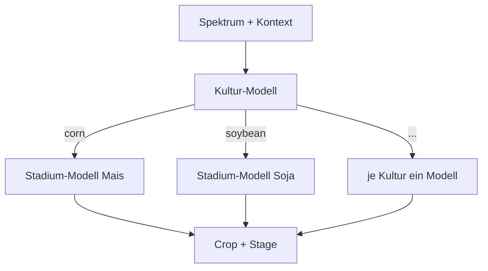

# Hierarchisch

## Idee

Erst die Kultur vorhersagen, dann das Stadium mit einem eigenen Modell **je Kultur**. Das
bildet die Zerlegung P(Crop, Stage) = P(Crop) · P(Stage | Crop) direkt ab: Das
Stadium-Modell für Mais muss nur Mais-Stadien unterscheiden und sieht keine Soja-Spektren.
Baustein: `HierarchicalClassifier` in `src/awp2/models/hierarchical.py` (#85).

- Die Stadium-Modelle lernen auf der **wahren** Kultur. Bei der Vorhersage entscheidet die
  vorhergesagte Kultur, welches Stadium-Modell antwortet (hartes Routing).
- Jedes Stadium-Modell kennt nur die Stadien seiner Kultur, daher entstehen nur Paare, die im
  Training vorkommen.
- Beide Stufen sind für `tune()` als `crop_estimator__…` und `stage_estimator__…` erreichbar;
  alle Stadium-Modelle teilen dieselben Hyperparameter.
- `predict_stage(X, crop)` sagt das Stadium für eine vorgegebene Kultur vorher. Mit der wahren
  Kultur ergibt das die **Oracle-Kultur**-Analyse: Wie gut wäre das Stadium ohne Kulturfehler?
  Grundlage der Fehleranalyse in #32. `X` muss dafür vorverarbeitet sein:
  `result.pipeline[-1].predict_stage(result.pipeline[:-1].transform(X_val), y_val["Crop"])`.
- Mit `balance_samples=True` werden die Gewichte je Stufe umskaliert: Das Kultur-Modell sieht
  jede Kultur mit gleichem Gesamtgewicht, jedes Stadium-Modell Gewichte mit Mittelwert 1. Die
  Fabriken nutzen bereits `class_weight="balanced"` und brauchen das nicht.

Stadien je Kultur im Trainingsteil:

| Kultur | Stadien | Zeilen | Seltenstes Stadium |
| --- | --- | --- | --- |
| corn | 6 | 1467 | Harvest (71) |
| soybean | 6 | 1168 | Harvest (47) |
| winter_wheat | 4 | 750 | Late (21) |
| cotton | 5 | 461 | Harvest (8) |
| rice | 2 | 66 | Late (29) |

## Vor- und Nachteile

| Vorteil | Nachteil |
| --- | --- |
| Nutzt die Abhängigkeit des Stadiums von der Kultur: Jedes Stadium-Modell löst eine kleinere, homogenere Aufgabe | Jeder Kulturfehler wird zum Stadiumfehler (Fehlerfortpflanzung beim harten Routing) |
| Sagt nur Paare vorher, die es gibt | Stadium-Modelle für seltene Kulturen haben wenig Daten (Reis: 66 Zeilen, Baumwolle/Harvest: 8) |
| Kultur- und Stadium-Stufe lassen sich getrennt analysieren und mit unterschiedlichen Klassifikatoren besetzen | Mehr Modelle; dieselben Hyperparameter für alle Stadium-Modelle sind ein Kompromiss |
| Die Oracle-Kultur trennt Kultur- und Stadiumfehler sauber | Kein Wissensaustausch zwischen gleichen Stadien verschiedener Kulturen (z. B. Mais/Late und Soja/Late) |

Geplante Gegenmaßnahmen: weiches Routing über Wahrscheinlichkeiten gegen die Fehlerfortpflanzung
(#88) sowie Vorverarbeitung und gezieltes Tuning schwacher Kulturen (#89).

## Klassifikatoren

Notebook: `notebooks/07_jd_hierarchical.ipynb` (#87). Alle Varianten mit derselben
Vorverarbeitung: standardisierte Spektren, AEZ one-hot, Monat zyklisch
(`PreprocessingConfig(use_spectral_standard_scale=True)`). Die Referenz `combined_svm_expanded`
(0.866) lief noch mit numerischem Monat; als fairer Vergleich wurde die kombinierte SVM mit
derselben Vorverarbeitung und demselben Raster **nur per CV** neu getunt
(`combined_svm_cv_reference`, CV 0.845).

| Klassifikator | CV kombiniert | BAcc Crop | BAcc Stage | BAcc kombiniert | Oracle-Kultur kombiniert | MLflow-Run |
| --- | --- | --- | --- | --- | --- | --- |
| [RBF-SVM → RBF-SVM](#rbf-svm-rbf-svm) | 0.839 | 0.920 | 0.902 | **0.844** | 0.939 | `aa082323` |
| [Extra Trees → RBF-SVM](#extra-trees-rbf-svm) | 0.811 | 0.874 | 0.890 | 0.801 | 0.939 | `8449d63e` |
| [Extra Trees → Extra Trees](#extra-trees-extra-trees) | 0.797 | 0.874 | 0.879 | 0.785 | 0.922 | `55dd4258` |
| Kombiniert: RBF-SVM (nur CV) | 0.845 | – | – | – | – | `014c54f2` |

### RBF-SVM → RBF-SVM

- Gemeinsame Suche über beide Stufen (`hierarchical_svm_search`, 144 Kandidaten, MLflow
  `2b851b88`): Kultur `C=30, gamma=0.01`, Stadium `C=100, gamma=0.003` – CV 0.839 ± 0.010.
- Validierung `hierarchical_svm` (MLflow `aa082323`): BAcc Crop 0.920, Stage 0.902,
  **kombiniert 0.844**, Macro-F1 kombiniert 0.820, Samples-F1 0.906; keine ungültigen Paare.
- **Knapp hinter kombiniert:** Die kombinierte SVM mit gleicher Vorverarbeitung
  (`combined_svm_cv_reference`) liegt in der CV 0.006 höher (0.845) und gewinnt 4 von 5 Folds;
  der Unterschied liegt im Rauschen (Std der Fold-Differenzen ≈ 0.011). Die hierarchische
  Suche hatte 144 statt 12 Kandidaten – ihr CV-Score ist eher leicht zu optimistisch.
- **Engpass Kultur:** Mit der wahren Kultur (`oracle_crop_metrics`) erreichen die Stadium-SVMs
  BAcc Stage 0.947 und kombiniert 0.939; Kulturfehler kosten also rund 0.095 BAcc kombiniert.
  Eine eigene Kultur-SVM (0.920) ist nicht besser als die Kultur aus der kombinierten SVM
  (`combined_svm_expanded`: 0.931, allerdings mit numerischem Monat – kein exakter Vergleich).
- Häufigste Kulturverwechslung Winterweizen → Baumwolle (26), vermutlich in frühen Stadien mit
  viel offenem Boden; dazu Mais ↔ Soja (je 22). Beim Stadium vor allem benachbarte Stadien
  (Emerge_VEarly → Early_Mid, 20) und Stadien mit wenig grüner Vegetation
  (Emerge_VEarly ↔ Mature_Senesc, 17 + 13; Critical → Mature_Senesc, 18).
- Das Stadium-Optimum liegt am Rasterrand (`C=100`, `gamma=0.003`). Bei der kombinierten SVM
  half eine Erweiterung (`combined_svm_wide_cv_search`, andere Vorverarbeitung); in #89 per CV
  mit der aktuellen Vorverarbeitung wiederholen.

### Extra Trees → RBF-SVM

- Suche `hierarchical_et_svm_search` (24 Kandidaten, MLflow `c3f13a6e`): Kultur
  `max_features=0.3`, Stadium `C=100, gamma=0.003` – CV 0.811.
- Validierung `hierarchical_et_svm` (MLflow `8449d63e`): Crop 0.874, Stage 0.890,
  **kombiniert 0.801**.
- Die Hypothese „Bäume für die Kultur“ trägt nicht: Die Kultur fällt gegenüber der SVM um 0.046
  ab. Die Stadium-SVMs haben dieselben Hyperparameter wie oben und lernen auf der wahren Kultur,
  sind also identisch (Oracle 0.939 per Konstruktion) – der ganze Verlust kommt aus der
  Kulturstufe.

### Extra Trees → Extra Trees

- Suche `hierarchical_et_search` (8 Kandidaten, MLflow `95c88504`): `max_features=0.3` auf
  beiden Stufen, Stadium `min_samples_leaf=3` – CV 0.797.
- Validierung `hierarchical_et` (MLflow `55dd4258`): Crop 0.874 (dasselbe Kultur-Modell wie
  bei Extra Trees → RBF-SVM), Stage 0.879, **kombiniert 0.785** – unter `combined_extra_trees`
  (0.804).
- Auch für Bäume bringt die Zerlegung keinen Gewinn; die Stadium-Bäume sind mit Oracle-Kultur
  (0.922) schwächer als die Stadium-SVMs (0.939).

## Fazit

**Vorläufig (#87):** Hierarchisch mit RBF-SVM auf beiden Stufen liegt in der CV knapp hinter
der kombinierten SVM (0.839 vs. 0.845, im Rauschen) – nicht besser. Die Stadium-Modelle sind stark (Oracle-Kultur 0.939); der
Ansatz verliert fast alles an der Kulturstufe, deren Fehler sich hart ins Stadium fortpflanzen.
Nächste Schritte: weiches Routing über Wahrscheinlichkeiten gegen die Fehlerfortpflanzung (#88),
erweiterte SVM-Suche und Vorverarbeitung (#89), Ursachen der Kulturfehler in der Fehleranalyse
(#32).
