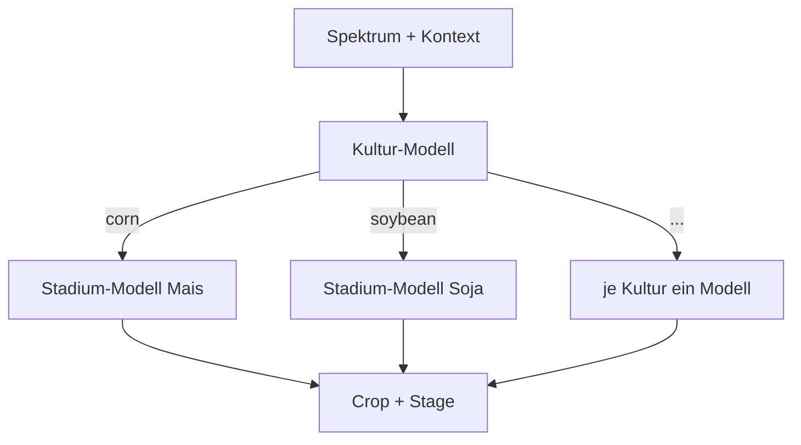

# Hierarchisch

## Idee

Erst die Kultur vorhersagen, dann das Stadium mit einem eigenen Modell **je Kultur**. Das
bildet die Zerlegung P(Crop, Stage) = P(Crop) · P(Stage | Crop) direkt ab: Das
Stadium-Modell für Mais muss nur Mais-Stadien unterscheiden und sieht keine Soja-Spektren.
Baustein: `HierarchicalClassifier` in `src/awp2/models/hierarchical.py` (#85).

- Die Stadium-Modelle lernen auf der **wahren** Kultur. Bei der Vorhersage entscheidet die
  vorhergesagte Kultur, welches Stadium-Modell antwortet (hartes Routing).
- Jedes Stadium-Modell kennt nur die Stadien seiner Kultur, daher entstehen nur Paare, die im
  Training vorkommen.
- Beide Stufen sind für `tune()` als `crop_estimator__…` und `stage_estimator__…` erreichbar;
  alle Stadium-Modelle teilen dieselben Hyperparameter.
- `predict_stage(X, crop)` sagt das Stadium für eine vorgegebene Kultur vorher. Mit der wahren
  Kultur ergibt das die **Oracle-Kultur**-Analyse: Wie gut wäre das Stadium ohne Kulturfehler?
  Grundlage der Fehleranalyse in #32. `X` muss dafür vorverarbeitet sein:
  `result.pipeline[-1].predict_stage(result.pipeline[:-1].transform(X_val), y_val["Crop"])`.
- Mit `balance_samples=True` werden die Gewichte je Stufe umskaliert: Das Kultur-Modell sieht
  jede Kultur mit gleichem Gesamtgewicht, jedes Stadium-Modell Gewichte mit Mittelwert 1. Die
  Fabriken nutzen bereits `class_weight="balanced"` und brauchen das nicht.

Stadien je Kultur im Trainingsteil:

| Kultur | Stadien | Zeilen | Seltenstes Stadium |
| --- | --- | --- | --- |
| corn | 6 | 1467 | Harvest (71) |
| soybean | 6 | 1168 | Harvest (47) |
| winter_wheat | 4 | 750 | Late (21) |
| cotton | 5 | 461 | Harvest (8) |
| rice | 2 | 66 | Late (29) |

## Vor- und Nachteile

| Vorteil | Nachteil |
| --- | --- |
| Nutzt die Abhängigkeit des Stadiums von der Kultur: Jedes Stadium-Modell löst eine kleinere, homogenere Aufgabe | Jeder Kulturfehler wird zum Stadiumfehler (Fehlerfortpflanzung beim harten Routing) |
| Sagt nur Paare vorher, die es gibt | Stadium-Modelle für seltene Kulturen haben wenig Daten (Reis: 66 Zeilen, Baumwolle/Harvest: 8) |
| Kultur- und Stadium-Stufe lassen sich getrennt analysieren und mit unterschiedlichen Klassifikatoren besetzen | Mehr Modelle; dieselben Hyperparameter für alle Stadium-Modelle sind ein Kompromiss |
| Die Oracle-Kultur trennt Kultur- und Stadiumfehler sauber | Kein Wissensaustausch zwischen gleichen Stadien verschiedener Kulturen (z. B. Mais/Late und Soja/Late) |

Geplante Gegenmaßnahmen: weiches Routing über Wahrscheinlichkeiten gegen die Fehlerfortpflanzung
(#88) sowie Vorverarbeitung und gezieltes Tuning schwacher Kulturen (#89).

## Klassifikatoren

_Noch keine._ Erste Läufe in #87, als Unterkapitel nach der
[Vorlage](index.md#aufbau-einer-ansatz-seite), z. B. „RBF-SVM → RBF-SVM“.

## Fazit

_Offen._
