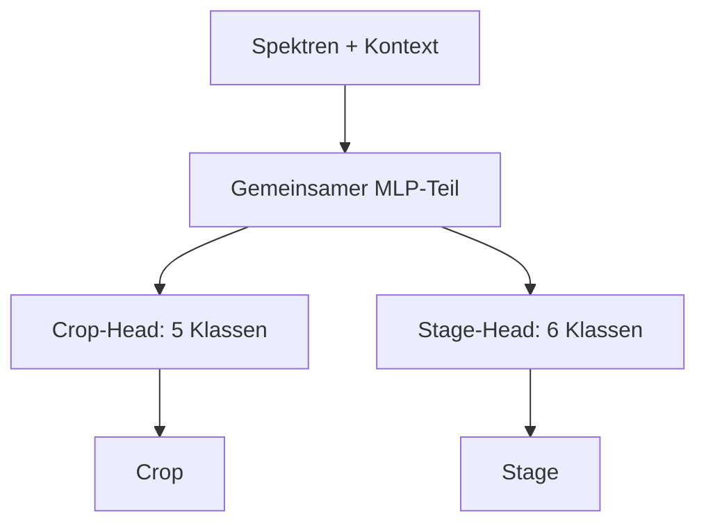

# Multi-Task

## Idee

Ein Modell lernt aus einem Spektrum eine gemeinsame Repräsentation und sagt daraus mit zwei
getrennten Ausgaben gleichzeitig `Crop` und `Stage` voraus. Anders als beim kombinierten Ansatz
bleiben Kultur und Stadium jeweils eigene Klassen; anders als beim getrennten Ansatz teilen die
beiden Aufgaben den größten Teil des Modells.

Als erster Kandidat wird ein tabellarisches Multi-Task-MLP entwickelt. Es erhält die
vorverarbeiteten Spektralbänder sowie AEZ und Month, lernt mehrere gemeinsame verdeckte Schichten
und verzweigt dann in einen Crop-Head mit fünf sowie einen Stage-Head mit sechs Klassen.

Die Hypothese lautet: Spektrale Muster, die für eine Kultur hilfreich sind, unterstützen auch die
Erkennung ihres Entwicklungsstadiums. Die gemeinsame Repräsentation kann deshalb mit den rund
3.900 Trainingszeilen besser generalisieren als zwei vollständig getrennte MLPs.

## Vor- und Nachteile

| Vorteil | Nachteil |
| --- | --- |
| Crop und Stage können voneinander über die gemeinsame Repräsentation profitieren. | Mehr Trainingsparameter und Hyperparameter als bei Baumverfahren oder SVM. |
| Jede Aufgabe behält ihre eigenen Klassen; seltene kombinierte Paare werden nicht zu einer eigenen 11-Beobachtungen-Klasse. | Zwei unabhängige Heads können nicht beobachtete Crop/Stage-Paare vorhersagen. |
| Die Gewichtung beider Aufgaben ist steuerbar und im Training sichtbar. | Der Nutzen geteilter Schichten muss bei der vorhandenen Datenmenge erst gezeigt werden. |
| Der Ansatz passt direkt zur Multi-Output-Bewertung für Crop und Stage. | Neuronale Netze benötigen Skalierung, Regularisierung und eine kleine, disziplinierte Suche. |

## Erster Arbeitsplan

Der erste Durchlauf prüft ausschließlich, ob geteilte Schichten bei tabellarischen Merkmalen
helfen. Label-Logik, Vorverarbeitung und Sequenzarchitektur bleiben dabei unverändert.

| Schritt | Frage | Umsetzung | Ergebnis für den nächsten Schritt |
| --- | --- | --- | --- |
| 1 | Ist ein Multi-Task-Modell mit der gemeinsamen Pipeline technisch möglich? | `MultiTaskMLPClassifier` mit gemeinsamem MLP-Teil und je einem Crop- und Stage-Head in `src/awp2/models/` umsetzen. `fit()` erhält beide Zielspalten, `predict()` gibt sie wieder zurück. | Tests bestätigen Ausgabeform, gültige Einzellabels und Reproduzierbarkeit mit `SEED`. |
| 2 | Hilft das Teilen von Schichten überhaupt? | Multi-Task-MLP gegen zwei getrennte MLPs mit derselben Vorverarbeitung und vergleichbarer Modellgröße vergleichen. Die Multi-Task-Startvariante nutzt gleiche Gewichtung für Crop- und Stage-Loss. | Nur die CV-BAcc kombiniert entscheidet, ob gemeinsames Lernen einen plausiblen Nutzen zeigt. |
| 3 | Welche kleine MLP-Konfiguration ist auf den Trainingsfolds am besten? | Ausschließlich Breite/Tiefe, Dropout und Lernrate in einer kleinen, vorab festgelegten Suche mit `tune()` variieren. Klassenungleichgewicht in beiden Heads berücksichtigen. | Der CV-Gewinner wird festgehalten; der Validierungsanteil bleibt unberührt. |
| 4 | Generalisiert der CV-Gewinner? | Genau einmal `run()` auf dem gemeinsamen Holdout ausführen. | BAcc für Crop, Stage und kombiniert mit der RBF-SVM-Referenz sowie den getrennten MLPs vergleichen. |
| 5 | Entstehen problematische Paarvorhersagen? | Confusion Matrices, Klassenrecalls und `invalid_combinations` analysieren. | Eine Einschränkung auf beobachtete Paare nur als eigenständige Folgehypothese planen. |

LSTM, GRU und Transformer sind keine Varianten dieses ersten Vergleichs. Sie testen zusätzlich,
ob die Reihenfolge der Wellenlängen gegenüber der tabellarischen Darstellung hilft. Erst wenn das
Multi-Task-MLP als sauberer Ausgangspunkt dokumentiert ist, folgt ein Multi-Task-GRU als erste
sequenzielle Erweiterung; LSTM und Transformer bleiben davon getrennte Experimente.

## Bewertung und Dokumentation

Die Hyperparameter-Suche erfolgt mit `tune()` auf den festen Trainingsfolds. Erst der nach
CV-BAcc kombiniert gewählte Kandidat wird einmalig mit `run()` auf dem Validierungsanteil
bewertet. Bewertet werden mindestens:

- BAcc für Crop, Stage und kombiniert,
- Macro-F1 für Crop, Stage und kombiniert,
- Samples-F1 und Anteil ungültiger Paare,
- Confusion Matrices sowie die häufigsten Verwechslungen je Ziel.

Der Tuning-Lauf und der Bewertungslauf werden in MLflow gespeichert. Danach folgen eine Zeile im
[Experiment-Log](../experimente.md), die Ergebnisse auf dieser Seite und die wichtigsten
Abbildungen in `docs/modelle/img/`.

## Klassifikatoren

### Tabellarisches Multi-Task-MLP

_Noch nicht implementiert oder bewertet._ Das erste Experiment testet die in diesem Dokument
beschriebene Architektur gegen die bestehende kombinierte RBF-SVM-Referenz.

## Fazit

_Offen. Der Ansatz wurde noch nicht trainiert oder auf dem Holdout bewertet._
