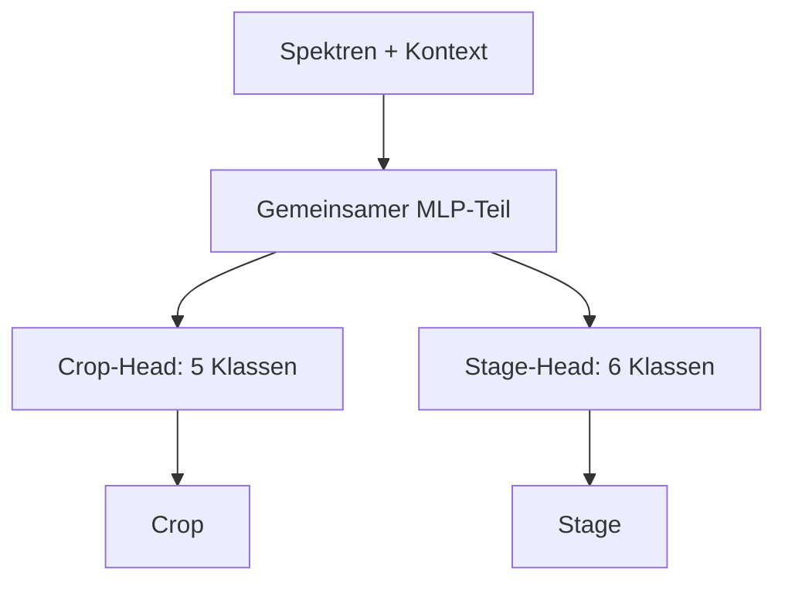
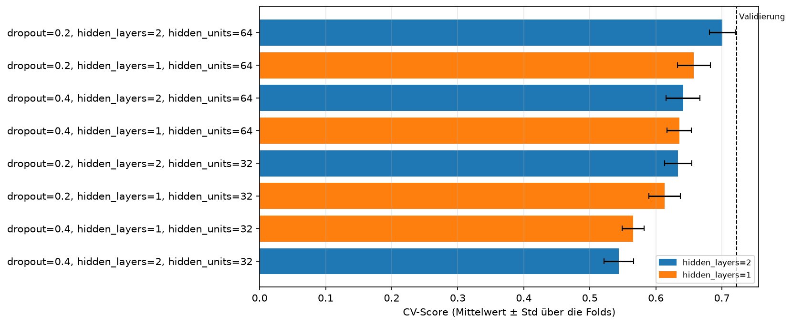
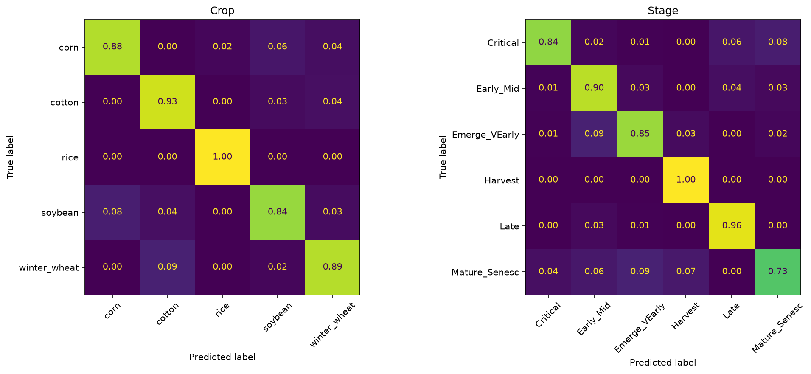
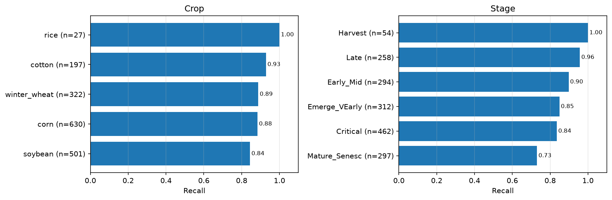
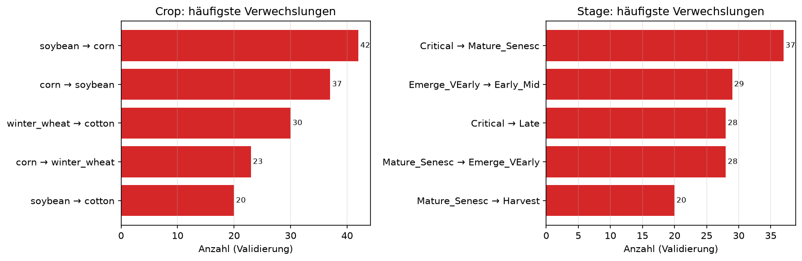
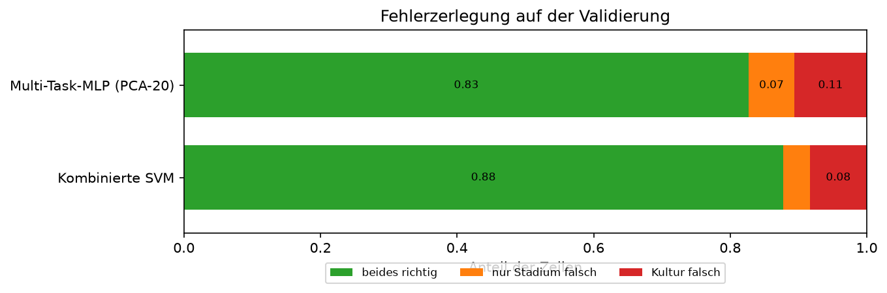
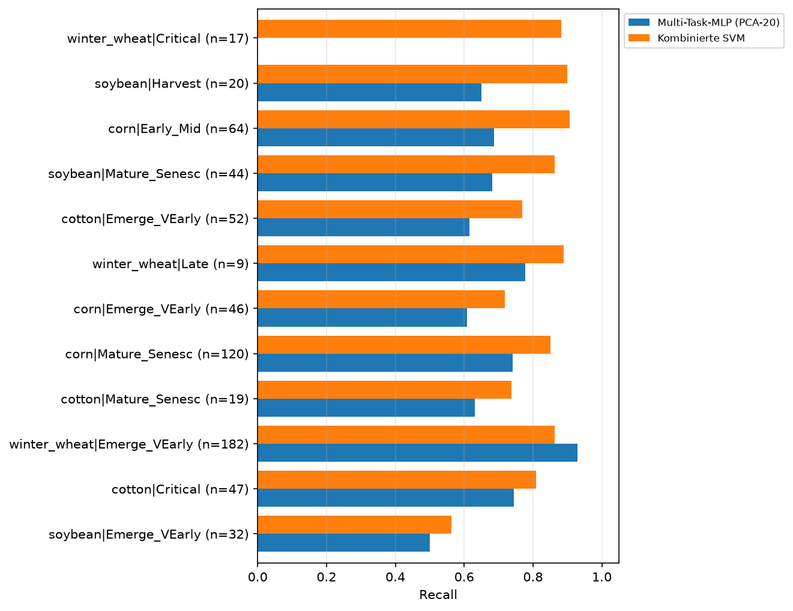
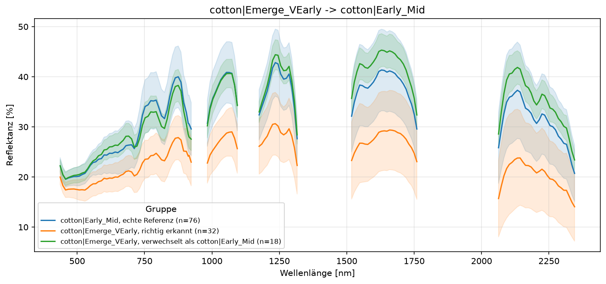
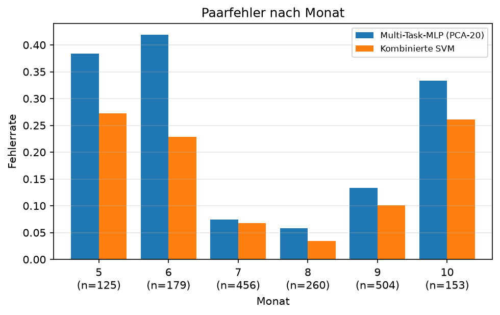

# Multi-Task

## Idee

Ein Modell lernt aus einem Spektrum eine gemeinsame Repräsentation und sagt daraus mit zwei
getrennten Ausgaben gleichzeitig `Crop` und `Stage` voraus. Anders als beim kombinierten Ansatz
bleiben Kultur und Stadium jeweils eigene Klassen; anders als beim getrennten Ansatz teilen die
beiden Aufgaben den größten Teil des Modells.

Als erster Kandidat wird ein tabellarisches Multi-Task-MLP entwickelt. Es erhält die
vorverarbeiteten Spektralbänder sowie AEZ und Month, lernt mehrere gemeinsame verdeckte Schichten
und verzweigt dann in einen Crop-Head mit fünf sowie einen Stage-Head mit sechs Klassen.

Die Hypothese lautet: Spektrale Muster, die für eine Kultur hilfreich sind, unterstützen auch die
Erkennung ihres Entwicklungsstadiums. Die gemeinsame Repräsentation kann deshalb mit den rund
3.900 Trainingszeilen besser generalisieren als zwei vollständig getrennte MLPs.

## Vor- und Nachteile

| Vorteil | Nachteil |
| --- | --- |
| Crop und Stage können voneinander über die gemeinsame Repräsentation profitieren. | Mehr Trainingsparameter und Hyperparameter als bei Baumverfahren oder SVM. |
| Jede Aufgabe behält ihre eigenen Klassen; seltene kombinierte Paare werden nicht zu einer eigenen 11-Beobachtungen-Klasse. | Die Paarbeschränkung kann nur Kombinationen aus dem jeweiligen Trainingsanteil ausgeben. |
| Die Gewichtung beider Aufgaben ist steuerbar und im Training sichtbar. | Der Nutzen geteilter Schichten muss bei der vorhandenen Datenmenge erst gezeigt werden. |
| Der Ansatz passt direkt zur Multi-Output-Bewertung für Crop und Stage. | Neuronale Netze benötigen Skalierung, Regularisierung und eine kleine, disziplinierte Suche. |

## Erster Arbeitsplan

Der erste Durchlauf prüft ausschließlich, ob geteilte Schichten bei tabellarischen Merkmalen
helfen. Label-Logik, Vorverarbeitung und Sequenzarchitektur bleiben dabei unverändert.

| Schritt | Frage | Umsetzung | Ergebnis für den nächsten Schritt |
| --- | --- | --- | --- |
| 1 | Ist ein Multi-Task-Modell mit der gemeinsamen Pipeline technisch möglich? | **Abgeschlossen:** `MultiTaskMLPClassifier` mit gemeinsamem MLP-Teil und je einem Crop- und Stage-Head in `src/awp2/models/`. `fit()` erhält beide Zielspalten, `predict()` gibt sie wieder zurück. | Unit-Tests bestätigen Zielvertrag, Pipeline-Integration, Klonbarkeit, die Validierung ungültiger Zielspalten und die Paarbeschränkung. |
| 2 | Hilft das Teilen von Schichten überhaupt? | Multi-Task-MLP gegen zwei getrennte MLPs mit derselben Vorverarbeitung und vergleichbarer Modellgröße vergleichen. Die Multi-Task-Startvariante nutzt gleiche Gewichtung für Crop- und Stage-Loss. | Nur die CV-BAcc kombiniert entscheidet, ob gemeinsames Lernen einen plausiblen Nutzen zeigt. |
| 3 | Welche kleine MLP-Konfiguration ist auf den Trainingsfolds am besten? | **Abgeschlossen:** Acht Kombinationen aus Breite/Tiefe und Dropout mit `tune()` vergleichen; die Lernrate bleibt fest. Klassenungleichgewicht in beiden Heads berücksichtigen. | Zwei Schichten mit 64 Einheiten und Dropout 0,2 gewinnen mit CV-BAcc kombiniert 0,701. |
| 4 | Generalisiert der beste CV-Kandidat? | **Abgeschlossen:** PCA-20 mit `weight_decay=0.0` auf den Trainingsfolds auswählen und einmal mit `run()` auf dem gemeinsamen Holdout bewerten. | BAcc Crop/Stage/kombiniert: 0,920 / 0,902 / 0,765; weiterhin unter der RBF-SVM-Referenz von 0,866. |
| 5 | Entstehen problematische Paarvorhersagen? | **Abgeschlossen:** Die Dekodierung auf im Trainingsanteil beobachtete Paare beschränken und PCA-20 erneut mit CV auswählen und einmal bewerten. | Keine ungültigen Vorhersagen; CV-BAcc kombiniert steigt von 0,722 auf 0,728. |

Der tabellarische Vergleich ist abgeschlossen. Als getrennte sequenzielle Erweiterung testet
/#136 nun einen Multi-Task-LSTM: Er prüft, ob die Reihenfolge der Wellenlängen gegenüber der
tabellarischen Darstellung hilft, ohne die bestehende MLP-Referenz oder deren Holdout-Ergebnis
nachträglich zu beeinflussen.

## Bewertung und Dokumentation

Die Hyperparameter-Suche erfolgt mit `tune()` auf den festen Trainingsfolds. Erst der nach
CV-BAcc kombiniert gewählte Kandidat wird einmalig mit `run()` auf dem Validierungsanteil
bewertet. Bewertet werden mindestens:

- BAcc für Crop, Stage und kombiniert,
- Macro-F1 für Crop, Stage und kombiniert,
- Samples-F1 und Anteil ungültiger Paare,
- Confusion Matrices sowie die häufigsten Verwechslungen je Ziel.

Der Tuning-Lauf und der Bewertungslauf werden in MLflow gespeichert. Danach folgen eine Zeile im
[Experiment-Log](../experimente.md), die Ergebnisse auf dieser Seite und die wichtigsten
Abbildungen in `docs/modelle/img/`.

## Klassifikatoren

### Tabellarisches Multi-Task-MLP

Notebook: `notebooks/10_duac1011_multi-task-mlp.ipynb`. Das Modell hat zwei gemeinsame
ReLU-Schichten und danach getrennte Crop- und Stage-Heads. Die Spektren werden standardisiert,
AEZ wird One-Hot-kodiert und Month zyklisch kodiert.

- Die Suche `multi_task_mlp_search` (MLflow `9272d3e0`) verglich acht Kombinationen aus einer
        oder zwei Schichten mit 32 oder 64 Einheiten und Dropout 0,2 oder 0,4. Zwei Schichten mit
        64 Einheiten und Dropout 0,2 gewinnen mit CV-BAcc kombiniert 0,701 ± 0,019.
- Der einmalige Validierungslauf `multi_task_mlp` (MLflow `7495ab54`) erreicht BAcc 0,909 für
        Crop, 0,879 für Stage und **0,722 kombiniert**. Macro-F1 beträgt 0,865 für Crop, 0,843 für
        Stage und 0,586 kombiniert; der Samples-F1 beträgt 0,867.
- Die PCA-20-Variante ohne L2-Regularisierung erreicht nach der Paarbeschränkung als einmaliger
        Validierungslauf `multi_task_mlp_pca20` (MLflow `578375ad`, Tuning `e32c87c0`) BAcc 0,920
        für Crop, 0,902 für Stage und **0,765 kombiniert**. Macro-F1 beträgt 0,882 für Crop,
        0,881 für Stage und 0,726 kombiniert; der Samples-F1 beträgt 0,888.
- Gegenüber dem Ausgangs-MLP steigt die kombinierte BAcc um 0,043 und das kombinierte Macro-F1
        um 0,140. Die kombinierte BAcc bleibt jedoch 0,102 unter der RBF-SVM-Referenz (0,866).
- Die Paarbeschränkung gibt ausschließlich im jeweiligen Trainingsanteil beobachtete Crop/Stage-
        Kombinationen aus; im PCA-Holdout entstehen keine ungültigen Paare.

### Multi-Task-LSTM mit spät fusioniertem Kontext (vor Evaluation)

Ein gemeinsamer LSTM kodiert die skalierte Spektralfolge; getrennte Crop- und Stage-Heads sehen
erst danach die spektrale Repräsentation mit optionalem Kontext. Die Paarbeschränkung wählt bei
der Vorhersage ausschließlich Kombinationen, die im jeweiligen Training beobachtet wurden.

- **Hypothese:** Ein gemeinsamer sequenzieller Encoder lernt spektrale Muster, die gleichzeitig
        Kultur und Stadium trennen; AEZ- und Monatsembeddings können dazu eine kompakte
        Kontextdarstellung liefern.
- **Kontrollen:** `none`, das bestehende One-Hot-/zyklische Encoding und lernbare
        AEZ-/Monatsembeddings unterscheiden sich nur in der späten Kontextfusion. Alle Varianten
        verwenden dieselbe standardisierte Spektralvorverarbeitung und den gleichen Suchraum.
- **Auswertung:** Für jede Variante wählt `tune()` ausschließlich anhand der CV-BAcc kombiniert
        den Kandidaten; `run()` bewertet diesen Gewinner einmal auf dem gemeinsamen Holdout.

#### CV-only: Regularisierung und Preprocessing

Die folgenden vier Läufe verwenden ausschließlich die Trainingsfolds und verändern keine
Holdout-Metrik oder Referenz.

- L2-Regularisierung erreicht mit `weight_decay=1e-5` CV-BAcc kombiniert 0,698 (MLflow
        `c9d28534`) und bleibt damit unter der ursprünglichen Suche (0,701). Sie wird nicht weiter
        verfolgt.
- Vegetationsindizes erreichen 0,703 (MLflow `5c0df446`), nur 0,002 über der ursprünglichen
        Suche. Der marginale Unterschied begründet keinen weiteren Lauf.
- Savitzky-Golay-Glättung mit Fenster 7 und Ordnung 2 erreicht 0,690 (MLflow `b2108fd`) und
        wird verworfen.
- PCA-20 auf standardisierten Spektren erreicht 0,720 (MLflow `c7b5f71`) und verbessert die
        ursprüngliche MLP-CV um 0,019. Mit Paarbeschränkung gewinnt anschließend
        `weight_decay=0.0` die Auswahl mit 0,728 (MLflow `e32c87c0`); nur diese Konfiguration wird
        auf dem Holdout bewertet.

## Fehleranalyse: PCA-20 gegen kombinierte SVM

Notebook: `notebooks/11_duac1011_multi-task-fehleranalyse.ipynb` (#32). Beide
Referenzmodelle werden mit ihren vorher per CV festgelegten Einstellungen neu trainiert und ohne
Tracking auf der gemeinsamen Validierung verglichen. Der Refit bestätigt den Abstand: das
Multi-Task-MLP erreicht BAcc Crop/Stage/kombiniert von 0,920 / 0,902 / **0,764**, die
kombinierte SVM 0,930 / 0,906 / **0,866**. Beide sagen ausschließlich gültige Crop/Stage-Paare
voraus; die Paarbeschränkung erklärt den Abstand daher nicht.

| | Multi-Task-MLP | Kombinierte SVM |
| --- | --- | --- |
| beides richtig | 0,827 | 0,877 |
| Kultur falsch | 0,106 | 0,084 |
| nur Stadium falsch | 0,067 | 0,039 |
| Stadium-BAcc bei richtiger Kultur | 0,940 | 0,957 |

- Das MLP verliert an **beiden** Teilaufgaben: 2,2 Prozentpunkte mehr Kulturfehler und 2,8
        Punkte mehr reine Stadiumfehler. Bei richtiger Kultur trennt es die Stadien ebenfalls
        schlechter; der Abstand ist also nicht bloß die Folge der Kulturentscheidung.
- Die kombinierte SVM trifft 139 vollständige Paare, die das MLP verfehlt, umgekehrt trifft das
        MLP nur 55 exklusiv ($p = 1{,}4\cdot10^{-9}$, exakter McNemar-Test). Der Test wird von
        häufigen Klassen bestimmt und bewertet nicht die Balanced Accuracy.

- Die BAcc-Lücke betrifft auch Klassen mit mittlerem Support: `corn|Early_Mid` erreicht 0,688
        statt 0,906 Recall (64 Zeilen), `corn|Mature_Senesc` 0,742 statt 0,850 (120). Seltene Paare
        verstärken sie: `winter_wheat|Critical` erreicht 0,000 statt 0,882 (17).
- Die häufigste einzelne Verwechslung ist `cotton|Emerge_VEarly` → `cotton|Early_Mid` (18).
        Die fehlklassifizierten Fälle stammen überwiegend aus Juni und haben mit NDVI 0,14 sowie
        mittlerer Reflektanz 33,99 % Werte näher an `cotton|Early_Mid` (0,17; 32,45 %) als an korrekt
        erkannter früher Baumwolle (0,12; 23,48 %). Das erklärt die Verwechslung als
        phänologischen Übergang, nicht als ungültige Kombination.

- Mai, Juni und Oktober bleiben in den Out-of-Fold-Vorhersagen des Trainingsteils deutlich
        fehleranfälliger (0,416 / 0,359 / 0,340) als Juli und August (0,096 / 0,072). Der Befund ist
        damit nicht nur ein Zufall des Validierungssplits und passt zu frühen, Übergangs- und
        Seneszenzspektren.
- Die kombinierte SVM lernt die 23 Paare direkt. Das MLP optimiert zwei gleich gewichtete Köpfe
        und kombiniert sie erst bei der Dekodierung; diese Zielfunktion begünstigt nicht zwingend die
        gemeinsame Paar-BAcc. Ein kontrollierter CV-Vergleich mit zwei getrennten MLPs bleibt nötig,
        bevor sich ein Nutzen der gemeinsamen Repräsentation behaupten lässt.

## Fazit

**In Arbeit.** PCA-20 verbessert den tabellarischen Multi-Task-MLP klar gegenüber dem
Ausgangsmodell, erreicht aber die kombinierte SVM-Referenz nicht. Der vorbereitete Multi-Task-
LSTM prüft getrennt davon die sequenzielle Repräsentation und drei Kontextformen; Ergebnisse
stehen noch aus.
