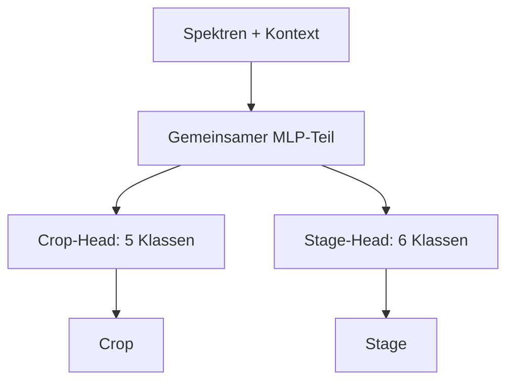

# Multi-Task

## Idee

Ein Modell lernt aus einem Spektrum eine gemeinsame Repräsentation und sagt daraus mit zwei
getrennten Ausgaben gleichzeitig `Crop` und `Stage` voraus. Anders als beim kombinierten Ansatz
bleiben Kultur und Stadium jeweils eigene Klassen; anders als beim getrennten Ansatz teilen die
beiden Aufgaben den größten Teil des Modells.

Als erster Kandidat wird ein tabellarisches Multi-Task-MLP entwickelt. Es erhält die
vorverarbeiteten Spektralbänder sowie AEZ und Month, lernt mehrere gemeinsame verdeckte Schichten
und verzweigt dann in einen Crop-Head mit fünf sowie einen Stage-Head mit sechs Klassen.

Die Hypothese lautet: Spektrale Muster, die für eine Kultur hilfreich sind, unterstützen auch die
Erkennung ihres Entwicklungsstadiums. Die gemeinsame Repräsentation kann deshalb mit den rund
3.900 Trainingszeilen besser generalisieren als zwei vollständig getrennte MLPs.

## Vor- und Nachteile

| Vorteil | Nachteil |
| --- | --- |
| Crop und Stage können voneinander über die gemeinsame Repräsentation profitieren. | Mehr Trainingsparameter und Hyperparameter als bei Baumverfahren oder SVM. |
| Jede Aufgabe behält ihre eigenen Klassen; seltene kombinierte Paare werden nicht zu einer eigenen 11-Beobachtungen-Klasse. | Zwei unabhängige Heads können nicht beobachtete Crop/Stage-Paare vorhersagen. |
| Die Gewichtung beider Aufgaben ist steuerbar und im Training sichtbar. | Der Nutzen geteilter Schichten muss bei der vorhandenen Datenmenge erst gezeigt werden. |
| Der Ansatz passt direkt zur Multi-Output-Bewertung für Crop und Stage. | Neuronale Netze benötigen Skalierung, Regularisierung und eine kleine, disziplinierte Suche. |

## Erster Arbeitsplan

Der erste Durchlauf prüft ausschließlich, ob geteilte Schichten bei tabellarischen Merkmalen
helfen. Label-Logik, Vorverarbeitung und Sequenzarchitektur bleiben dabei unverändert.

| Schritt | Frage | Umsetzung | Ergebnis für den nächsten Schritt |
| --- | --- | --- | --- |
| 1 | Ist ein Multi-Task-Modell mit der gemeinsamen Pipeline technisch möglich? | **Abgeschlossen:** `MultiTaskMLPClassifier` mit gemeinsamem MLP-Teil und je einem Crop- und Stage-Head in `src/awp2/models/`. `fit()` erhält beide Zielspalten, `predict()` gibt sie wieder zurück. | Unit-Tests bestätigen Zielvertrag, Pipeline-Integration, Klonbarkeit und die Validierung ungültiger Zielspalten. |
| 2 | Hilft das Teilen von Schichten überhaupt? | Multi-Task-MLP gegen zwei getrennte MLPs mit derselben Vorverarbeitung und vergleichbarer Modellgröße vergleichen. Die Multi-Task-Startvariante nutzt gleiche Gewichtung für Crop- und Stage-Loss. | Nur die CV-BAcc kombiniert entscheidet, ob gemeinsames Lernen einen plausiblen Nutzen zeigt. |
| 3 | Welche kleine MLP-Konfiguration ist auf den Trainingsfolds am besten? | **Abgeschlossen:** Acht Kombinationen aus Breite/Tiefe und Dropout mit `tune()` vergleichen; die Lernrate bleibt fest. Klassenungleichgewicht in beiden Heads berücksichtigen. | Zwei Schichten mit 64 Einheiten und Dropout 0,2 gewinnen mit CV-BAcc kombiniert 0,701. |
| 4 | Generalisiert der CV-Gewinner? | **Abgeschlossen:** Den CV-Gewinner einmal mit `run()` auf dem gemeinsamen Holdout bewerten. | BAcc Crop/Stage/kombiniert: 0,909 / 0,879 / 0,722; unter der RBF-SVM-Referenz von 0,866. |
| 5 | Entstehen problematische Paarvorhersagen? | **Abgeschlossen:** `invalid_combinations` des Holdout-Laufs auswerten. | 1,25 % der Vorhersagen sind im Trainingsanteil nicht beobachtete Paare; eine Paar-Beschränkung bleibt eine eigene Folgehypothese. |

LSTM, GRU und Transformer sind keine Varianten dieses ersten Vergleichs. Sie testen zusätzlich,
ob die Reihenfolge der Wellenlängen gegenüber der tabellarischen Darstellung hilft. Erst wenn das
Multi-Task-MLP als sauberer Ausgangspunkt dokumentiert ist, folgt ein Multi-Task-GRU als erste
sequenzielle Erweiterung; LSTM und Transformer bleiben davon getrennte Experimente.

## Bewertung und Dokumentation

Die Hyperparameter-Suche erfolgt mit `tune()` auf den festen Trainingsfolds. Erst der nach
CV-BAcc kombiniert gewählte Kandidat wird einmalig mit `run()` auf dem Validierungsanteil
bewertet. Bewertet werden mindestens:

- BAcc für Crop, Stage und kombiniert,
- Macro-F1 für Crop, Stage und kombiniert,
- Samples-F1 und Anteil ungültiger Paare,
- Confusion Matrices sowie die häufigsten Verwechslungen je Ziel.

Der Tuning-Lauf und der Bewertungslauf werden in MLflow gespeichert. Danach folgen eine Zeile im
[Experiment-Log](../experimente.md), die Ergebnisse auf dieser Seite und die wichtigsten
Abbildungen in `docs/modelle/img/`.

## Klassifikatoren

### Tabellarisches Multi-Task-MLP

Notebook: `notebooks/10_duac1011_multi-task-mlp.ipynb`. Das Modell hat zwei gemeinsame
ReLU-Schichten und danach getrennte Crop- und Stage-Heads. Die Spektren werden standardisiert,
AEZ wird One-Hot-kodiert und Month zyklisch kodiert.

- Die Suche `multi_task_mlp_search` (MLflow `9272d3e0`) verglich acht Kombinationen aus einer
        oder zwei Schichten mit 32 oder 64 Einheiten und Dropout 0,2 oder 0,4. Zwei Schichten mit
        64 Einheiten und Dropout 0,2 gewinnen mit CV-BAcc kombiniert 0,701 ± 0,019.
- Der einmalige Validierungslauf `multi_task_mlp` (MLflow `7495ab54`) erreicht BAcc 0,909 für
        Crop, 0,879 für Stage und **0,722 kombiniert**. Macro-F1 beträgt 0,865 für Crop, 0,843 für
        Stage und 0,586 kombiniert; der Samples-F1 beträgt 0,867.
- Die kombinierte BAcc bleibt 0,144 unter der RBF-SVM-Referenz (0,866). Der erste tabellarische
        Multi-Task-Kandidat ist damit keine konkurrenzfähige Referenz.
- 1,25 % der Vorhersagen bilden nicht im Trainingsanteil beobachtete Crop/Stage-Paare. Das
        Modell darf diese Paare in dieser ersten Variante noch erzeugen; eine Beschränkung wäre eine
        getrennt zu bewertende Dekodierungsvariante.
- Schwächste Klassen sind Soja mit Recall 0,84 und Mature_Senesc mit Recall 0,73. Am häufigsten
        verwechselt das Modell Soja → Mais (42) sowie Critical → Mature_Senesc (37); beide Muster
        entsprechen den bekannten, spektral ähnlichen Kultur- und Stadiumsgruppen.

#### CV-only: Regularisierung und Preprocessing

Die folgenden vier Läufe verwenden ausschließlich die Trainingsfolds und verändern keine
Holdout-Metrik oder Referenz.

- L2-Regularisierung erreicht mit `weight_decay=1e-5` CV-BAcc kombiniert 0,698 (MLflow
        `c9d28534`) und bleibt damit unter der ursprünglichen Suche (0,701). Sie wird nicht weiter
        verfolgt.
- Vegetationsindizes erreichen 0,703 (MLflow `5c0df446`), nur 0,002 über der ursprünglichen
        Suche. Der marginale Unterschied begründet keinen weiteren Lauf.
- Savitzky-Golay-Glättung mit Fenster 7 und Ordnung 2 erreicht 0,690 (MLflow `b2108fd`) und
        wird verworfen.
- PCA-20 auf standardisierten Spektren erreicht 0,720 (MLflow `c7b5f71`) und verbessert die
        ursprüngliche MLP-CV um 0,019. Diese Variante ist der einzige Kandidat aus dem Screening für
        eine später klar getrennte einmalige Holdout-Bewertung.

## Fazit

**In Arbeit.** Das tabellarische Multi-Task-MLP zeigt, dass die gemeinsame Repräsentation
technisch und evaluativ funktioniert, erreicht aber die kombinierte SVM-Referenz nicht. Ein
getrenntes MLP bleibt die notwendige Kontrollvariante, bevor der Nutzen geteilter Schichten
beurteilt werden kann.
