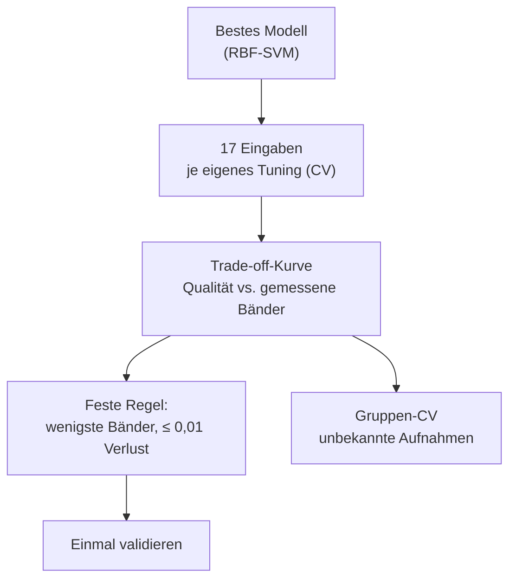
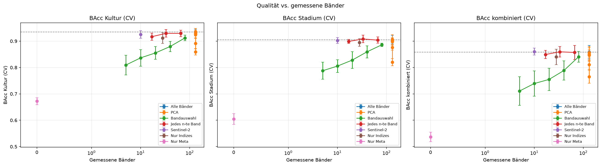
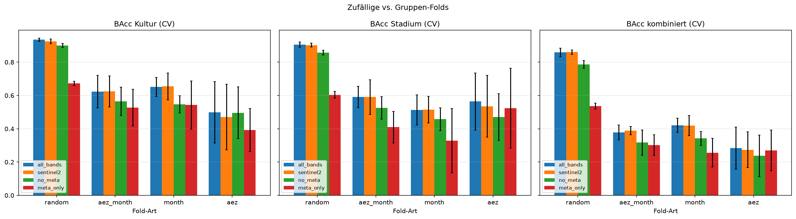

# Datenreduktion (Meilenstein 3)

Wie viel spektraler Input ist für Kultur und Stadium nötig? Ergebnis der Studie zu Meilenstein 3
(#155, #163, #170, #174, #193). Alle Zahlen: Balanced Accuracy (BAcc), 80/20-Split, CV auf dem
Trainingsteil, Validierung nur einmal pro Empfehlung.

## Kernaussagen

- **10 Sentinel-2-Bänder reichen.** Statt 131 Hyperion-Bändern verliert die kombinierte SVM auf
  der Validierung nur 0,008 BAcc kombiniert (0,857 gegenüber 0,866). Der hierarchische Ansatz
  verliert 0,006. Das sind **92 % weniger gemessene Bänder**.
- **Breite Abdeckung schlägt einzelne „beste“ Bänder.** Eine univariate Bandauswahl kommt mit
  10 Bändern nur auf 0,739 und selbst mit 80 Bändern auf 0,841, weil sie benachbarte, fast
  identische Bänder wählt. Sentinel-2 deckt VIS, Red Edge, NIR und beide SWIR-Bereiche ab.
- **PCA spart Merkmale, aber keine Messungen.** PCA-20 hält die Qualität, braucht aber alle
  131 Bänder als Eingabe.
- **AEZ und Monat sind unverzichtbar**, Vegetationsindizes, Albedo und PC_1/PC_2 bringen
  nichts zusätzlich.
- **Sequenzmodelle profitieren aktiv:** Ein GRU ist mit Sentinel-2 besser als mit allen
  Bändern (kürzere Sequenz).
- **Grenze:** Alle Werte gelten für bekannte Aufnahmen. Für neue Aufnahmen, Monate oder Regionen
  fällt jedes Modell auf 0,27–0,43 (siehe [Grenzen](#grenzen-unbekannte-aufnahmen)).

## Studiendesign

| Familie | Varianten | Gemessene Bänder |
| --- | --- | --- |
| Alle Bänder | Referenz | 131 |
| PCA | 2, 5, 10, 20, 40 Komponenten | 131 |
| Überwachte Bandauswahl (im Trainingsfold) | 5, 10, 20, 40, 80 Bänder | 5–80 |
| Jedes n-te Band | n = 2, 4, 8 | 66, 33, 17 |
| Sentinel-2-Simulation | 10 Oberflächenbänder (B2–B8A, B11, B12) | 10 |
| Nur Indizes / nur Meta | 29 Indizes + Meta / AEZ + Monat | 28 / 0 |

„Gemessene Bänder“ zählt, was ein Sensor liefern müsste – nicht, was das Modell sieht. Der Code
liegt in `awp2.reduction` und `awp2.preprocessing` (`PreprocessingConfig.spectral_sensor`,
`spectral_select_k`, `spectral_band_step`, `use_spectra`).

## Ergebnis: kombinierte Klasse

| Eingabe | Gemessene Bänder | CV kombiniert | Val. Kultur | Val. Stadium | Val. kombiniert |
| --- | --- | --- | --- | --- | --- |
| Alle Bänder | 131 | 0,859 | 0,920 | 0,913 | **0,866** |
| Sentinel-2 | 10 | 0,860 | 0,931 | 0,905 | 0,857 |
| Jedes 8. Band | 17 | 0,849 | – | – | – |
| Bandauswahl k=10 | 10 | 0,739 | – | – | – |

Einschränkung: Der Macro-F1 kombiniert fällt mit Sentinel-2 um 0,046 – mehr Fehlalarme in
Klassen mit 2–13 Validierungsbeispielen (z. B. `cotton|Harvest`). Details:
`notebooks/33_jd_datenreduktion.ipynb`.

## Ergebnis: hierarchisch

| Eingabe | Gemessene Bänder | CV kombiniert | Val. kombiniert | Val. bei richtiger Kultur |
| --- | --- | --- | --- | --- |
| Alle Bänder | 131 | 0,846 | **0,845** | 0,941 |
| Jedes 8. Band | 17 | 0,839 | 0,828 | 0,924 |
| Sentinel-2 | 10 | 0,834 | 0,839 | 0,928 |

- Die Reduktion trägt auch hierarchisch. Mit Sentinel-2 leidet das Stadium etwas mehr, die
  Kultur ist sogar besser.
- **Bandauswahl je Ebene** (jede Ebene wählt eigene Bänder, #162) lohnt sich nicht: Die
  Vereinigung der Bänder wächst schnell (52 bei k=10), die Qualität bleibt bei 0,685.
- Die Kulturfehler kosten rund 0,10 – die Kultur-Stufe ist der Engpass.

Details: `notebooks/36_jd_hierarchisch_reduktion.ipynb`.

## Fachliche Begründung der Bänder

Welche Region wählt eine Ebene, wenn sie nur 10 Bänder bekommt (Bandauswahl je Ebene, k=10)?

| Ebene | Gewählte Region | Deutung |
| --- | --- | --- |
| Kultur | Rot 600–691 nm | Chlorophyll-Absorption, Übergang zum Red Edge |
| Stadium Mais, Baumwolle | NIR 750–880 nm | Biomasse und Blattstruktur wachsen mit dem Stadium |
| Stadium Reis | Blau/Grün 437–508 nm | vermutlich das Wasser im überfluteten Feld |
| Stadium Soja, Winterweizen | SWIR2 2060–2350 nm | Trocknung, Lignin und Cellulose bei Reife und Ernte |

Jede Ebene braucht eine andere Region. Darum funktioniert eine breite Abdeckung (Sentinel-2,
jedes n-te Band) besser als wenige ausgewählte Nachbarbänder. Hintergrund zu den Regionen:
[Vegetation](../domaene/vegetation.md).

## Sequenzmodelle

| Modell | Eingabe | CV kombiniert | Val. kombiniert |
| --- | --- | --- | --- |
| RBF-SVM | alle Bänder | 0,859 | **0,866** |
| GRU + AEZ/Monat-Embeddings | Sentinel-2 | 0,794 | 0,832 |
| LSTM/GRU + Embeddings | alle Bänder (8 je Schritt) | 0,783 | – |
| hierarchisch: SVM → SVM | alle Bänder | 0,846 | 0,845 |
| hierarchisch: SVM → GRU | Sentinel-2 | 0,805 | 0,799 |
| hierarchisch: GRU → GRU | Sentinel-2 | 0,768 | – |

Die Netze sind mit 10 Sensorbändern besser als mit 131 Bändern: Kürzere Sequenzen sind mit rund
4.500 Trainingszeilen leichter zu lernen. Hierarchisch leiden die Stage-Netze zusätzlich unter
wenigen Zeilen je Kultur. Die SVM bleibt in beiden Ansätzen vorn. Details:
`notebooks/35_jd_sequenzmodelle.ipynb`, `notebooks/38_jd_hierarchisch_sequenzmodelle.ipynb`.

## Grenzen: unbekannte Aufnahmen

Zeilen derselben Zelle aus AEZ × Monat stammen sehr wahrscheinlich aus derselben Aufnahme.
Gruppen-Folds halten eine ganze Zelle (bzw. einen Monat oder eine Region) aus dem Training heraus.

| Fold-Art | Kombiniert | Kombiniert, Sentinel-2 | Hierarchisch | Hierarchisch, Sentinel-2 |
| --- | --- | --- | --- | --- |
| zufällig | **0,859** | **0,860** | 0,846 | 0,834 |
| neue Aufnahme | 0,378 | 0,389 | 0,420 | **0,426** |
| neuer Monat | 0,421 | 0,419 | 0,417 | **0,424** |
| neue Region | 0,284 | 0,274 | 0,269 | **0,294** |

- Für die Challenge gilt der zufällige Split: Die Testdaten liegen in denselben 32 Zellen wie
  das Training.
- Für neue Aufnahmen ist der hierarchische Ansatz robuster (eigenes Kultur-Modell), und
  Sentinel-2 ist dort gleichauf oder besser.
- Mehr Trainingsdaten (80/20 statt 70/30) helfen nur bei bekannten Aufnahmen.

Details: `notebooks/34_jd_gruppen_cv.ipynb`, `notebooks/37_jd_hierarchisch_gruppen_cv.ipynb`.

## Empfehlung

| Frage | Antwort |
| --- | --- |
| Minimaler Input ohne Qualitätsverlust | 10 Sentinel-2-Bänder + AEZ + Monat |
| Endmodell für die Abgabe | kombinierte RBF-SVM auf allen Bändern (höchste BAcc und Macro-F1) |
| Für neue Aufnahmen | hierarchische SVM mit Sentinel-2-Eingabe |
| Nicht empfohlen | univariate Bandauswahl, Bandauswahl je Ebene, PCA zur Datenreduktion |

Alle Läufe: [Experimente](experimente.md) und MLflow-Experimente `band-reduction`,
`split-leakage`.
