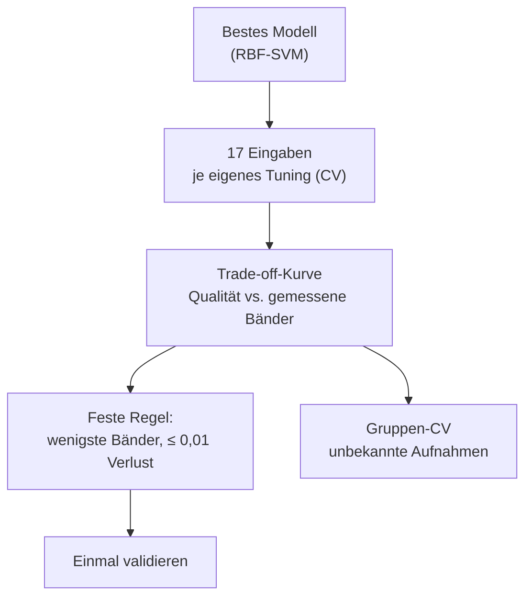
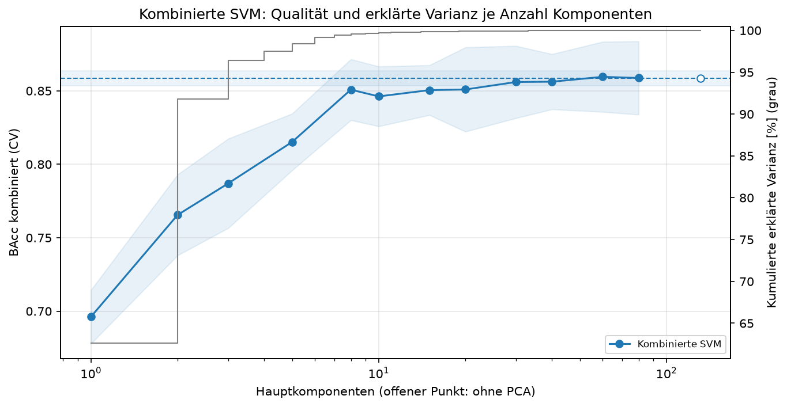
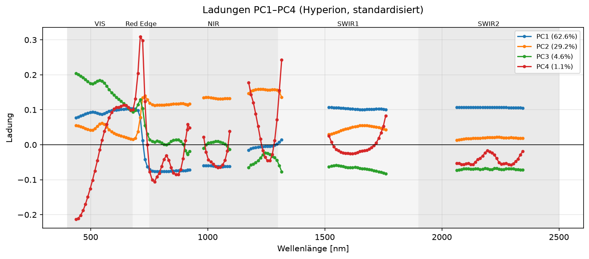
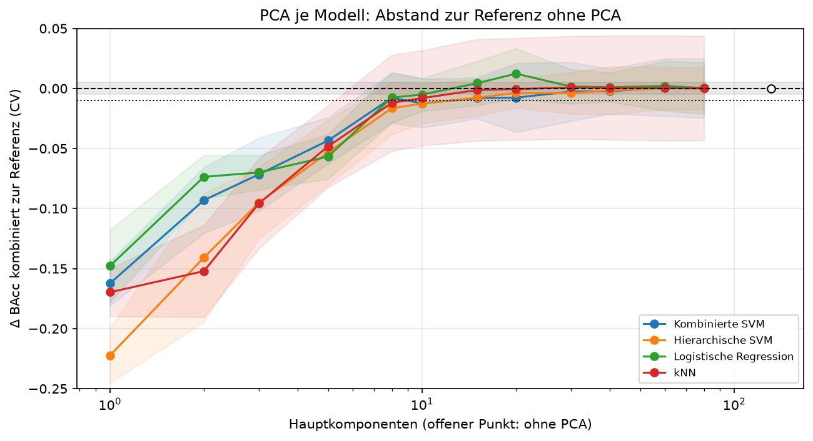

# Datenreduktion (Meilenstein 3)

Wie viel spektraler Input ist für Kultur und Stadium nötig? Ergebnis der Studie zu Meilenstein 3
(#155, #163, #170, #174, #193). Alle Zahlen: Balanced Accuracy (BAcc), 80/20-Split, CV auf dem
Trainingsteil, Validierung nur einmal pro Empfehlung.

## Kernaussagen

- **10 Bänder an Sentinel-2-Positionen reichen auf Hyperion-Daten.** Statt 131 Hyperion-Bändern
  verliert die kombinierte SVM auf der Validierung nur 0,008 BAcc kombiniert (0,857 gegenüber
  0,866). Der hierarchische Ansatz verliert 0,006. Das sind **92 % weniger gemessene Bänder**.
  Die Bänder sind aus Hyperion simuliert; die Übertragung auf echte Sentinel-2-Aufnahmen ist
  nicht geprüft (siehe [Einordnung](#was-die-sentinel-2-empfehlung-bedeutet-und-was-nicht)).
- **Breite Abdeckung schlägt einzelne „beste“ Bänder.** Eine univariate Bandauswahl kommt mit
  10 Bändern nur auf 0,739 und selbst mit 80 Bändern auf 0,841, weil sie benachbarte, fast
  identische Bänder wählt. Sentinel-2 deckt VIS, Red Edge, NIR und beide SWIR-Bereiche ab.
- **PCA lohnt sich nicht:** Ab 8 Komponenten hält sie die Qualität (−0,008), darunter fällt sie
  steil ab. Sie spart Merkmale (140 → 17), aber keine Messungen (weiter 131 Bänder), und die SVM
  wird kaum schneller (Faktor ≈ 1,3). Auch auf Sentinel-2 bringt sie nichts (siehe
  [Lohnt sich PCA?](#lohnt-sich-pca)).
- **AEZ und Monat sind unverzichtbar.** Albedo und PC_1/PC_2 bringen nichts zusätzlich.
- **Der Nutzen der Vegetationsindizes hängt vom Modell ab:** Der SVM bringen sie nichts, Bäumen
  und der logistischen Regression +0,015 bis +0,029 (siehe [Modellfamilien](#merkmalsnutzen-je-modellfamilie)).
- **Sequenzmodelle profitieren aktiv:** Ein GRU ist mit Sentinel-2 besser als mit allen
  Bändern (kürzere Sequenz).
- **Grenze:** Alle Werte gelten für bekannte Aufnahmen. Für neue Aufnahmen, Monate oder Regionen
  fällt jedes Modell auf 0,27–0,43 (siehe [Grenzen](#grenzen-unbekannte-aufnahmen)).

## Studiendesign

| Familie | Varianten | Gemessene Bänder |
| --- | --- | --- |
| Alle Bänder | Referenz | 131 |
| PCA | 2, 5, 10, 20, 40 Komponenten (Studie #213: 1–80) | 131 |
| Überwachte Bandauswahl (im Trainingsfold) | 5, 10, 20, 40, 80 Bänder | 5–80 |
| Jedes n-te Band | n = 2, 4, 8 | 66, 33, 17 |
| Sentinel-2-Simulation | 10 Oberflächenbänder (B2–B8A, B11, B12) | 10 |
| Nur Indizes / nur Meta | 29 Indizes + Meta / AEZ + Monat | 28 / 0 |

„Gemessene Bänder“ zählt, was ein Sensor liefern müsste – nicht, was das Modell sieht. Der Code
liegt in `awp2.reduction` und `awp2.preprocessing` (`PreprocessingConfig.spectral_sensor`,
`spectral_select_k`, `spectral_band_step`, `use_spectra`).

## Ergebnis: kombinierte Klasse

| Eingabe | Gemessene Bänder | CV kombiniert | Val. Kultur | Val. Stadium | Val. kombiniert |
| --- | --- | --- | --- | --- | --- |
| Alle Bänder | 131 | 0,859 | 0,920 | 0,913 | **0,866** |
| Sentinel-2 | 10 | 0,860 | 0,931 | 0,905 | 0,857 |
| Jedes 8. Band | 17 | 0,849 | – | – | – |
| Bandauswahl k=10 | 10 | 0,739 | – | – | – |

Einschränkung: Der Macro-F1 kombiniert fällt mit Sentinel-2 um 0,046 – mehr Fehlalarme in
Klassen mit 2–13 Validierungsbeispielen (z. B. `cotton|Harvest`). Details:
`notebooks/33_jd_datenreduktion.ipynb`.

## Ergebnis: hierarchisch

| Eingabe | Gemessene Bänder | CV kombiniert | Val. kombiniert | Val. bei richtiger Kultur |
| --- | --- | --- | --- | --- |
| Alle Bänder | 131 | 0,846 | **0,845** | 0,941 |
| Jedes 8. Band | 17 | 0,839 | 0,828 | 0,924 |
| Sentinel-2 | 10 | 0,834 | 0,839 | 0,928 |

- Die Reduktion trägt auch hierarchisch. Mit Sentinel-2 leidet das Stadium etwas mehr, die
  Kultur ist sogar besser.
- **Bandauswahl je Ebene** (jede Ebene wählt eigene Bänder, #162) lohnt sich nicht: Die
  Vereinigung der Bänder wächst schnell (52 bei k=10), die Qualität bleibt bei 0,685.
- Die Kulturfehler kosten rund 0,10 – die Kultur-Stufe ist der Engpass.

Details: `notebooks/36_jd_hierarchisch_reduktion.ipynb`.

## Fachliche Begründung der Bänder

Welche Region wählt eine Ebene, wenn sie nur 10 Bänder bekommt (Bandauswahl je Ebene, k=10)?

| Ebene | Gewählte Region | Deutung |
| --- | --- | --- |
| Kultur | Rot 600–691 nm | Chlorophyll-Absorption, Übergang zum Red Edge |
| Stadium Mais, Baumwolle | NIR 750–880 nm | Biomasse und Blattstruktur wachsen mit dem Stadium |
| Stadium Reis | Blau/Grün 437–508 nm | vermutlich das Wasser im überfluteten Feld |
| Stadium Soja, Winterweizen | SWIR2 2060–2350 nm | Trocknung, Lignin und Cellulose bei Reife und Ernte |

Jede Ebene braucht eine andere Region. Darum funktioniert eine breite Abdeckung (Sentinel-2,
jedes n-te Band) besser als wenige ausgewählte Nachbarbänder. Hintergrund zu den Regionen:
[Vegetation](../domaene/vegetation.md).

## Sequenzmodelle

| Modell | Eingabe | CV kombiniert | Val. kombiniert |
| --- | --- | --- | --- |
| RBF-SVM | alle Bänder | 0,859 | **0,866** |
| GRU + AEZ/Monat-Embeddings | Sentinel-2 | 0,794 | 0,832 |
| LSTM/GRU + Embeddings | alle Bänder (8 je Schritt) | 0,783 | – |
| hierarchisch: SVM → SVM | alle Bänder | 0,846 | 0,845 |
| hierarchisch: SVM → GRU | Sentinel-2 | 0,805 | 0,799 |
| hierarchisch: GRU → GRU | Sentinel-2 | 0,768 | – |

Die Netze sind mit 10 Sensorbändern besser als mit 131 Bändern: Kürzere Sequenzen sind mit rund
4.500 Trainingszeilen leichter zu lernen. Hierarchisch leiden die Stage-Netze zusätzlich unter
wenigen Zeilen je Kultur. Die SVM bleibt in beiden Ansätzen vorn. Details:
`notebooks/35_jd_sequenzmodelle.ipynb`, `notebooks/38_jd_hierarchisch_sequenzmodelle.ipynb`.

## Merkmalsnutzen je Modellfamilie

Ein Vegetationsindex ist meist ein Verhältnis zweier Bänder. Bäume prüfen pro Split nur ein
Merkmal, lineare Modelle können kein Verhältnis bilden – ihnen liefern Indizes genau das.

| Modell | alle Bänder | + Indizes | nur Indizes + Meta (28 Bänder) | Sentinel-2 (10 Bänder) |
| --- | --- | --- | --- | --- |
| Extra Trees | 0,811 | **0,827** | 0,808 | 0,814 |
| HistGradientBoosting | 0,792 | **0,820** | 0,791 | 0,780 |
| logistische Regression | 0,808 | **0,823** | 0,807 | 0,797 |
| RBF-SVM | **0,859** | 0,848 | 0,840 | **0,860** |

- Die verlustfreie Reduktion hängt vom Modell ab: Für die SVM reicht Sentinel-2, für Bäume und
  lineare Modelle reichen die Indizes.
- Die SVM bleibt mit Abstand das beste Modell.

Details: `notebooks/41_jd_indizes_modellfamilien.ipynb`.

## Lohnt sich PCA?

**Nein – nicht für die SVM und nicht für das Ziel von M3.** PCA braucht ab 8 Komponenten keine
merkliche Qualität mehr, spart aber weder Messungen noch nennenswert Rechenzeit. Studie mit
k = 1–80 Komponenten, je Variante eigenes Tuning, PCA im Trainingsfold gefittet (#213).

*Lesen:* blaue Punkte = CV-BAcc kombiniert je k (Band: ± Std über die Folds), gestrichelt =
alle 131 Bänder mit ± 0,005; graue Stufen = kumulierte erklärte Varianz (rechte Achse).

| Komponenten | 1 | 2 | 3 | 5 | **8** | 10 | 15 | 20 | 30 | 60 | ohne PCA |
| --- | --- | --- | --- | --- | --- | --- | --- | --- | --- | --- | --- |
| CV kombiniert | 0,696 | 0,766 | 0,787 | 0,815 | **0,851** | 0,846 | 0,850 | 0,851 | 0,856 | 0,860 | 0,859 |
| erklärte Varianz | 62,6 % | 91,8 % | 96,4 % | 98,4 % | 99,6 % | 99,7 % | 99,8 % | 99,9 % | 99,9 % | 100 % | 100 % |

- **Knie bei 8 Komponenten** (Regel: ≤ 0,01 Verlust). Die Kurve ist danach flach und verrauscht;
  innerhalb von ± 0,005 liegt PCA erst ab 30 Komponenten.
- **Varianz ist nicht Trennkraft:** 2 Komponenten erklären 91,8 % der Varianz, verlieren aber
  0,093. PC2 (29 % Varianz) trennt die Klassen schlechter als PC3, PC6 oder PC11 (< 0,1 %).
- **Gamma bleibt gleich** (0,003 bei fast jedem k): PCA ohne Whitening erhält die Abstände.

### Was steckt in den Komponenten?

| Komponente | Varianz | Deutung |
| --- | --- | --- |
| PC1 | 62,6 % | VIS und SWIR gegen NIR: Boden/trockene Pflanze gegen grüne Biomasse |
| PC2 | 29,2 % | Helligkeit, am stärksten im NIR-Plateau |
| PC3 | 4,6 % | sichtbar (Pigmente) gegen SWIR (Wasser, Lignin) |
| PC4 | 1,1 % | Red Edge (≈ 712–722 nm) und Flanken der Wasserbanden |

Die wichtigsten Einzelbänder der SVM (`X722` Red Edge, `X1316` am Rand einer Wasserbande,
[Feature Importance](feature-importance.md)) stecken erst in PC4. Die trennende Information liegt
in kleinen Komponenten – darum versagt PCA mit wenigen Komponenten.

### Praktischer Gewinn und Modellabhängigkeit

| Modell | ohne PCA | Knie | Merkmale | Zeit Fit + Predict je Fold |
| --- | --- | --- | --- | --- |
| Kombinierte SVM | 0,859 | k = 8: 0,851 | 140 → 17 | 0,37 → 0,28 s (≈ 1,3×) |
| Hierarchische SVM | 0,846 | k = 15: 0,839 | 140 → 24 | ≈ 1,3× |
| Logistische Regression | 0,808 | k = 8: 0,800; **k = 20: 0,820** | 140 → 29 | ≈ 19 → 1,6 s (≈ 12×) |
| kNN (1-NN) | 0,719 | k = 10: 0,711 | 140 → 19 | langsamer (≈ 0,5×) |
| Sentinel-2, SVM | 0,860 | k = 8: 0,859 | 19 → 17 | ≈ 1,0× |
| Sentinel-2, hierarchisch | 0,846 | k = 8: 0,846 | 19 → 17 | ≈ 1,0× |

- **Die Form ist bei allen Modellen gleich:** steiler Abfall bis 5 Komponenten, ab 8–15 im
  Rauschen. Gemessen werden immer alle Bänder (131 bzw. 10).
- **Nur die logistische Regression profitiert:** PCA-20 ist besser (+0,012) und rund 12-mal
  schneller, bleibt aber 0,04 unter der SVM. kNN gewinnt trotz Abstandsmodell nichts.
- **Sentinel-2 + PCA lohnt sich nicht:** 10 → 8 ohne Verlust, aber ohne Nutzen; 10 → 5 kostet
  0,024. Die Messersparnis kommt allein vom Sensor.
- **Keine Validierung:** Vorab festgelegt war, das Knie der kombinierten SVM nur zu validieren,
  wenn es ≥ 0,005 besser oder ≥ 2-mal schneller ist. Beides trifft nicht zu.
- Einschränkungen: Referenz ist die Vorverarbeitung aus #155 (CV 0,859), nicht AEZ × Monat
  (0,864); Zeiten aus einem Lauf ohne Wiederholung; alle k auf denselben Folds getunt.

Details: `notebooks/42_jd_pca_studie.ipynb`, MLflow-Läufe `pca_study_*` im Experiment
`band-reduction` (z. B. Referenz `057c5238`, Knie k = 8 `e689bdf6`).

## Grenzen: unbekannte Aufnahmen

Zeilen derselben Zelle aus AEZ × Monat stammen sehr wahrscheinlich aus derselben Aufnahme.
Gruppen-Folds halten eine ganze Zelle (bzw. einen Monat oder eine Region) aus dem Training heraus.

| Fold-Art | Kombiniert | Kombiniert, Sentinel-2 | Hierarchisch | Hierarchisch, Sentinel-2 |
| --- | --- | --- | --- | --- |
| zufällig | **0,859** | **0,860** | 0,846 | 0,834 |
| neue Aufnahme | 0,378 | 0,389 | 0,420 | **0,426** |
| neuer Monat | 0,421 | 0,419 | 0,417 | **0,424** |
| neue Region | 0,284 | 0,274 | 0,269 | **0,294** |

- Für die Challenge gilt der zufällige Split: Die Testdaten liegen in denselben 32 Zellen wie
  das Training.
- Für neue Aufnahmen ist der hierarchische Ansatz robuster (eigenes Kultur-Modell), und
  Sentinel-2 ist dort gleichauf oder besser.
- Mehr Trainingsdaten (80/20 statt 70/30) helfen nur bei bekannten Aufnahmen.

Details: `notebooks/34_jd_gruppen_cv.ipynb`, `notebooks/37_jd_hierarchisch_gruppen_cv.ipynb`.

## Was die Sentinel-2-Empfehlung bedeutet – und was nicht

Unsere „Sentinel-2“-Bänder sind **aus Hyperion simuliert**: Jedes Band ist das Rechteck-Mittel der
Hyperion-Bänder in seiner Bandbreite (`SimulateSensor`, `SENTINEL2_BANDS`). Echte
Sentinel-2-Aufnahmen unterscheiden sich davon in mehreren Punkten:

| Aspekt | Hyperion (unsere Daten) | Sentinel-2 MSI | Folge für die Aussage |
| --- | --- | --- | --- |
| Spektrale Antwort | 220 Kanäle à ~10 nm, 357–2576 nm[^usgs-hyp]; im Datensatz 131 Bänder in 427–925, 973–1104, 1165–1326, 1508–1770, 2052–2355 nm[^aneece] | 13 Bänder mit gemessener Empfindlichkeitskurve (SRF), Bandbreite 13–181 nm (B8 115–118 nm, B12 180–181 nm)[^srf] | Rechteck-Näherung (B8 106 nm, B12 175 nm) weicht von der SRF ab → K1 (#191). Alle SRF-Bereiche der 10 Bänder liegen in den behaltenen Hyperion-Fenstern; B5 und B6 enthalten aber nur je ein Hyperion-Band. |
| Räumliche Auflösung | 30 m (GSD 29,88 m)[^usgs-hyp][^pearlman]; je Feld ein zufälliges Pixel abseits des Randes[^aneece] | 10 m (B2–B4, B8), 20 m (B5–B7, B8A, B11, B12)[^s2] | Ein S2-Pixel sieht ein Neuntel der Fläche; Effekt auf Mischpixel und Feldheterogenität unbekannt |
| Signal-Rausch-Verhältnis | gemessen 144–161 (550–700 nm), 89 (1575 nm), **40 (2125 nm)**[^pearlman] | 72–174 je Band, B11 und B12 je **100**[^s2] | Referenzstrahlungen unterscheiden sich, Werte nur grob vergleichbar. Die Simulation erbt das Hyperion-Rauschen, mittelt es aber über mehrere Bänder (B12 ≈ 17 Bänder) → K2, K6 |
| Prozessierung | Radiometrie → Bodenreflektanz mit dem SMARTS-Modell (Sichtweite, Feuchte, Druck aus NOAA, GRIDMET, NLDAS-2), dann gleitendes Mittel über 3 Bänder[^aneece] | Level-2A-Bodenreflektanz mit Sen2Cor (Atmosphäre, Gelände, Zirren)[^s2] | Andere Atmosphärenkorrektur und keine Glättung → Verteilungsverschiebung |
| Zeitraum, Geometrie | Mission 2000–2017[^usgs-hyp], Datensatz 2008–2015[^aneece]; 7,7 km Streifen, Schwenk bis zum Nachbarpfad, echte Nadir-Aufnahmen < 1 %[^usgs-faq] | ab 2015 (S2A), 290 km Streifen, Sichtfeld 20,6°, Wiederholung 5 Tage mit zwei Satelliten[^s2] | Kaum zeitliche Überlappung → keine gelabelten Paare; das Modell müsste auf S2-Daten neu trainiert werden |

**Korrekte Formulierung:** Auf Hyperion-Daten genügen zehn breite Bänder an den
Sentinel-2-Positionen; die spektrale Information von Sentinel-2 reicht also aus. Ob ein auf
Hyperion trainiertes Modell direkt auf echte Sentinel-2-Aufnahmen übertragbar ist, haben wir nicht
geprüft – dafür wären echte S2-Aufnahmen mit Labels nötig.

- **Grenze aus der Gruppen-CV:** Schon für unbekannte Hyperion-Aufnahmen fällt jedes Modell auf
  0,27–0,43 (siehe [Grenzen](#grenzen-unbekannte-aufnahmen)). Ein anderer Sensor ist eine
  mindestens so große Verschiebung.
- **Nur Klassifikation:** Für die Biomasse-Schätzung zeigen Marshall & Thenkabail einen Vorteil
  der Hyperion-Schmalbänder gegenüber Breitband-Sensoren.[^marshall] Unser Ergebnis gilt nur für
  Kultur und Stadium.

### Kontrollexperimente

Sie trennen, **warum** die Sentinel-2-Bänder reichen: Lage, Breite oder bloße Abdeckung. Alle je
10 Bänder, CV auf dem Trainingsteil, kombinierte RBF-SVM, gamma je Variante neu gesucht.

| # | Variante | beantwortet | CV kombiniert |
| --- | --- | --- | --- |
| – | Referenz: alle Bänder / Sentinel-2 (Rechteck) | – | 0,859 / 0,860 |
| K1 | Sentinel-2 mit echter SRF (#191) | Hängt das Ergebnis an der Rechteck-Näherung? | folgt |
| K2 | Hyperion-10: nächstes Einzelband je S2-Bandmitte | Bringt das Mitteln etwas oder zählt nur die Lage? | folgt |
| K3 | 10 gleichmäßig verteilte Bänder | Reicht beliebige gleichmäßige Abdeckung? | folgt |
| K4 | 10 zufällige Bänder, 20 Ziehungen | Liegt Sentinel-2 klar über Zufall? | folgt |
| K5 | univariate Bandauswahl k = 10 | Ist datengetriebene Auswahl schlechter? | 0,739 |
| K6 | Sentinel-2, Bandmitten ±10 nm, Rauschen 0,5/1/2 % (nur Testfold) | Wie empfindlich gegen Sensorunterschiede? | folgt |
| K7 | optional: Landsat-8/9 OLI (7 Bänder, ohne Red Edge) | Wie viel bringt Red Edge? | folgt |

[^usgs-hyp]: U.S. Geological Survey (o. J.): USGS EROS Archive – EO-1 Hyperion, siehe [Quellen](../domaene/quellen.md).
[^aneece]: Aneece & Thenkabail (2018), Abschnitte 2.2.1–2.2.4, siehe [Quellen](../domaene/quellen.md).
[^srf]: ESA (2026): Sentinel-2 Spectral Response Functions, Version 5.0, Blatt „Bandwidth and mid-wavelength“, siehe [Quellen](../domaene/quellen.md).
[^pearlman]: Pearlman et al. (2001), Folien „Hyperion Specifications“ und „Hyperion Measured SNR“, siehe [Quellen](../domaene/quellen.md).
[^s2]: ESA (o. J.): SentiWiki – S2 Mission, siehe [Quellen](../domaene/quellen.md).
[^usgs-faq]: U.S. Geological Survey (o. J.): Earth Observing-1 General Questions and Answers, siehe [Quellen](../domaene/quellen.md).
[^marshall]: Marshall & Thenkabail (2015), siehe [Quellen](../domaene/quellen.md).

## Empfehlung

| Frage | Antwort |
| --- | --- |
| Minimaler Input ohne Qualitätsverlust | 10 Bänder an Sentinel-2-Positionen (aus Hyperion simuliert) + AEZ + Monat |
| Endmodell für die Abgabe | kombinierte RBF-SVM auf allen Bändern (höchste BAcc und Macro-F1) |
| Für neue Aufnahmen | hierarchische SVM mit Sentinel-2-Eingabe |
| Nicht empfohlen | univariate Bandauswahl, Bandauswahl je Ebene, PCA (auch auf Sentinel-2) |

Alle Läufe: [Experimente](experimente.md) und MLflow-Experimente `band-reduction`,
`split-leakage`.
