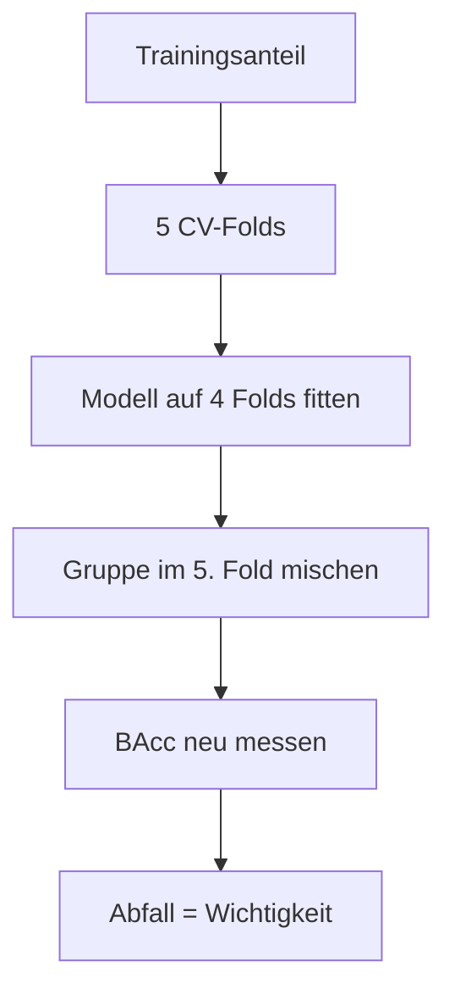

# Feature Importance & Erklärbarkeit

Welche Wellenlängen und Metadaten die Referenz-SVM für Kultur und Wachstumsstadium nutzt und ob
das zur Domäne passt (#34, Bonus der Aufgabenstellung). Notebook:
`notebooks/33_qmowo_feature-importance.ipynb`, Bausteine: `permutation_importance()`,
`feature_groups()` ([`awp2.explain`](../referenz/explain.md)), `plot_importance_spectrum()`,
`plot_importance_heatmap()` ([`awp2.plots`](../referenz/plots.md)).

!!! note "Validierung bleibt unberührt"
    Die Analyse nutzt nur den Trainingsanteil und dessen gemeinsame CV-Folds. Ihre Ergebnisse
    dürfen deshalb später für Merkmalsentscheidungen dienen, ohne die Validierung zu verbrauchen.
    Eine Bandauswahl nach dieser Rangliste muss trotzdem **innerhalb** der Folds laufen, sonst
    entsteht Leakage.

## Referenz und Methode

Referenz ist die kombinierte RBF-SVM `combined_svm_expanded` (`C=100`, `gamma=0.003`,
[Kombinierter Ansatz](ansaetze/kombiniert.md)) mit der Vorverarbeitung des Referenzlaufs:
CV-BAcc Kultur 0.925, Stadium 0.909, kombiniert 0.847. Nach der Vorverarbeitung hat das Modell 140
Merkmale: 131 Spektralbänder (67 leere Bänder sind entfernt), AEZ (7 One-Hot-Spalten) und Monat
(Sinus/Kosinus).

**Permutation Importance.** Das Modell wird je CV-Fold auf den vier Trainingsfolds gefittet. Im
fünften Fold werden die Werte einer Merkmalsgruppe zeilenweise vertauscht, das Modell sagt neu
voraus. Wichtigkeit ist der Abfall der Balanced Accuracy gegenüber der Vorhersage ohne Mischen.

- **Gruppen:** sieben Spektralregionen (Grenzen aus der [Domänen-Doku](../domaene/vegetation.md)),
  AEZ und Monat. AEZ-Spalten und Sinus/Kosinus werden immer gemeinsam gemischt. Zusätzlich wird
  jedes der 131 Bänder einzeln gemischt.
- **Wiederholungen:** Regionen 5 × 5 Folds, Einzelbänder 3 × 5 Folds. Angegeben sind Mittelwert
  und Standardabweichung.
- **Metriken:** BAcc für Kultur, Stadium und die Kombination sowie der Recall je Klasse – nie nur
  die einfache Accuracy.

**SHAP als zweite Methode.** KernelSHAP erklärt die `decision_function` der SVM für dieselben
neun Gruppen. Bei neun Gruppen reichen 2⁹ = 512 Koalitionen, die Shapley-Werte sind exakt. Die
Stichprobe sind höchstens 10 Zeilen je kombinierter Klasse (228 Zeilen), der Hintergrund sind zehn
Cluster-Zentren des Trainingsanteils.

**Integrated Gradients** braucht ein differenzierbares Modell. Die Referenz-SVM ist es nicht, die
neuronalen Modelle liegen deutlich darunter; ihre Erklärung würde nicht die Referenz erklären.

## 1. Regionen: NIR und Monat tragen das Modell

*Lesen:* Jede Gruppe hat drei Balken (Kultur, Stadium, kombiniert). Je höher, desto mehr Leistung
geht ohne die Gruppe verloren; die Fehlerbalken sind die Standardabweichung über 25 Mischungen.

| Gruppe | Merkmale | Abfall BAcc kombiniert | Kultur | Stadium | Ø Einzelband |
| --- | --- | --- | --- | --- | --- |
| NIR | 44 | **0.473** ± 0.031 | 0.427 | 0.417 | 0.009 |
| Monat | 2 | **0.439** ± 0.025 | 0.211 | 0.412 | – |
| SWIR 1 | 27 | 0.332 ± 0.031 | 0.277 | 0.253 | 0.006 |
| SWIR 2 | 29 | 0.322 ± 0.027 | 0.276 | 0.226 | 0.010 |
| Rot | 8 | 0.217 ± 0.028 | 0.232 | 0.122 | 0.007 |
| Red Edge | 7 | 0.207 ± 0.025 | 0.211 | 0.114 | 0.019 |
| Blau | 7 | 0.205 ± 0.031 | 0.133 | 0.122 | 0.017 |
| AEZ | 7 | 0.199 ± 0.024 | 0.204 | 0.149 | – |
| Grün | 9 | 0.166 ± 0.018 | 0.150 | 0.107 | 0.009 |

- NIR, Monat und die beiden SWIR-Regionen heben sich klar ab; die übrigen Gruppen liegen
  innerhalb der Standardabweichung dicht beieinander.
- **Kultur und Stadium nutzen verschiedene Information:** Für die Kultur zählen NIR und SWIR, für
  das Stadium NIR und der Monat (0.41). Der Monat liegt für die Kultur auf dem Niveau der meisten
  anderen Gruppen.
- **Der Monat ist ein Kontextmerkmal**, kein Spektralmerkmal. Ohne Metadaten sinkt die CV-BAcc von
  0.834 auf 0.742 (`combined_svm_no_meta`, [Experimente](experimente.md)). „Wichtige Wellenlänge“
  gilt daher zusätzlich zum Monat.
- Die Regionen sind unterschiedlich groß (NIR 44 Bänder, Red Edge 7). Ein Teil des Vorsprungs von
  NIR und SWIR kommt daher, dass dort mehr Bänder gleichzeitig zerstört werden.

## 2. Einzelbänder: stark redundant, nur die Red Edge sticht heraus

*Lesen:* Jeder Punkt ist ein Band, die Höhe der Abfall der BAcc, wenn nur dieses Band gemischt
wird. Das blaue Band ist ± 1 Standardabweichung. Unterbrechungen sind entfernte Bänder
(923–983, 1094–1175, 1316–1518 und 1760–2063 nm).

| Band | Region | Abfall BAcc kombiniert | Std |
| --- | --- | --- | --- |
| `X722` | Red Edge | 0.038 | 0.019 |
| `X1316` | SWIR 1 | 0.032 | 0.018 |
| `X437` | Blau | 0.032 | 0.023 |
| `X447` | Blau | 0.026 | 0.024 |
| `X732` | Red Edge | 0.024 | 0.011 |
| `X752` | NIR | 0.022 | 0.010 |
| `X2345` | SWIR 2 | 0.021 | 0.013 |
| `X712` | Red Edge | 0.021 | 0.008 |

- Der größte Einzelwert (0.04) liegt weit unter dem ganzer Regionen (bis 0.47): Nachbarbänder
  ersetzen sich gegenseitig, Einzelwerte **unterschätzen** daher die Wichtigkeit einer Region.
- Die Red Edge ist die **einzige zusammenhängende Spitze** (712, 722, 732, 742 nm, Maximum bei
  722 nm). Sie passt zum steilen Anstieg der Vegetationsreflexion, den die Red-Edge-Position
  beschreibt.
- Die blauen Bänder, `X1316` (am Rand eines entfernten Blocks) und `X2345` (Ende des Spektrums)
  haben eine Standardabweichung in der Größe des Mittelwertes. Sie können Randeffekte sein und
  werden fachlich nicht gedeutet.

## 3. Je Kultur und je Stadium: unterschiedliche Bereiche

*Lesen:* Zeilen sind die gemischten Gruppen, Spalten die Klassen. Die Zahl ist der Abfall des
Recalls dieser Klasse; das hellste Kästchen je Spalte zeigt die wichtigste Gruppe.

| Klasse | wichtigste Gruppen (Abfall Recall) |
| --- | --- |
| Mais | SWIR 2 (0.39), SWIR 1 (0.27), NIR (0.21) |
| Baumwolle | SWIR 2 (0.50), Monat (0.39), Rot (0.38) |
| Reis | NIR (0.78), SWIR 1 (0.41), AEZ (0.40) |
| Soja | NIR (0.38), Red Edge (0.29), Grün (0.26) |
| Winterweizen | NIR (0.46), SWIR 1 (0.41), AEZ (0.32) |
| `Emerge_VEarly` | NIR (0.52), SWIR 1 (0.43), Monat (0.38) |
| `Early_Mid` | Monat (0.44), SWIR 2 (0.35) |
| `Critical` | Monat (0.35), NIR (0.27) |
| `Late` | NIR (0.57), Monat (0.49) |
| `Mature_Senesc` | NIR (0.37), SWIR 2 (0.28), SWIR 1 (0.26) |
| `Harvest` | NIR (0.54), Monat (0.51) |

- Frühe Stadien brauchen NIR und SWIR 1 (lückiger Bestand, Boden und Pflanze gemischt), mittlere
  den Monat, späte NIR und Monat.
- Sichtbar und Red Edge spielen für die Stadien höchstens eine Nebenrolle (≤ 0.20). Die Hypothese
  der [Domänen-Doku](../domaene/vegetation.md), Chlorophyll trenne grünen Bestand von Seneszenz,
  wird damit nicht deutlich gestützt.
- Reis hat nur 93 Beobachtungen (rund 13 je Fold); seine Werte schwanken stärker.

## 4. SHAP bestätigt die Rangfolge

*Lesen:* Die Heatmaps zeigen den mittleren Betrag des SHAP-Werts je Gruppe und Klasse (Beitrag
zum Score, andere Skala als der Recall-Abfall); verglichen wird die Rangfolge. Im
Vergleichsdiagramm stehen je Gruppe zwei Balken, der Anteil an der Gesamtwichtigkeit nach
Permutation und nach SHAP. Ähnlich hohe Balken heißen, beide Methoden sehen die Gruppe gleich
wichtig.

- Die Rangfolge der neun Gruppen stimmt fast überein (Spearman 0.95). SHAP setzt Monat (0.24) und
  NIR (0.235) etwas höher als die Permutation (0.17 und 0.185).
- Je Klasse stimmen die Hauptbefunde überein, etwa Reis/NIR und `Late`/`Harvest` am NIR. Bei Mais
  liegt in der Permutation das SWIR 2 vorn, bei SHAP der Monat; SHAP misst den Beitrag zum Score,
  die Permutation den Verlust an Recall. Mit höchstens 10 Zeilen je Klasse sind die
  klassenweisen SHAP-Werte ungenauer als die gruppierten.

## 5. Einordnung mit Domäne und Index-Katalog

*Lesen:* Die Einzelband-Abbildung aus Abschnitt 2 mit grauen Linien bei den Wellenlängen der
Katalog-Indizes (#123). Eine Spitze ohne graue Linie wird von keinem Index genutzt.

| Region | Katalog-Indizes mit Band in der Region | Abfall BAcc kombiniert |
| --- | --- | --- |
| Blau | 3 | 0.205 |
| Grün | 10 | 0.166 |
| Rot | 7 | 0.217 |
| Red Edge | 16 | 0.207 |
| NIR | 23 | 0.473 |
| SWIR 1 | 5 | 0.332 |
| SWIR 2 | 0 | 0.322 |

- **Red Edge:** Die Spitze bei 712–742 nm entspricht der Red-Edge-Position. Kein Katalog-Index
  liegt auf 722 nm; die REIP-Merkmale beschreiben dagegen die Lage des Anstiegs.
- **NIR und Wasser:** Wichtige Bänder bei 1175–1255 nm liegen nahe den Wellenlängen von
  `NDWI_1070_1200` und `NDWI_860_1240`. Das ist ein Hinweis auf einen Wasserbezug, aber kein
  Beleg; er müsste mit Literatur gestützt werden.
- **SWIR 2 ohne Katalog-Index:** Die Region ist die drittwichtigste (für Mais und Baumwolle die
  wichtigste), hat aber keinen Index. Der naheliegende CAI (um 2100 nm) ist wegen des leeren
  Bandes `X2002` nicht direkt berechenbar. Ob eine angepasste Variante mit den Bändern 2063, 2123
  und 2184 nm hilft, ist eine offene, per CV prüfbare Hypothese.
- **Chlorophyll (Blau, Rot, Grün):** gering bis mittel (0.17–0.22), obwohl dort die meisten
  Indizes liegen. Die Indizes drücken die Information offenbar anders aus, als das Modell sie
  nutzt, oder NIR und SWIR tragen die Trennung.

## Grenzen

- **Korrelierte Bänder:** Einzelband-Permutation unterschätzt die Wichtigkeit, Regionen
  überschätzen sie teilweise über die Bandzahl. Beide Sichten gemeinsam lesen.
- **Außerhalb der Verteilung:** Gemischte Zeilen sind keine realistischen Spektren. Die Werte
  zeigen, was das Modell nutzt, keinen Kausalzusammenhang.
- **Metadaten:** Monat und AEZ gehören zur Referenz und sind stark gewichtet. Die spektrale
  Wichtigkeit ohne Metadaten wurde nicht untersucht.
- **Eine Referenz:** Die Aussagen gelten für die RBF-SVM; andere Modelle können andere Bereiche
  nutzen.
- **Kleine Klassen:** Reis und seltene Stadien schwanken stärker.

## Offen

- **Abgleich mit Bandauswahl (#126) und Bandreduktionsstudie (#33):** Bänder, die per CV
  entbehrlich sind, dürfen hier nicht als wichtig auftauchen. Die Red-Edge- und SWIR-2-Bänder
  sollten in der datengetriebenen Auswahl wiederzufinden sein.
- Wichtigkeit ohne Metadaten (`combined_svm_no_meta`) und für ein Modell mit Indizes (Gruppen
  „Spektrum“ gegen „Indizes“).
- Hypothese einer angepassten CAI-Variante für das SWIR 2 als eigenes Experiment
  ([Ansatz entwickeln](ansatz-entwickeln.md)).
