# Feature Importance & Erklärbarkeit

Welche Wellenlängen und Metadaten die Referenz-SVM für Kultur und Wachstumsstadium nutzt und ob
das zur Domäne passt (#34, Bonus der Aufgabenstellung). Notebooks:
`notebooks/09_analyse/02_duac1011_feature-importance.ipynb` (Permutation Importance und SHAP) und
`notebooks/09_analyse/03_duac1011_spektralgruppen.ipynb` (Gruppen einzeln, Abschnitt 6). Bausteine:
`permutation_importance()`, `feature_groups()` ([`awp2.explain`](../referenz/explain.md)),
`plot_importance_spectrum()`, `plot_importance_heatmap()` ([`awp2.plots`](../referenz/plots.md)).

!!! note "Validierung bleibt unberührt"
    Die Analyse nutzt nur den Trainingsanteil und dessen gemeinsame CV-Folds. Ihre Ergebnisse
    dürfen deshalb später für Merkmalsentscheidungen dienen, ohne die Validierung zu verbrauchen.
    Eine Bandauswahl nach dieser Rangliste muss trotzdem **innerhalb** der Folds laufen, sonst
    entsteht Leakage.

## Referenz und Methode

Referenz ist die kombinierte RBF-SVM `combined_svm_expanded` (`C=100`, `gamma=0.003`,
[Kombinierter Ansatz](ansaetze/kombiniert.md)) mit der Vorverarbeitung des Referenzlaufs:
CV-BAcc Kultur 0.925, Stadium 0.909, kombiniert 0.847. Nach der Vorverarbeitung hat das Modell 140
Merkmale: 131 Spektralbänder (67 leere Bänder sind entfernt), AEZ (7 One-Hot-Spalten) und Monat
(Sinus/Kosinus).

**Permutation Importance.** Das Modell wird je CV-Fold auf den vier Trainingsfolds gefittet. Im
fünften Fold werden die Werte einer Merkmalsgruppe zeilenweise vertauscht, das Modell sagt neu
voraus. Wichtigkeit ist der Abfall der Balanced Accuracy gegenüber der Vorhersage ohne Mischen.

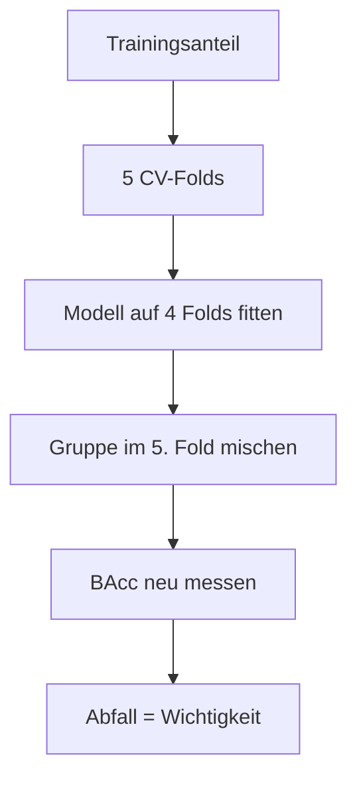

- **Gruppen:** sieben Spektralregionen (Grenzen aus der [Domänen-Doku](../domaene/vegetation.md)),
  AEZ und Monat. AEZ-Spalten und Sinus/Kosinus werden immer gemeinsam gemischt. Zusätzlich wird
  jedes der 131 Bänder einzeln gemischt.
- **Wiederholungen:** Regionen 5 × 5 Folds, Einzelbänder 3 × 5 Folds. Angegeben sind Mittelwert
  und Standardabweichung.
- **Metriken:** BAcc für Kultur, Stadium und die Kombination sowie der Recall je Klasse – nie nur
  die einfache Accuracy.

**SHAP als zweite Methode.** KernelSHAP erklärt die `decision_function` der SVM für dieselben
neun Gruppen. Bei neun Gruppen reichen 2⁹ = 512 Koalitionen, die Shapley-Werte sind exakt. Die
Stichprobe sind höchstens 10 Zeilen je kombinierter Klasse (228 Zeilen), der Hintergrund sind zehn
Cluster-Zentren des Trainingsanteils.

**Integrated Gradients** braucht ein differenzierbares Modell. Die Referenz-SVM ist es nicht, die
neuronalen Modelle liegen deutlich darunter; ihre Erklärung würde nicht die Referenz erklären.

## 1. Regionen: NIR und Monat tragen das Modell

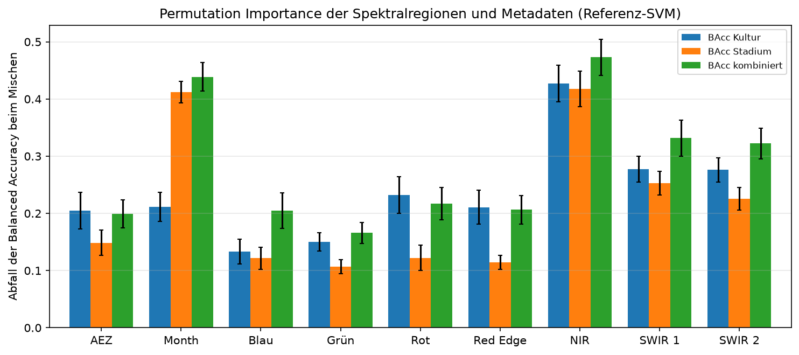

*Lesen:* Jede Gruppe hat drei Balken (Kultur, Stadium, kombiniert). Je höher, desto mehr Leistung
geht ohne die Gruppe verloren; die Fehlerbalken sind die Standardabweichung über 25 Mischungen.

| Gruppe | Merkmale | Abfall BAcc kombiniert | Kultur | Stadium | Ø Einzelband |
| --- | --- | --- | --- | --- | --- |
| NIR | 44 | **0.473** ± 0.031 | 0.427 | 0.417 | 0.009 |
| Monat | 2 | **0.439** ± 0.025 | 0.211 | 0.412 | – |
| SWIR 1 | 27 | 0.332 ± 0.031 | 0.277 | 0.253 | 0.006 |
| SWIR 2 | 29 | 0.322 ± 0.027 | 0.276 | 0.226 | 0.010 |
| Rot | 8 | 0.217 ± 0.028 | 0.232 | 0.122 | 0.007 |
| Red Edge | 7 | 0.207 ± 0.025 | 0.211 | 0.114 | 0.019 |
| Blau | 7 | 0.205 ± 0.031 | 0.133 | 0.122 | 0.017 |
| AEZ | 7 | 0.199 ± 0.024 | 0.204 | 0.149 | – |
| Grün | 9 | 0.166 ± 0.018 | 0.150 | 0.107 | 0.009 |

- NIR, Monat und die beiden SWIR-Regionen heben sich klar ab; die übrigen Gruppen liegen
  innerhalb der Standardabweichung dicht beieinander.
- **Kultur und Stadium nutzen verschiedene Information:** Für die Kultur zählen NIR und SWIR, für
  das Stadium NIR und der Monat (0.41). Der Monat liegt für die Kultur auf dem Niveau der meisten
  anderen Gruppen.
- **Der Monat ist ein Kontextmerkmal**, kein Spektralmerkmal. Ohne Metadaten sinkt die CV-BAcc von
  0.834 auf 0.742 (`combined_svm_no_meta`, [Experimente](experimente.md)). „Wichtige Wellenlänge“
  gilt daher zusätzlich zum Monat.
- Die Regionen sind unterschiedlich groß (NIR 44 Bänder, Red Edge 7). Ein Teil des Vorsprungs von
  SWIR 1 und SWIR 2 kommt daher, dass dort mehr Bänder gleichzeitig zerstört werden; Abschnitt 6.1
  vergleicht jede Region mit gleich großen Fenstern außerhalb von ihr. Pro Band ist die Red Edge
  dort wichtiger als fast alle Vergleichsfenster.

## 2. Einzelbänder: stark redundant, nur die Red Edge sticht heraus

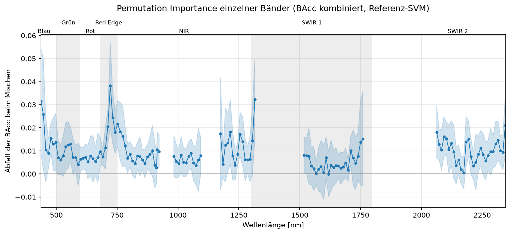

*Lesen:* Jeder Punkt ist ein Band, die Höhe der Abfall der BAcc, wenn nur dieses Band gemischt
wird. Das blaue Band ist ± 1 Standardabweichung. Unterbrechungen sind entfernte Bänder
(923–983, 1094–1175, 1316–1518 und 1760–2063 nm).

| Band | Region | Abfall BAcc kombiniert | Std |
| --- | --- | --- | --- |
| `X722` | Red Edge | 0.038 | 0.019 |
| `X1316` | SWIR 1 | 0.032 | 0.018 |
| `X437` | Blau | 0.032 | 0.023 |
| `X447` | Blau | 0.026 | 0.024 |
| `X732` | Red Edge | 0.024 | 0.011 |
| `X752` | NIR | 0.022 | 0.010 |
| `X2345` | SWIR 2 | 0.021 | 0.013 |
| `X712` | Red Edge | 0.021 | 0.008 |

- Der größte Einzelwert (0.04) liegt weit unter dem ganzer Regionen (bis 0.47): Nachbarbänder
  ersetzen sich gegenseitig, Einzelwerte **unterschätzen** daher die Wichtigkeit einer Region.
  Abschnitt 6.3 zeigt, wie stark: Im Modell nur mit der Region kostet ein Band das 8,5- bis 44-Fache.
- Die Red Edge ist die **einzige zusammenhängende Spitze** (712, 722, 732, 742 nm, Maximum bei
  722 nm). Sie passt zum steilen Anstieg der Vegetationsreflexion, den die Red-Edge-Position
  beschreibt.
- Die blauen Bänder, `X1316` (am Rand eines entfernten Blocks) und `X2345` (Ende des Spektrums)
  haben eine Standardabweichung in der Größe des Mittelwertes. Sie können Randeffekte sein und
  werden fachlich nicht gedeutet.

## 3. Je Kultur und je Stadium: unterschiedliche Bereiche

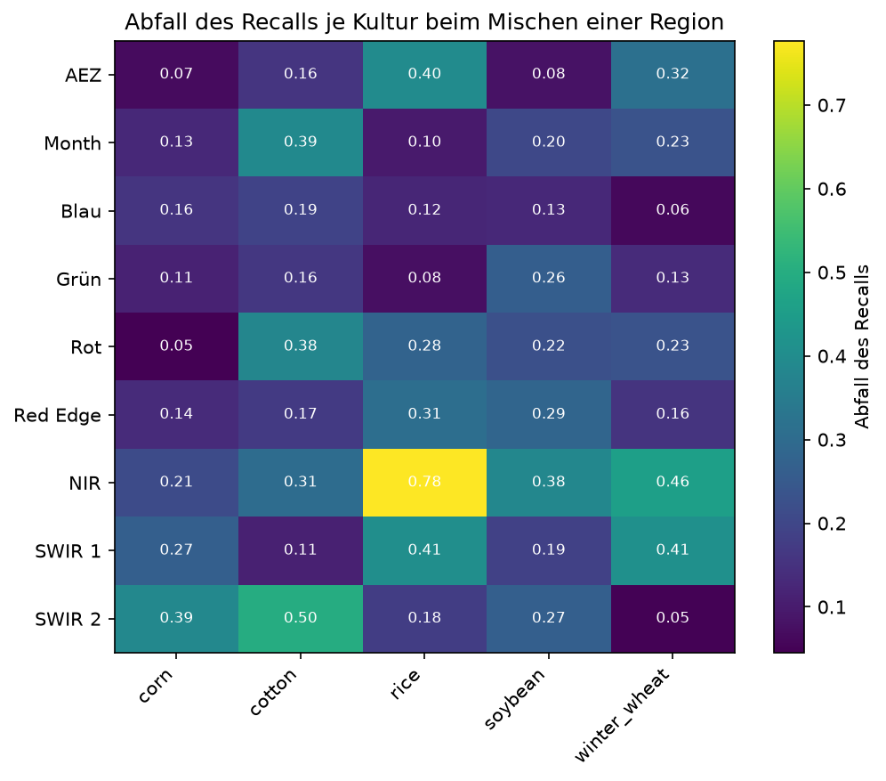

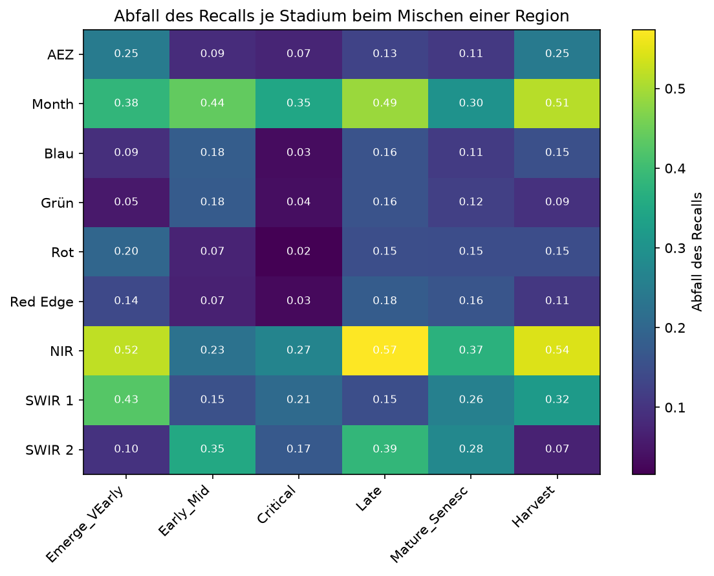

*Lesen:* Zeilen sind die gemischten Gruppen, Spalten die Klassen. Die Zahl ist der Abfall des
Recalls dieser Klasse; das hellste Kästchen je Spalte zeigt die wichtigste Gruppe.

| Klasse | wichtigste Gruppen (Abfall Recall) |
| --- | --- |
| Mais | SWIR 2 (0.39), SWIR 1 (0.27), NIR (0.21) |
| Baumwolle | SWIR 2 (0.50), Monat (0.39), Rot (0.38) |
| Reis | NIR (0.78), SWIR 1 (0.41), AEZ (0.40) |
| Soja | NIR (0.38), Red Edge (0.29), Grün (0.26) |
| Winterweizen | NIR (0.46), SWIR 1 (0.41), AEZ (0.32) |
| `Emerge_VEarly` | NIR (0.52), SWIR 1 (0.43), Monat (0.38) |
| `Early_Mid` | Monat (0.44), SWIR 2 (0.35) |
| `Critical` | Monat (0.35), NIR (0.27) |
| `Late` | NIR (0.57), Monat (0.49) |
| `Mature_Senesc` | NIR (0.37), SWIR 2 (0.28), SWIR 1 (0.26) |
| `Harvest` | NIR (0.54), Monat (0.51) |

- Frühe Stadien brauchen NIR und SWIR 1 (lückiger Bestand, Boden und Pflanze gemischt), mittlere
  den Monat, späte NIR und Monat.
- Sichtbar und Red Edge spielen für die Stadien höchstens eine Nebenrolle (≤ 0.20). Die Hypothese
  der [Domänen-Doku](../domaene/vegetation.md), Chlorophyll trenne grünen Bestand von Seneszenz,
  wird damit nicht deutlich gestützt.
- Reis hat nur 93 Beobachtungen (rund 13 je Fold); seine Werte schwanken stärker.

## 4. SHAP bestätigt die Rangfolge

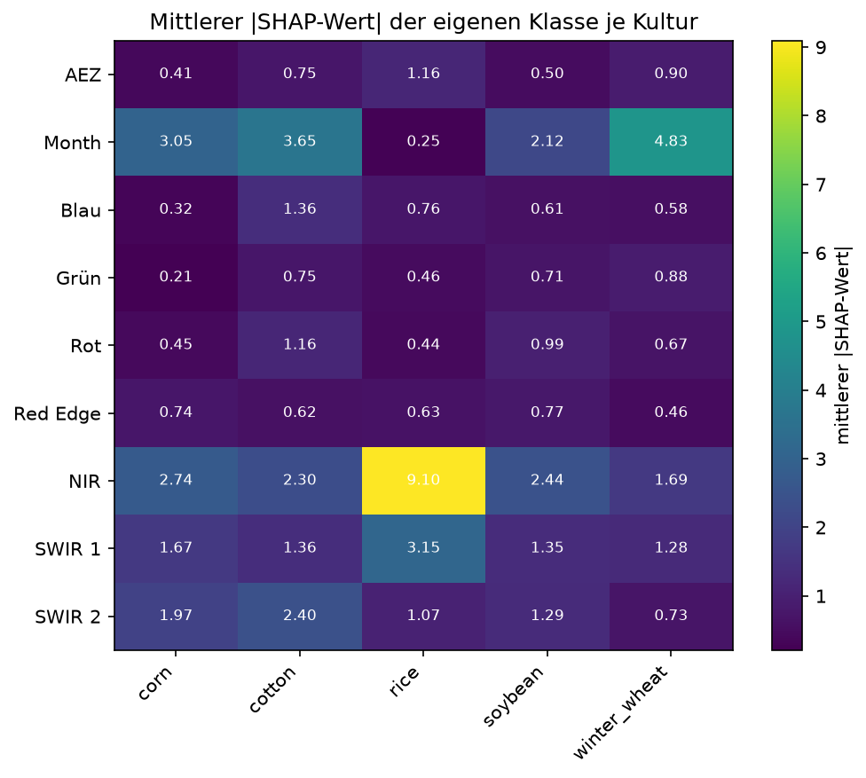

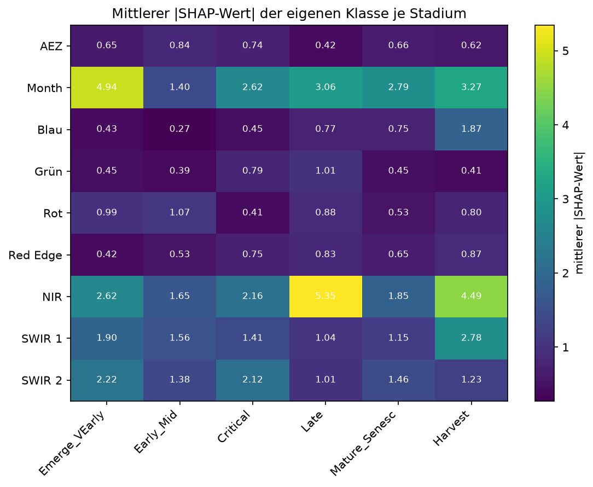

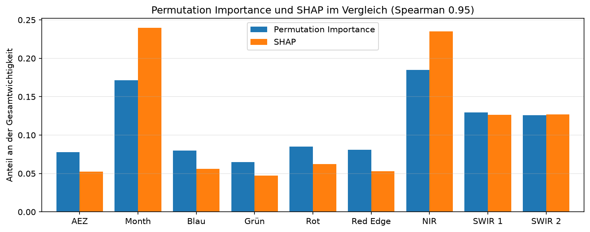

*Lesen:* Die Heatmaps zeigen den mittleren Betrag des SHAP-Werts je Gruppe und Klasse (Beitrag
zum Score, andere Skala als der Recall-Abfall); verglichen wird die Rangfolge. Im
Vergleichsdiagramm stehen je Gruppe zwei Balken, der Anteil an der Gesamtwichtigkeit nach
Permutation und nach SHAP. Ähnlich hohe Balken heißen, beide Methoden sehen die Gruppe gleich
wichtig.

- Die Rangfolge der neun Gruppen stimmt fast überein (Spearman 0.95). SHAP setzt Monat (0.24) und
  NIR (0.235) etwas höher als die Permutation (0.17 und 0.185).
- Je Klasse stimmen die Hauptbefunde überein, etwa Reis/NIR und `Late`/`Harvest` am NIR. Bei Mais
  liegt in der Permutation das SWIR 2 vorn, bei SHAP der Monat; SHAP misst den Beitrag zum Score,
  die Permutation den Verlust an Recall. Mit höchstens 10 Zeilen je Klasse sind die
  klassenweisen SHAP-Werte ungenauer als die gruppierten.

## 5. Einordnung mit Domäne und Index-Katalog

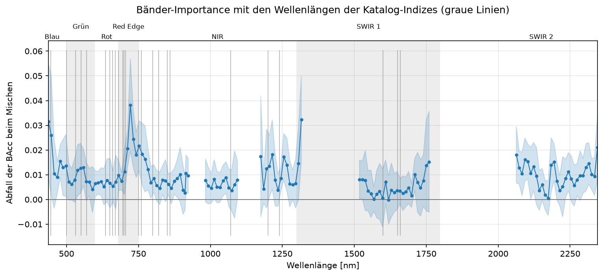

*Lesen:* Die Einzelband-Abbildung aus Abschnitt 2 mit grauen Linien bei den Wellenlängen der
Katalog-Indizes (#123). Eine Spitze ohne graue Linie wird von keinem Index genutzt.

| Region | Katalog-Indizes mit Band in der Region | Abfall BAcc kombiniert |
| --- | --- | --- |
| Blau | 3 | 0.205 |
| Grün | 10 | 0.166 |
| Rot | 7 | 0.217 |
| Red Edge | 16 | 0.207 |
| NIR | 23 | 0.473 |
| SWIR 1 | 5 | 0.332 |
| SWIR 2 | 0 | 0.322 |

- **Red Edge:** Die Spitze bei 712–742 nm entspricht der Red-Edge-Position. Kein Katalog-Index
  liegt auf 722 nm; die REIP-Merkmale beschreiben dagegen die Lage des Anstiegs.
- **NIR und Wasser:** Wichtige Bänder bei 1175–1255 nm liegen nahe den Wellenlängen von
  `NDWI_1070_1200` und `NDWI_860_1240`. Das ist ein Hinweis auf einen Wasserbezug, aber kein
  Beleg; er müsste mit Literatur gestützt werden.
- **SWIR 2 ohne Katalog-Index:** Die Region ist die drittwichtigste (für Mais und Baumwolle die
  wichtigste), hat aber keinen Index. Der naheliegende CAI (um 2100 nm) ist wegen des leeren
  Bandes `X2002` nicht direkt berechenbar. Ob eine angepasste Variante mit den Bändern 2063, 2123
  und 2184 nm hilft, ist eine offene, per CV prüfbare Hypothese.
- **Chlorophyll (Blau, Rot, Grün):** gering bis mittel (0.17–0.22), obwohl dort die meisten
  Indizes liegen. Die Indizes drücken die Information offenbar anders aus, als das Modell sie
  nutzt, oder NIR und SWIR tragen die Trennung.

## 6. Gruppen einzeln betrachtet: Redundanz und Größe trennen

**Anlass (Feedback):** Die Abschnitte 1–5 mischen jede Gruppe im Modell, das alle 140 Merkmale
kennt. Dort fällt die Red Edge (7 Bänder) kaum auf, obwohl sie fachlich wichtig ist. Zwei Effekte
verzerren das Bild: **Redundanz** (andere Regionen ersetzen die gemischte) und **Größe** (NIR 44
Bänder, Red Edge 7). Deshalb kommen drei Sichten dazu. Notebook:
`notebooks/09_analyse/03_duac1011_spektralgruppen.ipynb`, Bausteine: `size_matched_windows()`
([`awp2.explain`](../referenz/explain.md)), `run_group_study()`
([`awp2.group_study`](../referenz/group_study.md)), `PreprocessingConfig(spectral_regions=...)`.

| Sicht | Frage | Umsetzung |
| --- | --- | --- |
| Zufallsfenster | Ist die Region wichtiger als gleich große Fenster außerhalb von ihr? | bis zu 40 Fenster aus benachbarten Bändern, die die Region nicht berühren; Permutation im Gesamtmodell |
| Neu trainieren | Was leistet die Region allein, was fehlt ohne sie? | je Variante eigene Suche (`C` × `gamma`, 21 Kandidaten), CV, Fold-Differenzen gepaart |
| Innerhalb der Region | Welche Bänder zählen, wenn keine andere Region einspringt? | Modell nur mit der Region, jedes Band einzeln mischen |

Alles läuft auf den CV-Folds des Trainingsanteils, die Validierung bleibt unberührt. Die Suchen
stehen im MLflow-Experiment `spectral-groups` (24 Läufe, siehe [Experimente](experimente.md)).
Jede Variante bekommt eine eigene Suche, weil ein Modell mit sieben Bändern eine andere
Kernelbreite braucht als eines mit 131. Die Referenz erreicht dabei CV-BAcc kombiniert **0.860**
(Kultur 0.930, Stadium 0.908); der Wert 0.847 oben stammt vom früheren Referenzlauf.

### 6.1 Region gegen Zufallsfenster

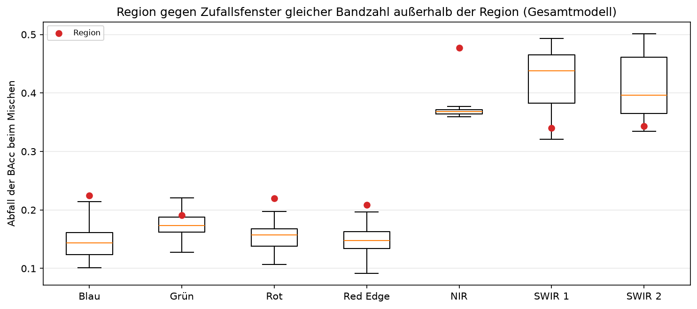

*Lesen:* Der Kasten zeigt, wie stark die BAcc sinkt, wenn ein zufälliges Fenster aus gleich vielen
benachbarten Bändern außerhalb der Region gemischt wird; der rote Punkt ist die Region. Die
Fenster dürfen die Region nicht berühren, sonst würde sie mit sich selbst verglichen.

| Region | Bänder | Fenster | Abfall Region | Median Fenster | 95 % Fenster | Fenster unter Region |
| --- | --- | --- | --- | --- | --- | --- |
| Blau | 7 | 40 | 0.225 | 0.144 | 0.215 | 97.5 % |
| Grün | 9 | 40 | 0.191 | 0.173 | 0.258 | 80 % |
| Rot | 8 | 40 | 0.220 | 0.157 | 0.231 | 92.5 % |
| **Red Edge** | 7 | 40 | 0.209 | 0.147 | 0.192 | **97.5 %** |
| NIR | 44 | 13 | 0.478 | 0.368 | 0.382 | 100 % |
| SWIR 1 | 27 | 40 | 0.340 | 0.438 | 0.478 | 10 % |
| SWIR 2 | 29 | 40 | 0.343 | 0.396 | 0.492 | 2.5 % |

- **Die Red Edge ist pro Band wichtiger als ein typisches Fenster:** 0.209 gegenüber einem Median
  von 0.147 für Fenster aus 7 benachbarten Bändern außerhalb; 39 von 40 Fenstern liegen darunter.
  Absolut bleibt ihr Abfall klein (NIR 0.478), weil sie nur 7 Bänder hat.
- **Nicht einzigartig:** Blau (97.5 %) und Rot (92.5 %) zeigen dasselbe Muster, Grün (80 %) nicht.
  Die Vergleichsfenster liegen überwiegend im NIR und SWIR, wo viele Nachbarbänder einander
  ersetzen. Gezeigt ist, dass Bänder im Sichtbaren und in der Red Edge weniger ersetzbar sind.
- **NIR:** Außerhalb des NIR gibt es nur 13 Fenster gleicher Größe (alle im SWIR); sie sind alle
  weniger wichtig. Das zeigt NIR > SWIR, aber keinen Größeneffekt.
- **SWIR 1 und SWIR 2** liegen unter dem Median gleich großer Fenster außerhalb (0.438 und
  0.396), die NIR-Bänder enthalten. Ihr hoher Wert in Abschnitt 1 ist im Wesentlichen ein
  Größeneffekt.
- Verstreute Zufallsgruppen aus 7 Bändern außerhalb der Red Edge kosten nur 0.073 (Maximum 0.145):
  Zusammenhängende Fenster zerstören mehr, weil die Nachbarn fehlen.
- Die Fenster streuen stark (bei 7 Bändern 0.09–0.23) und überlappen einander; die Sicht trennt
  nur grob.

### 6.2 Neu trainiert: allein und ohne Region

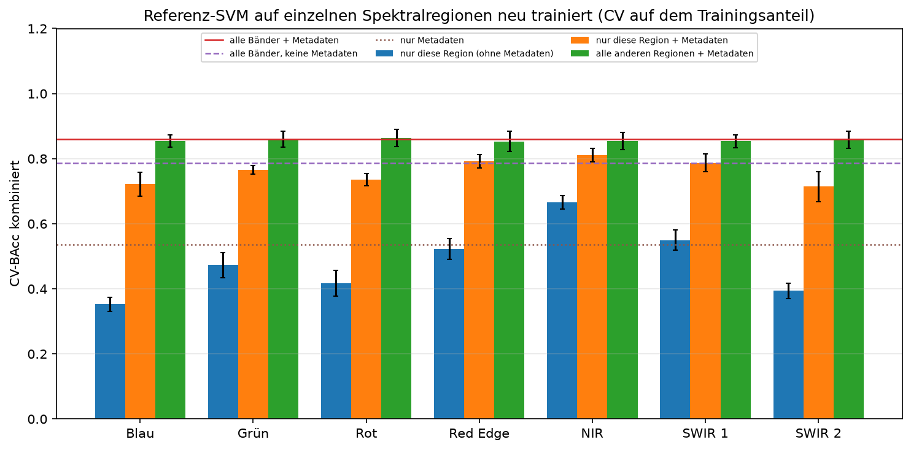

*Lesen:* Je Region drei Balken (CV-BAcc kombiniert, Fehlerbalken = Standardabweichung über die
Folds). Die Linien sind die Referenzen: alle Bänder mit Metadaten (0.860 ± 0.027), ohne
Metadaten (0.786) und nur Metadaten (0.536).

| Region | Bänder | nur Region (ohne Meta) | nur Region + Meta | ohne Region | Gewinn über Meta | je Band |
| --- | --- | --- | --- | --- | --- | --- |
| Blau | 7 | 0.352 | 0.722 | 0.854 | 0.186 | 0.027 |
| Grün | 9 | 0.473 | 0.766 | 0.860 | 0.229 | 0.025 |
| Rot | 8 | 0.417 | 0.735 | 0.864 | 0.199 | 0.025 |
| **Red Edge** | 7 | 0.522 | 0.792 | 0.853 | 0.256 | **0.037** |
| NIR | 44 | **0.666** | **0.811** | 0.855 | 0.274 | 0.006 |
| SWIR 1 | 27 | 0.550 | 0.787 | 0.853 | 0.251 | 0.009 |
| SWIR 2 | 29 | 0.394 | 0.714 | 0.858 | 0.178 | 0.006 |

- **Keine Region ist allein unverzichtbar:** Ohne eine Region liegt die BAcc 0.007 unter bis
  0.003 über der Referenz (Standardabweichung der Fold-Differenzen 0.006–0.018). Bei NIR und
  SWIR 1 ist das Modell ohne die Region in 4 von 5 Folds schlechter, aber nur um 0.005–0.007.
- **Mit Metadaten erreicht die Red Edge mit 7 Bändern 0.792.** Gegenüber SWIR 1 (27 Bänder, 0.787)
  ist sie gleichauf (+0.005, in 2 von 5 Folds besser). Das NIR (44 Bänder, 0.811) ist in allen
  5 Folds besser, aber nur um 0.018. Vor Blau, Rot, Grün und SWIR 2 liegt die Red Edge in
  **allen 5 Folds** (+0.027 bis +0.078). Für das Stadium ist sie (0.846) gleichauf mit SWIR 1
  (0.845), das NIR liegt bei 0.872.
- **Ohne Metadaten ist das NIR klar vorn** (0.666; Red Edge 0.522, −0.144, in keinem Fold besser).
  Die Red Edge liegt in allen 5 Folds vor Blau, Rot, Grün und SWIR 2; gegenüber SWIR 1 (0.550) ist
  sie leicht unterlegen (−0.027, in 1 von 5 Folds besser). Allein erreicht sie kaum mehr als die
  reinen Metadaten (0.536).
- **Gewinn über die Metadaten allein:** bei jeder Region in allen 5 Folds positiv, 0.178 (SWIR 2)
  bis 0.274 (NIR).
- **Das stützt das Feedback:** Mit nur 7 Bändern trägt die Red Edge fast so viel wie die
  6-mal größere NIR-Region, fällt im Gesamtmodell aber nicht auf, weil NIR und SWIR sie ersetzen
  können.
- **Sie ist nicht einzigartig:** Auch Grün (0.766), Rot (0.735) und Blau (0.722) bringen mit
  wenigen Bändern viel über die Metadaten hinaus; die Red Edge liegt unter ihnen vorn.
- **„Je Band“ nicht als Rangfolge lesen:** Der Gewinn wächst mit der Bandzahl nicht linear
  (Sättigung), das begünstigt kleine Regionen. Die Spalte zeigt, wie redundant NIR und SWIR
  innerhalb sind.

Fold-Differenzen (gepaart, Zahl der Folds, in denen die erste Variante besser ist):

| Vergleich | mit Metadaten | ohne Metadaten |
| --- | --- | --- |
| Red Edge − Blau | +0.070 (5/5) | +0.170 (5/5) |
| Red Edge − Grün | +0.027 (5/5) | +0.049 (5/5) |
| Red Edge − Rot | +0.057 (5/5) | +0.105 (5/5) |
| Red Edge − NIR | −0.018 (0/5) | −0.144 (0/5) |
| Red Edge − SWIR 1 | +0.005 (2/5) | −0.027 (1/5) |
| Red Edge − SWIR 2 | +0.078 (5/5) | +0.128 (5/5) |

Bei fünf Folds ist das ein Hinweis, kein Test: Die Folds teilen Trainingszeilen, die Differenzen
sind nicht unabhängig.

### 6.3 Innerhalb einer Region

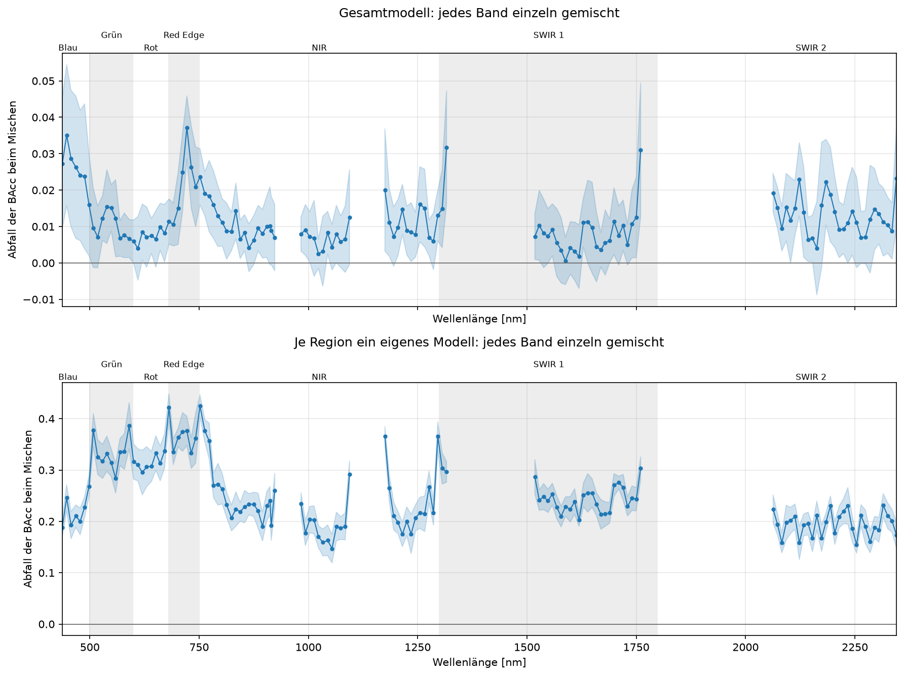

*Lesen:* Oben die Einzelband-Permutation im Gesamtmodell (wie Abschnitt 2), unten die Werte aus
sieben getrennten Modellen, die jeweils nur eine Region ohne Metadaten sehen.

| Region | Ø Band im Gesamtmodell | Ø Band im Regionsmodell | Faktor | Min.–Max. Band im Regionsmodell |
| --- | --- | --- | --- | --- |
| Blau | 0.026 | 0.219 | 8.5 | 0.188–0.268 |
| Grün | 0.010 | 0.334 | 32 | 0.284–0.386 |
| Rot | 0.007 | 0.315 | 44 | 0.295–0.337 |
| Red Edge | 0.021 | 0.366 | 18 | 0.333–0.422 |
| NIR | 0.010 | 0.233 | 23 | 0.147–0.425 |
| SWIR 1 | 0.009 | 0.247 | 27 | 0.203–0.304 |
| SWIR 2 | 0.013 | 0.194 | 15 | 0.155–0.231 |

- Ein gemischtes Band kostet im Regionsmodell das 8,5- (Blau) bis 44-Fache (Rot) des Wertes im
  Gesamtmodell. Die Redundanz zwischen den Regionen ist der Hauptgrund für die kleinen
  Einzelwerte in Abschnitt 2.
- Im Red-Edge-Modell (Baseline 0.52) kostet **jedes** der sieben Bänder 0.33–0.42, das sind
  64–81 % der Leistung; am meisten 681 nm (0.42), dann 722 nm (0.38) und 712 nm (0.37). Das
  Modell nutzt das **Zusammenspiel** der Bänder.
- Die Werte sind **nicht zwischen Regionen vergleichbar**: Je weniger Bänder ein Modell hat, desto
  weniger kann ein gemischtes Band ersetzt werden.
- Die wichtigsten Bänder liegen oft am Rand der Region oder neben einer Lücke (z. B. 681 nm,
  752 nm, 1306 und 1316 nm, 1760 nm). Ob das ein Randeffekt oder echte Übergangsinformation ist,
  bleibt offen.

### 6.4 Einordnung

- **Berichten als Paar:** Wichtigkeit im Gesamtmodell *und* Leistung allein bzw. ohne Region, dazu
  der Vergleich mit gleich großen Fenstern. Eine kleine Permutation heißt bei einer redundanten
  Region nicht, dass sie entbehrlich ist.
- **Für die Bandauswahl (#126):** Eine Region nicht streichen, nur weil ihre Permutation klein
  ist; das entscheidet die CV je Gruppe (Abschnitt „Offen“).

## Grenzen

- **Korrelierte Bänder:** Einzelband-Permutation unterschätzt die Wichtigkeit, Regionen
  überschätzen sie teilweise über die Bandzahl. Beide Sichten gemeinsam lesen; Abschnitt 6 trennt
  beide Effekte.
- **Streuung:** 5 Folds, Standardabweichung der absoluten Scores 0.02–0.04. Fold-Differenzen sind
  ein Hinweis, kein Signifikanztest.
- **Optimistische Absolutwerte:** Die CV-Werte in Abschnitt 6.2 sind das Maximum über 21 Kandidaten
  und werden nicht verschachtelt neu geschätzt. Alle Varianten sind gleich betroffen, der
  Vergleich bleibt fair, die absolute Höhe ist leicht zu optimistisch.
- **Raster:** Bei 13 von 24 Varianten liegt `C=1000` am oberen Rand des Rasters, bei `meta-only`
  `C=10` am unteren, bei zwei Varianten `gamma=0.001`. Die Scores dieser Modelle können leicht
  unterschätzt sein.
- **Zufallsfenster:** Höchstens 40 Fenster je Region, beim NIR nur 13; sie überlappen einander und
  liegen überwiegend im NIR und SWIR. „Benachbart“ gilt in Wellenlängenreihenfolge der
  verbleibenden Bänder, ein Fenster kann also einen entfernten Block überspringen.
- **Außerhalb der Verteilung:** Gemischte Zeilen sind keine realistischen Spektren. Die Werte
  zeigen, was das Modell nutzt, keinen Kausalzusammenhang.
- **Metadaten:** Monat und AEZ gehören zur Referenz und sind stark gewichtet; allein erreichen sie
  schon 0.536. Deshalb steht in Abschnitt 6.2 der Gewinn über die Metadaten.
- **Eine Referenz:** Die Aussagen gelten für die RBF-SVM; andere Modelle können andere Bereiche
  nutzen.
- **Kleine Klassen:** Reis und seltene Stadien schwanken stärker.

## Offen

- **Abgleich mit Bandauswahl (#126) und Bandreduktionsstudie (#33):** Bänder, die per CV
  entbehrlich sind, dürfen hier nicht als wichtig auftauchen. Die Red-Edge- und SWIR-2-Bänder
  sollten in der datengetriebenen Auswahl wiederzufinden sein. Nach Abschnitt 6 reichen schon
  die 7 Red-Edge-Bänder mit Metadaten für 0.792; ein kompaktes Modell aus Red Edge plus wenigen
  NIR-/SWIR-1-Bändern ist ein naheliegender CV-Test.
- Permutation Importance ohne Metadaten (`combined_svm_no_meta`) und für ein Modell mit Indizes
  (Gruppen „Spektrum“ gegen „Indizes“).
- Hypothese einer angepassten CAI-Variante für das SWIR 2 als eigenes Experiment
  ([Ansatz entwickeln](ansatz-entwickeln.md)).
