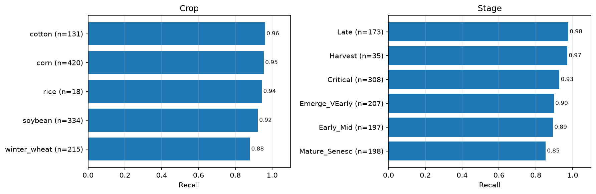
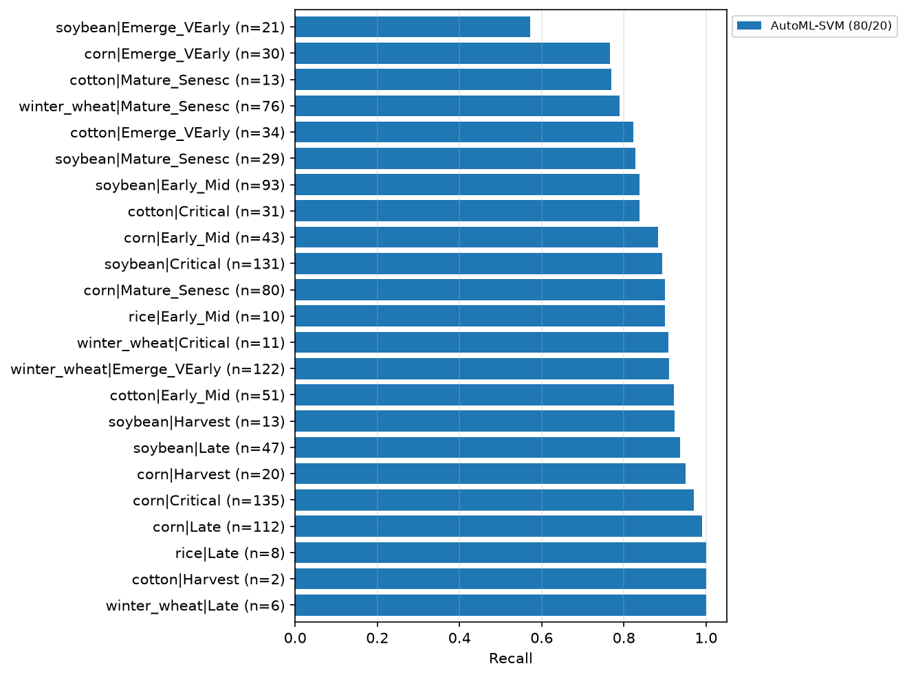
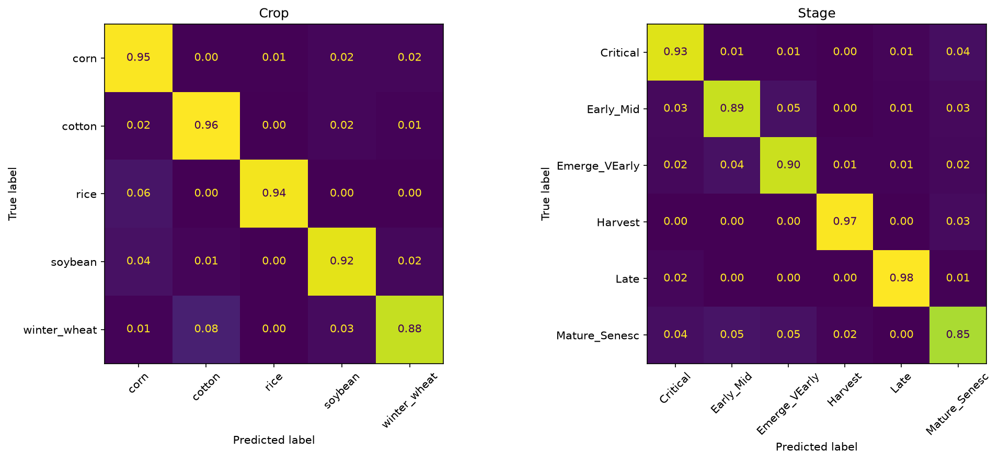
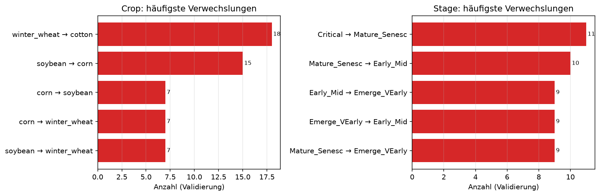
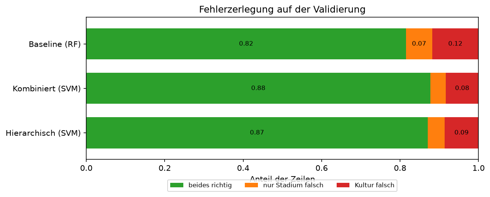
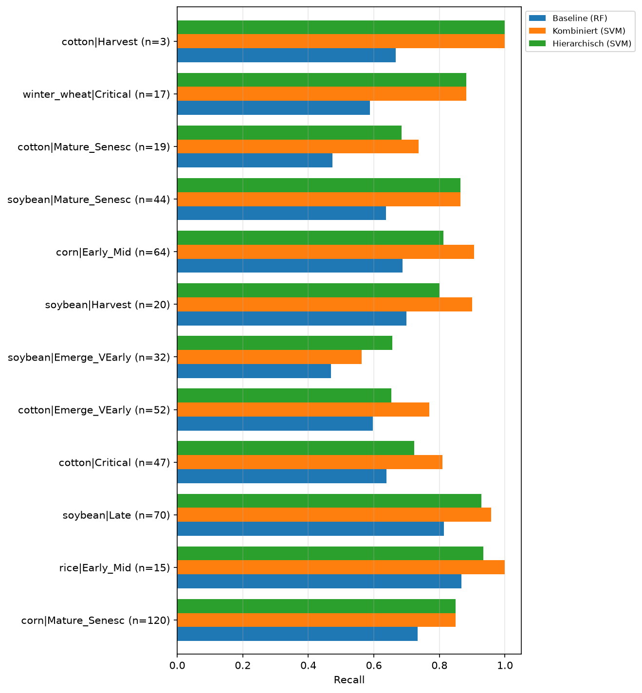
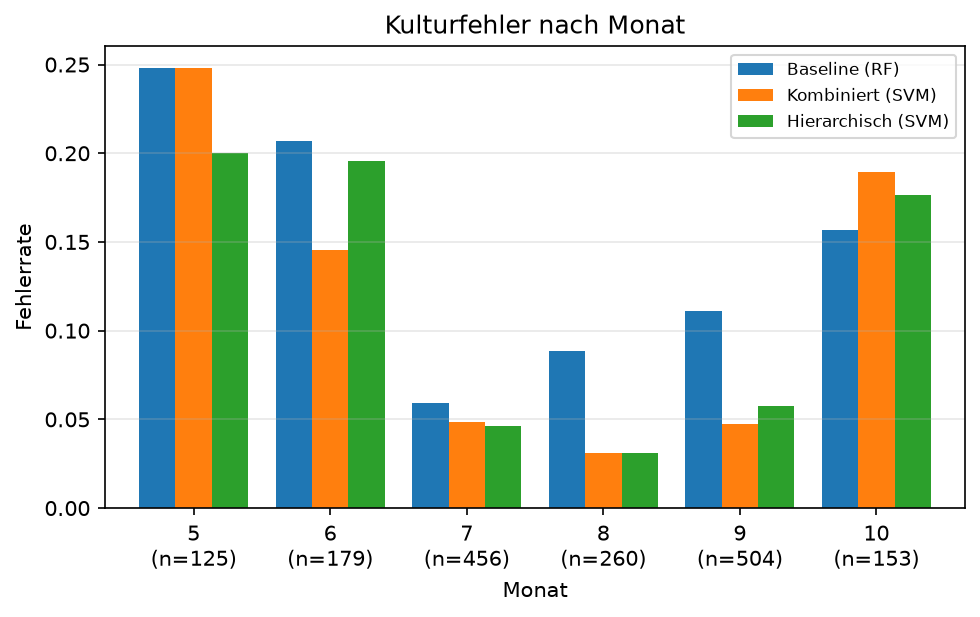
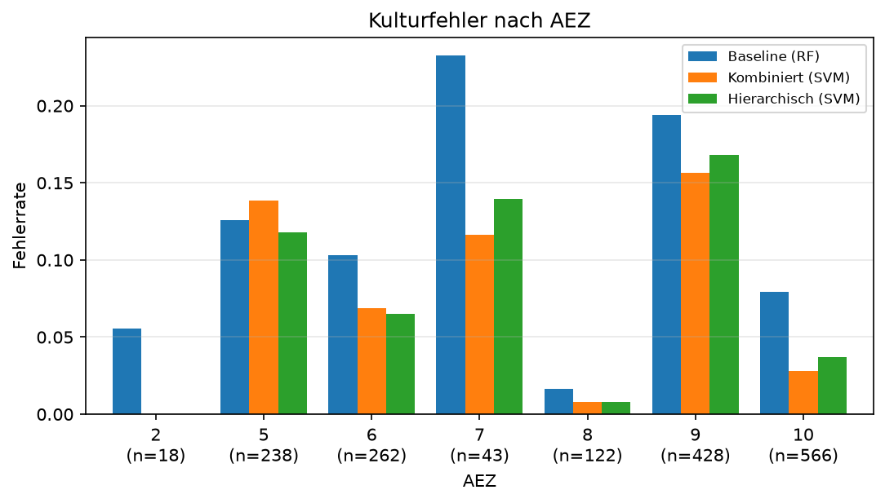
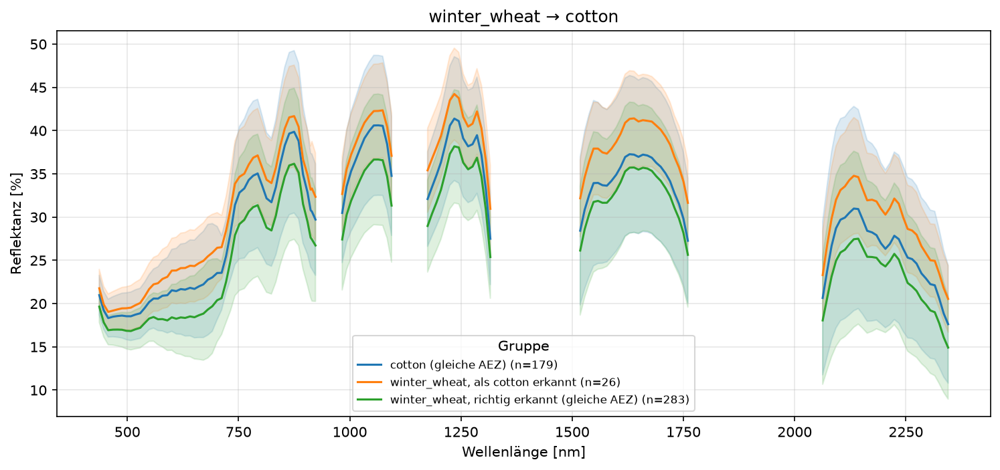
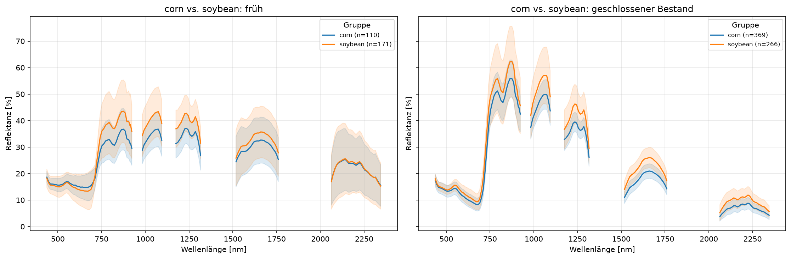

# Fehleranalyse

Die aktuelle Analyse beschreibt die eingefrorene 80/20-Referenz. Der darunterstehende
[historische Vergleich](#historische-analyse-7030) betrifft andere Modelle und einen 70/30-Split;
seine Zahlen sind nicht direkt mit dem finalen AutoML-Lauf vergleichbar.

## Finales AutoML-Modell (80/20)

### Grundlage und Reproduzierbarkeit

Stand: 25.10.2026. Analysiert wird die [kombinierte RBF-SVM](ansaetze/kombiniert.md#rbf-svm-aus-dem-fokussierten-automl-lauf)
aus MLflow-Run `c99e3915704a4131bf6da0a795fb50ee`, gespeichertes Modell
`m-fd1d4454d4d642b6a38d2aa5823abf80`. Das Modell wurde geladen, **nicht erneut trainiert**.
Da der Lauf keine zeilenweisen Vorhersagen speichert, wurden diese durch reine Inferenz auf
dem identischen Holdout rekonstruiert. Es wurde kein neuer MLflow-Lauf angelegt.

- Datei-Hashes von Quellcode, Datenartefakten und `uv.lock` stimmen mit dem Suchmanifest überein.
- MLflow-Datensatz-Digests stimmen überein: Training `896bd14b`, Validierung `377358a0`.
- Alle acht protokollierten Metriken werden exakt reproduziert: BAcc Crop **0.9325**, Stage
  **0.9204**, kombiniert **0.8832**; Macro-F1 **0.9170 / 0.9107 / 0.8576**;
  Samples-F1 **0.9217**; **0 %** ungültige Paare.

Reproduktion ohne Training: `uv run python tools/analyze_automl_final.py`.
Tabellen, Zeilenvorhersagen und Provenienz liegen unter
`reports/automl-focused-80-20/analysis/`; die Abbildungen stehen auf dieser Seite.
Das Skript bricht bei abweichenden Hashes, Datensatz-Digests oder Metriken ab.

### Fehlerzerlegung

| Ergebnis auf dem Holdout | Zeilen | Anteil |
| --- | --- | --- |
| Kultur und Stadium richtig | 998 | 89,27 % |
| Kultur falsch, Stadium beliebig | 77 | 6,89 % |
| Kultur richtig, nur Stadium falsch | 43 | 3,85 % |
| Gesamt | 1.118 | 100 % |

Von den 77 Kulturfehlern haben 55 auch ein falsches Stadium und 22 ein richtiges Stadium.
Damit betreffen **77 von 120 Paarfehlern (64,2 %) die Kultur**. Die reine Stadiumverwechslung
erklärt die übrigen 35,8 %. Die kombinierte Trefferquote von 89,27 % ist **nicht** die
Balanced Accuracy von 88,32 %: Letztere gewichtet alle 23 Paarklassen gleich.
Bei richtiger Kultur beträgt die Stadium-BAcc 0.9610; dieser bedingte Wert gilt nur für die
entsprechende Teilmenge und ist kein unabhängiger Leistungsnachweis.

### Klassenrecall

Winterweizen hat den niedrigsten Kultur-Recall: **0.8791 bei 215 Zeilen**. Bei den Stadien
ist **Mature_Senesc mit 0.8535 bei 198 Zeilen** am schwächsten. Die insgesamt hohe
Kulturleistung für Baumwolle (0.9618) verdeckt hingegen Schwächen einzelner Baumwollstadien.

| Schwächste Paarklassen | Holdout-Zeilen | Richtig | Recall |
| --- | --- | --- | --- |
| soybean\|Emerge_VEarly | 21 | 12 | 0.5714 |
| corn\|Emerge_VEarly | 30 | 23 | 0.7667 |
| cotton\|Mature_Senesc | 13 | 10 | 0.7692 |
| winter_wheat\|Mature_Senesc | 76 | 60 | 0.7895 |
| cotton\|Emerge_VEarly | 34 | 28 | 0.8235 |

Die kleinsten Klassen benötigen besondere Vorsicht: `cotton|Harvest` erreicht 2/2,
`winter_wheat|Late` 6/6 und `rice|Late` 8/8 Treffer. Das belegt keine stabile 100-%-Erkennung.
Ein einziger Fehler bei `cotton|Harvest` würde dessen Recall auf 0.5 und die gesamte kombinierte
BAcc um etwa **2,17 Prozentpunkte** senken. `rice|Early_Mid` erreicht 9/10 Treffer; Reis ist
auch insgesamt mit nur 18 Holdout-Zeilen schwach abgesichert.

### Konkrete Verwechslungen

Zeilen sind die wahren Klassen; jede Zeile summiert sich vor Rundung zu eins. Die Diagonale
entspricht dem Klassenrecall. Die folgenden absoluten Häufigkeiten ergänzen diese Sicht,
gewichten aber große Klassen stärker.

- **Winterweizen → Baumwolle: 18 Zeilen**, die häufigste Kulturverwechslung. Darunter sind
  8-mal `winter_wheat|Mature_Senesc` → `cotton|Early_Mid` und 4-mal dasselbe wahre Paar
  → `cotton|Emerge_VEarly`. Kultur- und Stadiumfehler treten hier gemeinsam auf.
- **Sojabohne → Mais: 15 Zeilen.** Darunter sind 7 der 21 Zeilen von
  `soybean|Emerge_VEarly`, die als `corn|Emerge_VEarly` erkannt werden. Bei diesen Fehlern
  stimmt das Stadium, aber nicht die Kultur.
- Der häufigste reine Paar-Stadiumfehler ist `soybean|Critical` →
  `soybean|Mature_Senesc` mit **8 Zeilen**. Zielübergreifend tritt
  `Critical` → `Mature_Senesc` 11-mal auf.
- Alle 3 Fehler von `cotton|Mature_Senesc` gehen nach `cotton|Critical`:
  Hier liegt die Schwäche ausschließlich im Stadium, nicht in der Kultur.

### Kontext und Grenzen

Die Paarfehlerrate ist im Mai 24,4 % (86 Zeilen), im Juni 22,5 % (120), im August dagegen
2,3 % (172). Für AEZ 5 beträgt sie 19,9 % (151), für AEZ 9 15,4 % (285) und für AEZ 6
4,3 % (184). Das sind **deskriptive Gruppenunterschiede**, keine kausalen Monats- oder
Regionseffekte: Kultur- und Stadiumzusammensetzung können sich unterscheiden. Diese aktuelle
Analyse enthält keine erneute Out-of-fold-Gegenprüfung; dafür wären neue Fits nötig.

Beobachtet sind die konkreten Verwechslungen, nicht ihre Ursache. Spektrale Überlappung,
Wachstumsübergänge oder Kontextabhängigkeit sind mögliche, hier **nicht nachgewiesene**
Erklärungen. Kleine Klassen begrenzen die Präzision der Recalls. Das wiederholt betrachtete
Holdout ist außerdem kein unabhängiger Abschlusstest; die adaptive CV-Suche kann optimistisch
sein. Aus diesen Befunden werden **keine weiteren Parameter- oder Modellentscheidungen**
abgeleitet. Das finale Modell bleibt unverändert.

## Historische Analyse (70/30)

Alle folgenden Abschnitte betreffen den früheren Modellvergleich, nicht `automl_final`.

Welche Klassen verwechselt werden, warum, und weshalb Baseline, kombinierter und hierarchischer
Ansatz unterschiedlich abschneiden (#32). Notebook: `notebooks/10_jd_fehleranalyse.ipynb`,
Bausteine: `error_breakdown()`, `recall_by_class()`, `compare_predictions()`
([Einen Ansatz entwickeln](ansatz-entwickeln.md#5-ergebnis-ansehen)).

!!! note "Validierung nur zur Analyse"
    Die Analyse nutzt die Vorhersagen auf der gemeinsamen Validierung, entscheidet aber nichts.
    Ideen daraus (siehe [Folgerungen](#folgerungen)) werden wie jede Hypothese per CV mit
    `tune()` geprüft. Die Muster nach Monat und AEZ sind zusätzlich auf Out-of-fold-Vorhersagen
    des Trainingsteils gegengeprüft.

## Verglichene Modelle

Je Ansatz das beste bewertete Modell, mit den protokollierten Einstellungen neu trainiert und auf
der gemeinsamen Validierung vorhergesagt – ohne neue Läufe und ohne weiteres Einstellen.

| Ansatz | Lauf | Vorverarbeitung | BAcc Crop | BAcc Stage | BAcc kombiniert |
| --- | --- | --- | --- | --- | --- |
| [Baseline](ansaetze/baseline.md) | `rf_baseline`, Random Forest | unskaliert, Monat numerisch | 0.888 | 0.866 | 0.750 |
| [Kombiniert](ansaetze/kombiniert.md) | `combined_svm_expanded`, RBF-SVM | `scale=True`, Monat numerisch | 0.931 | 0.906 | **0.866** |
| [Hierarchisch](ansaetze/hierarchisch.md) | `hierarchical_svm`, RBF-SVM → RBF-SVM | Spektren standardisiert, Monat zyklisch | 0.920 | 0.902 | 0.844 |

`combined_svm_expanded` und `hierarchical_svm` reproduzieren ihre protokollierten Werte (bis auf
Rundung). `rf_baseline` nicht: Das gespeicherte M1-Modell ist mit der heutigen Pipeline nicht mehr
ladbar (Interpolation geändert in `585fbf2`); nachtrainiert ergibt sich 0.750 statt 0.743 und
0,1 % ungültige Paare.

## Wo entstehen die Fehler?

| | Baseline | Kombiniert | Hierarchisch |
| --- | --- | --- | --- |
| beides richtig | 0.815 | 0.877 | 0.871 |
| Kultur falsch | 0.118 | 0.084 | 0.086 |
| nur Stadium falsch | 0.067 | 0.039 | 0.043 |
| Stadium-BAcc bei richtiger Kultur | 0.922 | 0.957 | 0.950 |

- **Rund zwei Drittel der Fehler sind Kulturfehler** – in allen drei Ansätzen. Die Kultur ist
  der Engpass, nicht das Stadium.
- **Baseline → SVM:** Die SVMs senken die reinen Stadiumfehler um rund 40 % (6,7 % → 3,9–4,3 %)
  und die Kulturfehler um gut ein Viertel (11,8 % → 8,4–8,6 %).
- **Hierarchisch:** Mit der wahren Kultur wäre BAcc kombiniert 0.939 statt 0.844
  (Oracle-Kultur, Stadium-BAcc 0.947) – die Kulturfehler pflanzen sich ungebremst ins Stadium
  fort. Die Stadium-BAcc bei richtiger Kultur ist beim kombinierten Ansatz allerdings sogar etwas
  höher (0.957 vs. 0.950); die Stadium-Modelle je Kultur sind also nicht besser als die
  kombinierte SVM.

## Unterscheiden sich die Ansätze wirklich?

McNemar-Test auf kombinierte Treffer (nicht BAcc – seltene Klassen fallen kaum ins Gewicht):

| Vergleich | nur erster richtig | nur zweiter richtig | p |
| --- | --- | --- | --- |
| Baseline vs. Kombiniert | 51 | 155 | 2·10⁻¹³ |
| Baseline vs. Hierarchisch | 47 | 140 | 6·10⁻¹² |
| Kombiniert vs. Hierarchisch | 44 | 33 | 0.25 |

- Beide SVM-Ansätze schlagen die Baseline klar.
- **Kombiniert vs. hierarchisch: kein signifikanter Unterschied** bei den Treffern (p = 0.25).
  Sie machen weitgehend dieselben Fehler: 106 Zeilen haben in beiden die falsche Kultur (140 bzw.
  145 insgesamt), 89 sogar in allen drei Ansätzen. Diese „harten“ Zeilen begrenzen jeden Ansatz.

## Woher kommt der BAcc-Abstand zwischen kombiniert und hierarchisch?

Die Balanced Accuracy gewichtet jede der 23 Klassen gleich. Bei ähnlich vielen Treffern entsteht
der Abstand von 0.022 über die Verteilung auf die Klassen.

| Klasse | Zeilen | Kombiniert | Hierarchisch | Differenz |
| --- | --- | --- | --- | --- |
| cotton\|Emerge_VEarly | 52 | 0.769 | 0.654 | −0.115 |
| winter_wheat\|Late | 9 | 0.889 | 0.778 | −0.111 |
| soybean\|Harvest | 20 | 0.900 | 0.800 | −0.100 |
| corn\|Early_Mid | 64 | 0.906 | 0.812 | −0.094 |
| cotton\|Critical | 47 | 0.809 | 0.723 | −0.085 |
| winter_wheat\|Emerge_VEarly | 182 | 0.863 | 0.907 | +0.044 |
| soybean\|Emerge_VEarly | 32 | 0.562 | 0.656 | +0.094 |

- Der hierarchische Ansatz verliert vor allem bei **kleinen Klassen** (9–64 Zeilen) und gewinnt
  bei der großen Klasse Winterweizen/Emerge (182). Das gleicht sich bei den Treffern aus, in der
  BAcc aber nicht. Mehrere Klassen beruhen auf weniger als 20 Zeilen – einzelne Differenzen sind
  unsicher.
- **Vermutung (nicht getestet):** Die eigene Kultur-SVM zieht die Grenzen zwischen den Kulturen
  anders als die kombinierte SVM, die je Kultur und Stadium eigene Bereiche lernt; Grenzfälle
  kleiner Klassen fallen so eher auf die falsche Seite. Der Vergleich ist allerdings durch die
  Vorverarbeitung verzerrt (siehe Tabelle oben). Mit gleicher Vorverarbeitung liegen beide in der
  CV nah beieinander (`combined_svm_cv_reference` 0.845 vs. `hierarchical_svm` 0.839).

## Wann und wo liegt die Kultur falsch?

- **Saisonränder:** Im Mai/Juni und Oktober liegt die Kultur bei den SVMs in 15–25 % der Zeilen
  falsch, von Juli bis September nur in 3–6 %. Auf dem Trainingsteil (out-of-fold, hierarchisch)
  zeigt sich dasselbe Muster für Mai (25 %) und Oktober (13 %), für Juni schwächer (10 %).
- **Vermutung:** Am Saisonanfang ist wenig Bestand da, am Ende ist er abgereift oder geerntet –
  die Spektren verschiedener Kulturen werden sich dann ähnlicher.
- Die Klassifikatoren unterscheiden sich an den Rändern trotzdem: im Juni kombiniert 14,5 % vs.
  hierarchisch 19,6 %, im Mai umgekehrt 24,8 % vs. 20,0 %. Die Baseline fällt zusätzlich im
  August/September ab (9–11 %); dort holen die SVMs am meisten.

- **Regionen:** Die Kulturfehler häufen sich in AEZ 9 (17 %, 428 Zeilen), 7 (14 %, nur 43 Zeilen)
  und 5 (12 %); in AEZ 8 und 10 sind es unter 4 %. Auf dem Trainingsteil ist das Muster gleich
  (AEZ 9: 16 %, AEZ 8/10: unter 4 %). Vermutlich bestimmt die Agrarökozone, welche Kulturen zur
  gleichen Zeit in ähnlichem Zustand sind.

## Was bedeutet das für die Vorverarbeitung?

Die Fehleranalyse liefert Hypothesen; die folgenden Ablationen aus den Notebooks
`09_jd_hierarchical_tuning.ipynb`, `08_duac1011_combined-svm-snv.ipynb`,
`07_duac1011_combined-svm-pca.ipynb` und `07_duac1011_combined-svm-month-encoding.ipynb`
prüfen sie ausschließlich per CV auf dem Trainingsteil.

- **Absolute Helligkeit erhalten:** Die hellen, als Baumwolle erkannten Weizenspektren sprechen
  dagegen, das Niveau jedes Spektrums vollständig zu entfernen. Das bestätigt die SNV-Ablation:
  Sie verliert bei der kombinierten SVM 0.024 CV-BAcc (0.823 statt 0.847) und bei der
  hierarchischen SVM 0.018. SNV wird daher nicht übernommen; eine Albedo-Ergänzung ist nur
  sinnvoll, wenn sie eine neue, klar abgegrenzte CV-Hypothese beantwortet.
- **Formglättung und Reduktion sind kein erkennbarer Hebel:** Savitzky-Golay verbessert die
  hierarchische SVM nur von 0.840 auf 0.842 CV-BAcc und bleibt unter der Rauschschwelle von
  0.005. PCA-20 gewinnt zwar das Reduktionsscreening der kombinierten SVM (CV 0.853), liegt auf
  der einmaligen Validierung mit 0.863 dennoch 0.003 unter der Rohspektren-Referenz. Die Fehler
  an Saisonrändern entstehen damit nicht erkennbar aus hochfrequentem Spektralrauschen oder
  bloßer Bandredundanz.
- **Monat kodiert den Kontext, ersetzt aber keine spektrale Trennung:** Die numerische und die
  zyklische Kodierung liegen bei der kombinierten SVM in der CV nur 0.002 auseinander (0.852 vs.
  0.849); in der hierarchischen Ablation bleibt der Unterschied ebenfalls im Rauschen. Die
  gehäuften Fehler im Mai/Juni und Oktober sind deshalb kein Anlass, die Monatsdarstellung ohne
  weitere Hypothese zu ändern. AEZ und Month bleiben nützlicher Kontext, ihre regionale und
  saisonale Shortcut-Wirkung muss in der Interpretation aber sichtbar bleiben.
- **Modellvergleich nicht als Pipeline-Wettbewerb lesen:** Die kombinierte und die hierarchische
  SVM nutzen unterschiedliche Skalierungs- und Month-Varianten. Der faire CV-Vergleich mit
  identischer Vorverarbeitung liegt jedoch bei 0.845 zu 0.839. Die in dieser Seite beschriebenen
  Fehlerunterschiede erklären sich daher überwiegend durch die Modellierung der Labels, nicht
  durch eine belegte Preprocessing-Verbesserung.

## Die häufigsten Verwechslungen

Häufigste Kulturverwechslungen des hierarchischen Modells: Winterweizen → Baumwolle (26),
Mais → Soja (22), Soja → Mais (22), Mais → Winterweizen (16), Soja → Winterweizen (15).

### Winterweizen → Baumwolle

| Gruppe | Zeilen | NDVI (Median) | mittlere Reflektanz [%] |
| --- | --- | --- | --- |
| Weizen, als Baumwolle erkannt | 26 | 0.24 | 32.7 |
| Weizen, richtig erkannt (gleiche AEZ) | 283 | 0.22 | 27.2 |
| Baumwolle (gleiche AEZ) | 179 | 0.19 | 29.9 |

- 22 der 26 Fälle stammen aus **AEZ 5**, alle aus den Stadien **Mature_Senesc (15)** und
  **Emerge_VEarly (11)**, vor allem im Oktober (11) und Juni/Juli.
- Alle drei Gruppen haben einen niedrigen NDVI (0.19–0.24, wenig grüne Vegetation). Der NDVI
  erklärt den Fehler aber nicht: Die falsch erkannten Zeilen haben sogar einen etwas *höheren*
  NDVI als die richtig erkannten.
- Auffällig ist die **Helligkeit**: Die falsch erkannten Weizenspektren sind heller als beide
  Vergleichsgruppen und liegen damit näher an der Baumwolle als am übrigen Weizen.
- Das Spektrum trennt die Kulturen in diesen Stadien grundsätzlich: 261 der 283 richtig
  erkannten Weizenzeilen derselben AEZ sind in denselben Stadien. **Vermutung:** Die 26 Fälle
  sind besonders helle Felder (z. B. mehr offener oder trockenerer Boden), die in den Bereich der
  Baumwolle fallen.

### Mais ↔ Soja

| Gruppe | Zeilen | Kultur falsch (beliebig) | als andere Kultur des Paars |
| --- | --- | --- | --- |
| Mais, früh (Emerge_VEarly, Early_Mid) | 110 | 0.182 | 0.155 (Soja) |
| Mais, geschlossener Bestand (Critical, Late) | 369 | 0.019 | 0.003 (Soja) |
| Soja, früh | 171 | 0.181 | 0.064 (Mais) |
| Soja, geschlossener Bestand | 266 | 0.030 | 0.023 (Mais) |

- **Früh** ist die Kultur deutlich öfter falsch (18 %) als im geschlossenen Bestand (2–3 %).
- Die Verwechslung ist **nicht symmetrisch**: Früher Mais geht meist an Soja (15,5 %), früher
  Soja nur zu 6,4 % an Mais – die übrigen Fehler gehen an andere Kulturen.
- Spektral überlappen frühe Mais- und Sojaspektren in allen Bereichen stark (breite Streuung);
  im kurzwelligen Infrarot ab 2050 nm sind die Mittel praktisch gleich. Im geschlossenen Bestand
  ist der Abstand im nahen Infrarot ähnlich groß, die Streuung – vor allem beim Mais – aber viel
  kleiner, sodass sich die Kulturen besser trennen. **Vermutung:** Früh bestimmt der Boden
  zwischen den Reihen einen großen Teil des Signals.

## Alle hierarchischen Klassifikatoren

Ergänzt in #104 (`notebooks/17_jd_hierarchical_vergleich.ipynb`): neun hierarchische
Klassifikatoren, siehe [Vergleich aller Klassifikatoren](ansaetze/hierarchisch.md#vergleich-aller-klassifikatoren).

- In allen neun liegt der größere Teil der Fehler bei der Kultur (8,6–23 % falsche Kultur,
  4–8 % nur Stadium falsch) – der Befund oben gilt modellunabhängig.
- Mindestens ein Klassifikator trifft auf dem Trainingsteil (out-of-fold) 96,2 % der Zeilen
  (SVM 87,7 %), auf der Validierung 95,9 % (SVM 87,1 %). 228 der 319 Kulturfehler der SVM auf dem
  Trainingsteil trifft ein anderes Modell – am häufigsten kNN, logistische Regression und Extra
  Trees. Die Obergrenze ist nicht erreichbar, zeigt aber, dass die Modelle unterschiedliche
  Fehler machen.
- Mit mehr Modellen sinkt die Zahl der Zeilen, die *alle* falsch haben, zwangsläufig; sie ist
  daher kein Maß für die Modelle selbst.

## Multi-Task-MLP

Die ergänzende Analyse des PCA-20-Multi-Task-MLP steht in
[Multi-Task](ansaetze/multi-task.md#fehleranalyse-pca-20-gegen-kombinierte-svm) und im Notebook
`notebooks/11_duac1011_multi-task-fehleranalyse.ipynb`.

- Gegen die kombinierte SVM liegt das MLP bei BAcc kombiniert um 0,102 zurück (0,764 vs. 0,866),
  obwohl beide ausschließlich gültige Paare ausgeben.
- Der Rückstand entsteht zugleich bei Kultur- und bei reinen Stadiumfehlern. Besonders Übergangs-
  und Seneszenzpaare verlieren Recall; die OOF-Gegenprobe bestätigt höhere Paarfehlerraten an
  Saisonrändern.
- Die stärkste Verwechslung, `cotton|Emerge_VEarly` → `cotton|Early_Mid`, weist auf
  überlappende Übergangsspektren. Ob geteilte MLP-Schichten besser als zwei getrennte MLPs sind,
  bleibt eine CV-Hypothese.

## Folgerungen

Alle Punkte sind Hypothesen für weitere Experimente; ob sie helfen, entscheidet die CV.

- **Kulturfehler an den Saisonrändern sind der Hauptengpass** aller Ansätze – auf Validierung
  und Trainingsteil. Mögliche Ansätze: Kontext gezielter nutzen (Monat × AEZ), Merkmale für
  Helligkeit bzw. Bodenanteil, stärkere Gewichtung früher und später Stadien.
- **Kombiniert vs. hierarchisch** unterscheiden sich bei den Treffern nicht signifikant; der
  BAcc-Vorsprung des kombinierten Ansatzes kommt von wenigen kleinen Klassen und ist zusätzlich
  durch unterschiedliche Vorverarbeitung verzerrt. Für die Abgabe bleibt `combined_svm_expanded`
  vorn, die Begründung sollte diese Unsicherheit nennen.
- **Hierarchisch** profitiert direkt von einer besseren Kulturstufe (Oracle-Kultur 0.939), ein
  vergleichbarer Oracle-Wert für den kombinierten Ansatz fehlt aber – welcher Ansatz mehr
  gewinnen würde, ist offen.
- **Ensemble:** Die hierarchischen Klassifikatoren ergänzen sich stark, eine gewichtete
  Abstimmung aus SVM, kNN, logistischer Regression und Extra Trees schlägt die SVM aber nicht
  über das Rauschen (#113, CV 0.844 vs. 0.839). Auf dem Trainingsteil hat in 282 von 482
  SVM-Fehlern ein anderes Modell recht, in 150 davon aber nur genau eines – es unterliegt in der
  Abstimmung.
